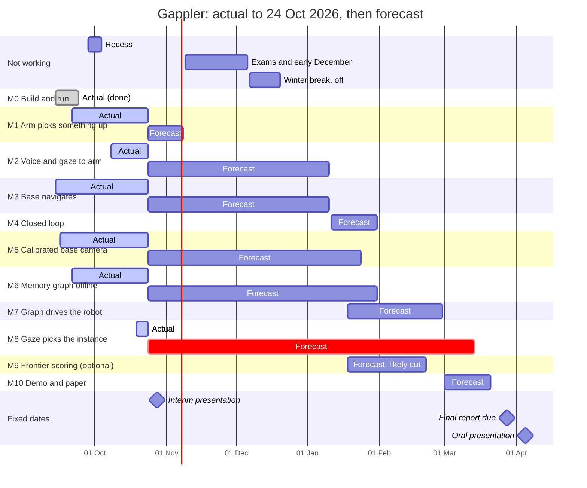
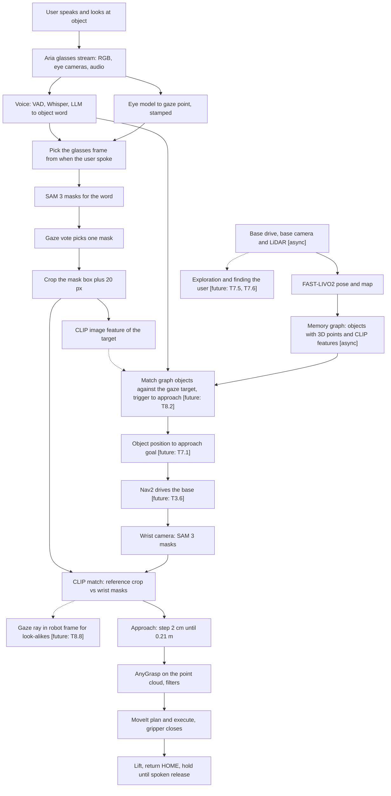
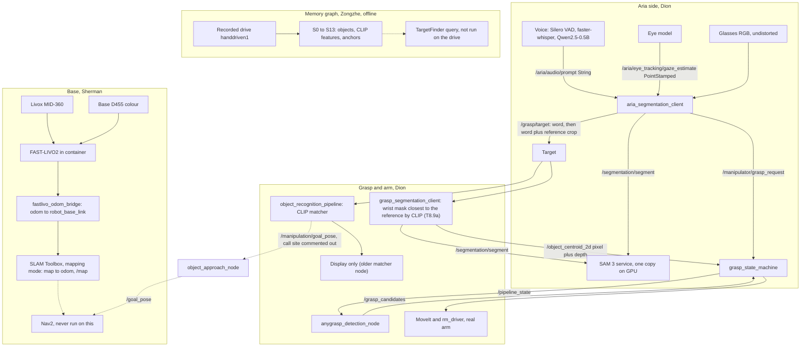

# Gappler combined progress report, to 2026-10-23

One technical account of the whole system, built from the three October progress reports (Dion,
Sherman, Zongzhe) and checked against the code and the global docs on 2026-10-24. It is the working
source for planning the interim presentation slides (2026-10-28). It is not the slides.

**Read it as an interim report.** The five-phase pipeline in section 2.2 is the final demonstration
the team is working towards (M10, March 2027). On 2026-10-23 the project is seven weeks in, so most
gaps between that pipeline and the current code are expected. Section 7 says where each part stands,
and the remaining links are scheduled milestones, not defects.

**Sources and how this document cites them.**

| Code | Source | Owner's part |
|---|---|---|
| **D§n** | `docs/dion_docs/DION_PROGRESS_REPORT_2026-10.md`, section n | Glasses (voice, gaze, SAM 3), cross camera, arm and grasp, project infrastructure |
| **S§n** | `docs/sherman_docs/SHERMAN_PROGRESS_REPORT_2026-10.md`, section n | Mobile base, LiDAR, camera mount, FAST-LIVO2 mapping, hand-off to Nav2, calibration rig |
| **Z§n** | `docs/zongzhe_docs/ZONGZHE_PROGRESS_REPORT_2026-10.md`, section n | Memory graph, sentence-to-class reasoning, nav bridge node fixes |
| **CC** | `docs/CHANNEL_CONTRACT.md` (H = live handover, P = planned, M = measurement, X = hidden channel) | Shared |
| **PP** | `docs/PROJECT_PLAN.md` (milestones M0 to M10) | Shared |
| **[code 10-24]** | Read from source on 2026-10-24 for this document, file and line given | |

Task IDs (T1.17, T6.4) are rows in `docs/task-tree.html`. Run records are in `docs/bench-runs/`.

**Status labels used throughout.**

| Label | Meaning |
|---|---|
| **Tested** | Implemented and tested, with a run record or measurement |
| **Built, not validated** | Implemented, but not yet validated adequately |
| **Isolated** | Implemented and tested on its own, not connected end to end |
| **In progress** | Partly implemented or being debugged |
| **Planned** | Proposed or planned, no code |
| **Unclear** | The evidence does not settle it |

**Evidence tags** keep each report's meaning. `[measured]` from a run, log or bag. `[code]` read from
source. `[inferred]` reasoning not yet tested. `[unverified]` to confirm. `[reported]` in Sherman's
report means "said by a person, no log behind it" (S, intro). This differs from the repo
`CLAUDE.md`, where `[reported]` means the 2026-08-25 hardware session. This document keeps
Sherman's meaning where it quotes him.

---

## 0. Interim assessment: project plan and strategy

This section covers the parts of the interim assessment that are about the plan, not the results.
It lets this document stand alone as the source for the slides.

### 0.1 What the assessment asks and where this document answers it

The interim assessment grades the team on a project plan and strategy, its implementation, and a
30-minute presentation: **20 minutes of presentation and 10 minutes of questions**, graded as a
team by the supervisor(s) and examiner(s).

| The assessment asks for | Where it is here |
|---|---|
| Main objectives | 0.2 |
| Background | 0.3, 2 |
| Proposed means of carrying out the tasks | 0.4, 0.5, 3 |
| Proposed weekly schedule in a chart | 0.6 |
| Budget proposal | Separate document, added as context before the slide content is written |
| Implementation and progress | 1, 5, 7 |
| Results obtained | 8 |
| Problems and next steps | 9, 10 |
| Presentation structure | 12 |

### 0.2 Objectives

**Main objective.** Build a mobile manipulator that takes a spoken command and the user's gaze,
explores a room it cannot see at the start to find the user and then the object they looked at,
drives to it, confirms it with the wrist camera and grasps it.

**How the parts fit** (Dion, 2026-10-24, PP §1).

- **Exploration is core.** The robot explores with its base camera and builds the memory graph as it
  goes. That is how it searches. M9, the paper's smarter exploration order, is optional and first to
  be cut. Without it the robot explores nearest-first (T7.5).
- **Finding the user speeds up exploration.** The object the user looked at is somewhere the user
  can see, so the robot looks for the user first (T7.6).
- **The gaze target is the trigger to approach.** The CLIP feature of the glasses crop is compared
  with each object the robot sees. A match above a cutoff stops exploration and sends the robot to
  that object. The wrist camera confirms or rejects it, and on a reject the robot goes back to
  exploring (T8.2). Without this check the robot has no reason to stop exploring. It also makes
  search faster, since the robot looks for one object, not every object of the class.
- **Gaze is the base case.** A without-gaze version (voice only, the sentence query) is a stretch
  extension (T8.11). The evaluation is end-to-end trials of the base case, success per phase (T8.3).

**Milestones.** Eleven, from the task tree's milestone list (`docs/task-tree.html`, `MS`) and
PP §5.1. Row counts are from the task tree on `dev` at `1cde0ec` on 2026-10-24. The rows T1.44 to
T1.46 exist only on PR #99's branch and are not counted.

| # | Milestone | Done means | Actual and forecast (24 Oct) | Lead | Task rows done | State on 2026-10-23 |
|---|---|---|---|---|---|---|
| M0 | Everyone can build and run | Two people other than Dion clone, build and pass the bench. Arm and LiDAR on the network together | Done 14 to 24 Sep 2026 | Zongzhe | 20 of 23 | Acceptance met (T0.5, 2026-09-24). Three support rows open |
| M1 | The arm picks something up | Five grasp attempts on a box, success rate recorded, stop verified first | Started 21 Sep. Forecast end 8 Nov 2026 | Dion | 24 of 43 | Met on the simple path (5 of 8, T1.12). AnyGrasp path validation open (T1.35) |
| M2 | Voice and gaze reach the arm | Two boxes, the arm picks the one you looked at, three times in four | Started 8 Oct. Forecast end 10 Jan 2027 | Dion | 11 of 25 | Started early. Glasses gaze pick and cross-camera match work on replay. Hardware test T2.5 open |
| M3 | The base navigates | Map, localisation, ten drives to a point with error recorded | Started 14 Sep. Forecast end 10 Jan 2027 | Sherman | 10 of 15 | Map and localisation done (T3.5). Drive to a point (T3.6) after 2026-10-28 |
| M4 | The current system, closed loop | One recorded run: speak, look, drive, grasp, per-stage timing | Forecast 11 to 31 Jan 2027 | Dion | 0 of 3 | Not started, as scheduled |
| M5 | A calibrated camera on the base | LiDAR points land on the right objects in the camera image, pose error as a number | Started 16 Sep. Forecast end 24 Jan 2027 | Sherman mount, Dion calibration | 4 of 9 | Mount fitted and geometry done. Calibration (T5.5) not built |
| M6 | The memory graph, offline | Objects from a recorded drive, no duplicates, a sentence query returns the right one | Started 21 Sep. Forecast end 31 Jan 2027 | Zongzhe | 25 of 32 | Ahead of the September plan, which started it on 28 Dec. Graph built and tuned. Query acceptance run (T6.8) left |
| M7 | The graph drives the robot | Spoken instruction, object out of view: the robot explores, finds the user, builds the graph live and drives to the object. Close-range perception takes over | Forecast 18 Jan to 28 Feb 2027 | Dion | 0 of 4 | Not started, as scheduled |
| M8 | Gaze picks the instance | The gaze target matched against what the robot sees triggers the approach. N end-to-end trials, success per phase | Started 19 Oct. Forecast end 14 Mar 2027 | Dion | 3 of 9 | Groundwork done early: CLIP matcher (T8.7), matcher uses the gaze pick (T8.5), baseline (T8.4) |
| M9 | Frontier scoring, visit ordering | The paper's exploration order beats our nearest-first exploration | Optional. Forecast 18 Jan to 21 Feb 2027 if kept | Zongzhe | 0 of 4 | Optional, first on the cut list. Exploration itself is core (M7) |
| M10 | Demonstration and paper | Recorded end-to-end run, paper draft whose central table is the end-to-end trials | Forecast 1 to 21 Mar 2027 | All | 0 of 4 | Not started, as scheduled. T10.4 is this report |
| | **Total** | | | | **97 of 171** | |

### 0.3 Background

**The problem.** People can point a robot at an object by looking at it and naming it. Existing
systems assume either that the object is already in front of the arm, or that a class name is
enough to find it. Neither holds when the user wants one particular object somewhere in a room the
robot has not looked at closely.

**Two systems this project joins** (references in 13.6).

| | FAM-HRI (Lai et al., 2025) | HiCo-Nav (Xu et al., ICRA 2026) |
|---|---|---|
| What it does | Gaze and speech from Meta Aria glasses tell a robot arm which object to pick | A robot explores an unseen room, builds a cognitive memory graph (3D points plus a CLIP feature per object), and answers language queries zero-shot |
| What it assumes | The object is already in front of the arm | A class is enough. "Find the box" finds a box, not the one you mean |
| How it enters Gappler | The inherited code in this repo was a recreation of FAM-HRI. Dion's glasses and grasp work rebuilds it | Zongzhe re-implements the memory graph. Sherman provides the mapping and localisation it needs |

**Why gaze matters beyond look-alike objects** (D§5.5). Two truly identical objects are the hardest
test case, not the pitch. The capability is knowing where the user is looking in the robot's own 3D
space. It helps with similar objects, partly hidden objects, uncertain image features, and a robot
that does not see what the user sees (the base camera is at knee height). Assistive use is the
clearest case: a user who can look but cannot easily point or speak, in a scene full of mugs, pill
bottles and cans.

**The starting point in September 2026** (D§1.3, S§2.1, Z§2.1). About a year of code from an earlier
team, with no tests, no CI and no docs matching the code. Nothing ran from a fresh clone. The AnyGrasp
path was unreachable through three interlocking defects (T1.8). One program homed the real arm within
seconds of starting with no prompt, and the stop program ignored Ctrl+C (T1.2). The navigation code
had never been built, the base had no camera, no map and no localisation. No memory graph code
existed.

### 0.4 Means: how the work is carried out

**Strategy.** Build from existing open-source systems and add the missing links, rather than tune
one old workflow. Make every step measurable before building on it.

| Practice | What it means in this project | Evidence |
|---|---|---|
| One subsystem per person, one contract between them | Dion: glasses, cross camera, arm and grasp. Sherman: base, sensors, mapping, localisation. Zongzhe: memory graph and goals. The channel contract names the owner of every topic and frame | CC §1, T0.7 |
| Test bench and CI before features | Seven levels (L0 static to L6 real robot). CI runs L0 to L2 on every PR and L0 to L4 on a GPU runner on the lab box. Simulation tests refuse to start on a non-private ROS domain | D§2.2, D§2.3 |
| Baseline first, then replace | LightGlue measured (0 of 15) before CLIP replaced it. SLAM Toolbox plumbing built before the switch to FAST-LIVO2. Upstream HiCo-Nav defaults measured before re-tuning | T8.4, T8.7, S§6.4, Z§3.5 |
| Hardware one step at a time | Each robot step has a written pass rule and a saved log. Two people present, one at the power button | D§3, `GRASP_BRINGUP_STEPS.md` |
| Withdraw wrong claims in writing | Wrong statements stay in the record with the correction | S§15 item 3 |
| Every claim tagged by its source | `[measured]`, `[code]`, `[inferred]`, `[unverified]` | All three reports |

**Open-source parts and what the team added** (combined from D§1.2, S§1.2, Z§1.2).

| Part | Gives us | Team's addition | Who |
|---|---|---|---|
| Meta Project Aria SDK, eye-tracking model | Glasses camera, gaze, audio | Capture timestamps end to end, gaze vote, gaze-to-mask pick, network fix | Dion |
| SAM 3 (Meta) | Text-prompted masks | One shared ROS 2 service (Dion). Batched multi-phrase path, 5.7 times faster (Zongzhe) | Dion, Zongzhe |
| faster-whisper, Silero VAD, Qwen2.5 0.5B and 1.5B | Speech to text, sentence detection, object word, sentence to classes | Sentence-level gating, release intent (Dion). Class expansion with timeout and CLIP fall-back (Zongzhe) | Dion, Zongzhe |
| open_clip ViT-B-32 `laion2b_s34b_b79k` | Image and text embeddings | Cross-camera matcher (Dion). Object features and task scoring in the graph (Zongzhe) | Dion, Zongzhe |
| AnyGrasp (graspnet) | 6-DoF grasps from a point cloud | Axis conversion, fingertip offset, fit check, approach cone, score floor, twin choice | Dion |
| MoveIt 2, RealMan RM65 driver | Planning, arm control | State machine fixes, e-stop, request gate, multi-grasp loop | Dion |
| FAST-LIVO2 (HKU MARS), ROS 2 port `U-AMC/FAST-LIVO2-ROS2` | LiDAR-inertial-visual pose and coloured map | Container and replay harness, three defect repairs, odom bridge to Nav2 | Sherman |
| SLAM Toolbox, Nav2, Livox driver, RealSense driver, Hexman base driver | 2D map, driving, sensors | Map saver with checksums, start-pose gate, CustomMsg converter, D455 mount and TF | Sherman |
| HiCo-Nav reference code (`ffc1517`, no licence, read not copied) | The memory graph method | Fresh implementation as 14 tested stages, nine upstream problems fixed or avoided, re-tuned for our sensors | Zongzhe |

**Hardware.** RealMan RM65 arm with a 71 mm gripper and a wrist RealSense D435i. Hexman ECHO-PLUS
base (460 x 380 x 140 mm) with a Livox MID-360 LiDAR and a front RealSense D455 on a custom mount.
Meta Aria glasses. One lab workstation with a 16 GB RTX 4060 Ti, shared by three people and CI. A
Jetson Orin as backup.

### 0.5 Team and effort

| Person | Owns | Planned hours a week | Output to 2026-10-23 |
|---|---|---|---|
| Dion | Glasses, cross camera, arm and grasp, test bench, CI, docs, refactor. Leads M1, M2, M4, M7, M8 | 12 | 204 commits, 61 merged PRs |
| Sherman | Base, LiDAR, camera mount, mapping and localisation, Nav2 hand-off, calibration rig, arm runbook and safety fixes. Leads M3, M5 mount | 8 to 10 | 217 commits, 19 merged PRs |
| Zongzhe | Memory graph, reasoning layer, query, nav bridge fixes, fresh-clone groundwork. Leads M0, M6, M9 | 8 to 10 | 89 commits on `dev`, 35 merged PRs |

Commit counts use different bases (section 8.6) and are not a comparison of effort. The plan's
critical path runs almost entirely through Dion (PP §6.13).

### 0.6 Weekly schedule

Week 1 starts Monday 2026-09-14. Non-working time: recess (week 3), exam period and early December
(weeks 9 to 12), first half of the winter break (weeks 13 and 14). Weeks 15 and 16 are half-speed
buffer. The interim presentation is in week 7 (2026-10-28). The final report is due in week 28
(2027-03-28) and the oral presentation is in weeks 30 and 31.

**Actual progress and forecast.** This replaces the September plan (in git at
`1cde0ec:docs/PROJECT_PLAN.md` §5.3). Actual spans run from the first task row marked done to
2026-10-24. Forecasts were re-estimated on 2026-10-24 from where each milestone stands. They are
estimates, not commitments.

```
wk    1  2  3  4  5  6  7  8  9 10 11 12 13 14 15 16 17 18 19 20 21 22 23 24 25 26 27 28 29 30 31
M0    *  *
M1       =  =  =  =  =  -  -
M2             =  =  =  -  -  -  -  -  -  -  -  -  -  -
M3    =  =  =  =  =  =  -  -  -  -  -  -  -  -  -  -  -
M4                                                       -  -  -
M5    =  =  =  =  =  =  -  -  -  -  -  -  -  -  -  -  -  -  -
M6       =  =  =  =  =  -  -  -  -  -  -  -  -  -  -  -  -  -  -
M7                                                          -  -  -  -  -  -
M8                   =  -  -  -  -  -  -  -  -  -  -  -  -  -  -  -  -  -  -  -  -
M9                                                          ?  ?  ?  ?  ?
M10                                                                           -  -  -
key         R           P     E  E  E  E  O  O  B  B                                   F     A  A
```

`*` done, `=` actual work to 24 Oct, `-` forecast, `?` optional and likely cut. Key row: `R`
recess, `P` interim presentation, `E` exams, `O` winter break off, `B` half-speed buffer, `F` final
report due, `A` oral presentation. A forecast bar that crosses `E` or `O` weeks is calendar time,
not working time.



**Why each forecast** (from section 10 and the three reports' next steps).

| Milestone | Forecast end | Basis |
|---|---|---|
| M0 | Done 24 Sep | M0 acceptance met (T0.5) |
| M1 | 8 Nov 2026 | AnyGrasp licence reply expected within two days of 24 Oct. Then the new SDK checks (T1.45) and the 12-trial validation (T1.35) the week after. Dion's estimate |
| M2 | 10 Jan 2027 | T8.9a done 24 Oct. T2.21 and T2.24 (refuse weak gaze picks) in week 7. The two-box hardware test (T2.5) needs M1 done and the live glasses stream (T2.12, T2.15), so it lands in the buffer weeks after the break |
| M3 | 10 Jan 2027 | Nav2 prerequisites (stamp offset, launch fix, timed stop, fixture T5.8) in weeks 7 and 8. Bring-up has doubled its estimate every time (PP §8.3), so the ten drives (T3.6) are forecast to finish in the buffer weeks. Two weeks later than the plan |
| M5 | 24 Jan 2027 | Calibration rig and target (T5.5) not built yet. Build, calibrate and verify (T5.6) after the break. One week later than the plan |
| M4 | 31 Jan 2027 | Needs M1, the T8.9a grasp, M3's drive and the handover T3.7. Two weeks later than the plan |
| M6 | 31 Jan 2027 | Query acceptance run (T6.8) in weeks 7 and 8. The re-recording with D455 depth (T6.2) waits for the calibration (M5). One week earlier than the plan |
| M7 | 28 Feb 2027 | Can start on 18 Jan, earlier than planned, because the graph is ahead. Needs the query service (P2), T7.1 and the live graph (T7.2). End unchanged |
| M8 | 14 Mar 2027 | Groundwork done early (T8.4, T8.5, T8.7). Glasses-to-robot calibration (T8.8) in January, the gaze-target trigger (T8.1, T8.2) and the end-to-end trials (T8.3) in Feb and March. End unchanged |
| M9 | 21 Feb 2027, if kept | Not started. First on the cut list (PP §8.1). Likely cut. The core exploration (T7.5) stays |
| M10 | 21 Mar 2027 | Unchanged. One week of margin before the report is due |

**What happened, week by week** (DONE dates from the task tree and the reports).

| Week | Dates | Dion | Sherman | Zongzhe |
|---|---|---|---|---|
| 1 | 14 to 20 Sep | Environment and nav build checks (T0.8). Channel contract (T0.7) | Network switch for arm and LiDAR (T0.2, with Dion). Base dimensions (T0.9). D455 provided (T5.1) | Nav workspace builds, nav node tests (T3.1, T3.2). Fresh-clone fixes (T0.3) |
| 2 | 21 to 27 Sep | CI on every PR and on the lab box GPU (T0.10, T0.11). Refactor into subsystem folders. First powered arm session and first commanded motion to HOME (T1.6, T1.7) | Arm safety fixes (T1.2). HOME pose in simulation (T1.3). D455 validated (T0.1). Mount v2 (T5.2). Fresh clone on Mac (T0.5). Arm joined to base TF tree (T3.3) | M0 acceptance on Mac (T0.5). HiCo-Nav code read, graph design |
| 3 | 28 Sep to 4 Oct | Recess | Recess | Recess |
| 4 | 5 to 11 Oct | Project plan due. Gripper test (T1.22). State machine on simulated arm (T1.23). SAM 3 service (T2.1) | Mount fitted, geometry single-sourced (T5.3, T5.4). Base and LiDAR bring-up starts (T3.4). SLAM Toolbox launch work | Upstream review done (T6.1). Stage types, back-projection, association, object and anchor stores (T6.3a, T6.3e, T6.4a to T6.4d). Nav bridge fixes merged |
| 5 | 12 to 18 Oct | Voice gating (T2.10). **First real grasp, first voice-started grasp** (T1.24, T1.11). 5 of 8 grasps (T1.12). Multi-grasp loop (T1.14). Glasses gaze pick and capture timestamps (T2.9, T2.19, T2.20) | Keyboard driving and LiDAR (T3.4). Arm runbook validated (T1.5). **Switch to FAST-LIVO2** (10-15). Public replay and own recording (T3.5a, T3.5b) | Task scoring and target finder (T6.7a, T6.8a). Periodic clean-up (T6.4f) |
| 6 | 19 to 25 Oct | AnyGrasp on the real arm, 2 of 3 (T1.17). Software e-stop (T1.38). LightGlue baseline, CLIP matcher, matcher uses gaze pick (T8.4, T8.7, T8.5). AnyGrasp blocker diagnosed (T1.44) | Own-data replay, three port defects (T3.5c). **Live hand-pushed map** (T3.5d). Pose handed to Nav2 frame tree (T3.5f). T3.5 done | Loader, batched SAM 3, CLIP features, first photos through all stages (T6.3b to T6.3). Answer key (T6.4e). Merge tuning (T6.4). Anchor gate (T6.5). Reasoning check (T6.7) |
| 7 | 26 Oct to 1 Nov | **Interim presentation, 28 Oct.** Grasp client uses the gaze reference (T8.9a, done 24 Oct, PR #129). Refuse weak gaze picks (T2.24) | Drive to a point (T3.6) after the presentation | Query acceptance run (T6.8) |

**Progress against the September plan at week 7.** That plan expected "M0 done, M1 and M3 under
way" at the interim. Actual: M0 done, M1 met on the simple path, M3's map and localisation done, and
M2, M6 and M8 started well ahead of their planned windows. Behind: the base camera calibration (M5,
T5.5) and the drive-to-point test (T3.6). Net effect in the forecast: M3, M4 and M5 slip one to two
weeks, M6 finishes a week early, and M8 and the final dates hold.

**Next on the schedule** (from section 10 and the three reports' next steps).

| When | What | Task |
|---|---|---|
| Week 7 | Refuse weak gaze picks, before any arm test with the glasses. Then T8.9a on the real arm | T2.24, T8.9a |
| Weeks 7 to 8 | New AnyGrasp SDK once licensed, fusion retest, then 12-trial validation. M1 closes | T1.45, T1.47, T1.35 |
| Weeks 7 to 8 | Nav2 prerequisites, start of the ten drives | T3.6 |
| Weeks 7 to 8 | Graph query acceptance run | T6.8 |
| Weeks 9 to 14 | Exams and winter break, no work | |
| Weeks 15 to 17 | Ten drives finish (M3), two-box gaze grasp on hardware (M2), calibration rig built | T3.6, T2.5, T5.5 |
| Weeks 18 to 20 | Calibration verified (M5), closed loop (M4), D455 depth recording (M6), glasses-to-robot calibration | T5.6, M4, T6.2, T8.8 |
| Weeks 19 to 24 | Exploration with a live graph, finding the user, graph-driven goal, gaze-target trigger (M7, M8) | T7.2, T7.5, T7.6, T7.1, T8.2 |
| Weeks 22 to 26 | End-to-end trials (M8), then demonstration run and paper (M10) | T8.3, M10 |

### 0.7 Critical path and risk management

**Critical path** (PP §6.13). The chain through Dion: grasp working (M1), segmentation and gaze
(M2), navigation-to-arm handover (T3.7), graph-driven goal (T7.1), gaze-target trigger (T8.2),
end-to-end trials (T8.3). Almost every task on it is Dion's, which is the schedule risk in one line.

**Cut list, decided in advance** (PP §8.1). If the schedule slips, cut in this order: M9 entirely
(exploration stays, nearest-first), the without-gaze comparison (T8.11), the reasoning layer, graph
pruning, the two-stage trigger, then fewer end-to-end trials. Exploration, live graph building,
finding the user and the gaze-target trigger are not on the list: the base case needs them.

**Risks seen so far.**

| Risk | Status |
|---|---|
| Arm bring-up slower than estimated | Held for the simple path: first grasp in week 5. AnyGrasp pushes M1's end one week, to 8 Nov |
| Wrist D435i faulty | Resolved: survived the replug (T0.12) |
| Graph duplicates from poor camera poses | Measured and controlled: 8 to 3 duplicates, 0 false merges (T6.4) |
| Reasoning model does not fit in GPU memory | Mitigated: local 1.5B model, 0.28 to 0.32 s a reply (T6.7) |
| Shared, throttled lab box | Ongoing: CPU throttling (T2.15), two silent hangs, `/home` 89 % full |
| AnyGrasp licence bound to hardware ID | Ongoing: new licence requested, MAC pinned (T1.45) |
| No hardware stop on arm or base | Ongoing: software stop plus the power button, two people at every motion test (T1.42) |

---

## 1. Executive summary

**Aim.** A mobile robot (RealMan RM65 arm on a Hexman ECHO-PLUS base) that fetches the object a
person means. The person wears Meta Aria glasses, looks at an object and says what they want. The
robot finds that specific object in the room, drives to it and grasps it.

**Core challenge.** The user can see the object. The robot cannot see the user or the object at the
start. The user's view (glasses, 1 to 3 m, front on) and the robot's views (base camera at knee
height, wrist camera at 0.2 to 0.5 m from above) share almost nothing pixel for pixel. The target's
identity has to survive the move from the user's viewpoint into the robot's perception and
manipulation.

**Solution in outline.** Two published research systems joined into one five-phase pipeline.

- FAM-HRI (Lai et al., arXiv 2503.16492): glasses gaze and speech tell an arm which object to pick.
  It assumes the object is already in front of the arm. The inherited code in this repo is a
  recreation of it.
- HiCo-Nav (Xu et al., ICRA 2026, extended journal version): a robot explores a room and builds a
  cognitive memory graph of objects, each with 3D points and a CLIP image feature, then answers
  language queries. It finds a class ("a box"), not the instance the user looked at.
- How they join: the robot explores like HiCo-Nav, and the CLIP feature of the glasses crop is
  compared with each object it sees. A good match is the trigger to stop exploring and drive to that
  object, and the wrist camera confirms it (M8, T8.2). The wrist half of this match works on replay
  (T8.9a). The exploration half is not built yet.

**Integration status on 2026-10-23.** As planned for this stage, no end-to-end run exists yet. Each
subsystem works in parts, on its own hardware or on recordings. The first planned closed-loop run
(speak, look, drive, grasp) is M4, scheduled 28 Dec 2026 to 17 Jan 2027 (PP §5.1). The interim
target in the plan is "M0 done, M1 and M3 under way, a progress report, not a working demo"
(PP §5.2).

| Subsystem | Furthest point reached |
|---|---|
| Glasses (Dion) | Spoken word plus gaze picks the right box in 60 of 61 recorded frames at 1.4 to 2.4 m. Replay end to end: 4 of 4 words produced a reference crop (T2.9, T2.20) |
| Cross camera (Dion) | CLIP matches the glasses crop to the right wrist mask, 27 of 27 on replay with different objects. Look-alikes fail (148 of 180, then 6 of 12). Since T8.9a (2026-10-24) the grasp client picks the matched mask: 600 of 602 published centroids on the looked-at box, on replay. Not yet run on the real arm |
| Grasp (Dion) | Real grasps on the arm, started by a recorded spoken command. Simple path 5 of 8 (5 of 6 within reach). AnyGrasp path 2 of 3 at one ideal spot, fails elsewhere (T1.12, T1.17, T1.44) |
| Base and mapping (Sherman) | FAST-LIVO2 coloured map from a hand-pushed 26 m loop, back to start within 12 mm. Pose handed to the Nav2 frame tree. Nav2 has never driven the base |
| Memory graph (Zongzhe) | Built offline from Sherman's recording. Merging tuned against a hand-made answer key (duplicates 8 to 3, 0 false merges). The query has never run end to end on the drive |

**Most important accomplishments.**

1. A shared, test-backed foundation: 7-level test bench, CI on a GPU runner, channel contract,
   one-folder-per-subsystem refactor, safety tooling (D§2).
2. First real grasps, started by voice, with software e-stop verified (D§3, D§6).
3. A finding that changed the design: keypoint matching between glasses and wrist fails (0 of 15),
   whole-object CLIP embeddings work for different objects (25 of 25 offline) (D§5).
4. A working FAST-LIVO2 pipeline on the lab's sensors, after finding and fixing three silent defects
   in the ROS 2 port (S§9).
5. A tested memory graph implementation of HiCo-Nav, with nine upstream problems fixed or avoided and
   399 tests passing on the lab box (Z§2.2, Z§3.9).

**Work remaining towards the final demo.** Most of this is scheduled for later milestones.

1. No autonomous driving yet. Nav2 has never driven the base (T3.6, after 2026-10-28).
2. Nothing connects the memory graph to the glasses or to navigation yet. The query service (P2) and
   the gaze feature input (P3) are drafted or planned (M6 to M8).
3. The cross-camera match now picks the grasped mask (T8.9a, on replay). It has not run on the real
   arm, and weak gaze picks are not yet refused (T2.24) (section 5.4).
4. AnyGrasp at grasp range sees one face of the box, so its confident grasps are the wrong ones
   (T1.44). This is the main open technical problem on the grasp side.
5. No calibration between any two cameras yet: base camera to LiDAR (T5.5, M5) and glasses to robot
   (T8.8). Look-alike objects need the second.
6. Exploration, finding the user and the gaze-target trigger are planned (T7.5, T7.6, T8.2) but not built (section 5.2).

---

## 2. Problem definition and intended system behaviour

### 2.1 The scenario

A user wearing Aria glasses looks at an object in a room and says, for example, "find the box". The
robot is elsewhere. It has never seen this user's view. It must:

1. Turn the speech and the gaze into a representation of the target.
2. Find the target in its own sensors.
3. Drive to a pose from which the arm can reach the target.
4. Confirm, at close range, that the object in front of it is the one the user meant.
5. Grasp it.

### 2.2 The intended pipeline (final demonstration target)

| Phase | Intended behaviour |
|---|---|
| 1. Intent capture | Select the RGB frame from the utterance, segment with SAM 3, pick the mask with gaze and confidence, crop with about 20 px padding, embed with CLIP, cache and distribute, stop streaming |
| 2. Exploration and user discovery | The robot explores with the base camera, builds a memory graph during exploration, and finds the user |
| 3. Target search | Compare base-camera candidates against the cached CLIP embedding. On a match, go to phase 4 |
| 4. Navigate and confirm | Drive to a reachable pose. The wrist camera confirms the target with CLIP (and gaze geometry where valid) |
| 5. Grasp | Wrist RGB-D, AnyGrasp candidates, filter for feasibility, MoveIt plan and execute, verify |

### 2.3 How this differs from the plan the team is executing

The team's plan (PP §1, §4, §5, CC §6) follows this pipeline. Since the 2026-10-24 framing fix
(T10.5) exploration and finding the user are in the plan again. Three differences remain in how the
parts are built today.

| Brief | Team's plan | Source |
|---|---|---|
| The robot explores and finds the user | **In the plan, not built.** Exploration nearest-first with a live graph (T7.5, T7.2), finding the user (T7.6). M9's frontier scoring is optional and first to be cut. The return-to-user leg after the grasp stays out of scope | PP §1, §4, §8.1, CC A-2 |
| Base-camera candidates compared with the cached glasses embedding | The memory graph stores one CLIP image feature per object. Today it is queried with a **sentence** (CLIP text vector). Comparing graph objects with the glasses feature, as the trigger to approach, is T8.2 (P3) | Z§3.7, CC P2, P3 |
| The cached target is a CLIP embedding | The aria client sends a **reference crop image**, not a vector. The wrist matcher re-encodes it with CLIP on every wrist frame | [code 10-24] `object_recognition_pipeline.py:570` |
| Stop streaming after the utterance | Not implemented and not planned. The phase table keeps the glasses on in both phases. The stop word `end` clears the target | CC §6 phase table, `aria_config.yaml:100` |

### 2.4 Assumptions the system makes today

- One indoor lab room, glass-walled (S§15 item 6).
- The target sits on a table in front of the arm at grasp time. Grasps were tested only with the box
  in a narrow band of positions (D§6.5).
- The object word is in SAM 3's reach and, for the graph, in the 30-class vocabulary (Z§3.3).
- Gaze depth is a fixed 1.5 m (`aria_config.yaml`, `default_depth_m`).
- One shared lab box: one 16 GB RTX 4060 Ti for SAM 3, AnyGrasp, CLIP, Whisper and the language
  models, three users plus CI (D§9, S§15, Z§4).

---

## 3. End-to-end architecture

### 3.1 Subsystems and owners

| Subsystem | Folder | Owner | Responsibility |
|---|---|---|---|
| Aria (glasses) | `aria/` | Dion | Voice to object word, gaze, glasses image, gaze pick, reference crop, cross-camera matcher |
| Shared services | `shared_services/` | Dion | The one SAM 3 segmentation service |
| Grasp | `grasp/` | Dion | Wrist segmentation client, AnyGrasp detector, grasp visualisation |
| Arm (bot) | `arm/` | Dion | RM65 driver, MoveIt, grasp state machine, e-stop |
| Nav, motion and sensing | `nav/` | Sherman | Base driver, LiDAR, D455 mount and TF, FAST-LIVO2, SLAM Toolbox, Nav2, odom bridge |
| Nav, goals and graph | `memory_graph/`, `nav/object_approach`, `nav/goal_reached` | Zongzhe | Memory graph, reasoning layer, query service, bridge nodes that turn an object pose into a Nav2 goal |

The line between Sherman and Zongzhe is the goal: Sherman gets the robot to a commanded point,
Zongzhe decides which point (CC §1).

### 3.2 Intended pipeline

Labels: **[async]** runs concurrently with other stages, **[opt]** optional, **[future]** not
built.



### 3.3 Implemented pipeline today

Only edges that exist in code and have run, live or on replay. Dashed edges exist in code but have
not run on hardware or have no live publisher.



What the second diagram shows that the first hides:

- The glasses chain and the grasp chain are connected by the word, the reference crop and the grasp
  request. Since T8.9a the grasp client picks its wrist mask by CLIP against the reference (replay
  only, not yet on the real arm).
- The memory graph has no live input and no consumer.
- The base pipeline ends at a map and a TF tree. No goal reaches Nav2 from any source.

---

## 4. Combined component inventory

| Component | Responsibility | Inputs | Outputs | Depends on | Owner | Implementation | Validation | Evidence |
|---|---|---|---|---|---|---|---|---|
| Voice pipeline (`audio_streaming_pipeline.py`) | Finished sentence to one object word, or a release | Glasses audio | `/aria/audio/prompt` (String), `/manipulator/release` (Bool) | Silero VAD, faster-whisper, Qwen2.5-0.5B | Dion | Tested | 31 messages per phrase down to 1. Word about 1.1 s after speech ends. Speech-to-text about 1.5 s | D§4.3, T2.10, CC A-5 |
| Eye tracking | Gaze point in the undistorted glasses image | Eye cameras | `/aria/eye_tracking/gaze_estimate` (PointStamped, glasses clock) | Aria eye model fork | Dion | Tested | Gaze bias about 60 px (5.6 deg) at 1.4 m | D§4.5, T2.14, T2.19 |
| Glasses image stream | Undistorted, rotated RGB | Glasses RGB | `/aria/rgb_camera/undistorted` | Aria SDK | Dion | Built, not validated (rotate-then-undistort fix not on live stream, CPU throttling) | 12.5 px shift before fix | D§4.4, T2.13, T2.15 |
| SAM 3 segmentation service | Text-prompted masks, one GPU copy | Image plus prompt | Masks, boxes, scores | SAM 3 weights | Dion | Tested | 117 masks/min vs old 119. About 250 ms/call. 258 to 271 ms at 640x480 | D§4.2, T2.1, T2.11 |
| Aria segmentation client | Pick the frame from the utterance, gaze vote, reference crop | Word, gaze, glasses images (20 s history) | `/grasp/target` (word, then crop plus mask), `/manipulator/grasp_request` | SAM 3 service | Dion | Tested on replay | 60 of 61 frames, 4 of 4 replay words, 28 unit tests | D§4.1, D§4.3, T2.9, T2.20 |
| Cross-camera matcher (`cross_camera_mask_match_rule.py`, moved into `grasp/grasp_segmentation_client/` by T8.9a) | Which wrist mask is the reference object | `/grasp/target` reference, wrist RGB | The grasp client's chosen mask | CLIP ViT-B-32, SAM 3 service | Dion | Tested on replay inside the grasp client (T8.9a). Real arm not yet | 25 of 25 offline, 27 of 27 replay, 245 of 245 three boxes, 148 of 180 look-alikes, 6 of 12 harder replay | D§5.3, D§5.4, [code 10-24] |
| Grasp segmentation client | Target mask and centroid on the wrist camera | `/grasp/target` word, wrist RGB-D | `/object_centroid_2d`, `/camera/sam/mask` | SAM 3 service | Dion | Tested | Depth within 2 cm of tape at 0.25 to 0.6 m. With a reference, picks the CLIP match (cutoff 0.56, a tie publishes nothing). 600 of 602 on replay (T8.9a) | D§6.3, CC H5a, PR #129 |
| AnyGrasp detector | 6-DoF grasp candidates on the wrist point cloud | Wrist RGB-D, mask, `/pipeline_state` | `/grasp_candidates` in `camera_color_optical_frame` | AnyGrasp SDK and licence | Dion | In progress | 2 of 3 at the ideal spot. Fails off it (T1.35, T1.44) | D§6.4 to D§6.6 |
| Grasp state machine | IDLE, SELECTING (approach), EXECUTING (grasp), STOPPED. Gate, e-stop, release loop | Grasp request, centroid, candidates, release | MoveIt goals, gripper commands, `/manipulation/done`, `/pipeline_state` | MoveIt 2, rm_driver | Dion | Tested on the real arm | Simple path 5 of 8. E-stop cancels MoveIt within 1 ms. 11 defects open | D§6.1, D§6.2, D§6.7 |
| Arm driver and MoveIt | Plan and execute on the RM65 | Joint goals | Joint states | RealMan ROS 2 driver | Dion (Sherman runbook) | Tested | Joint feedback 199.5 to 199.9 Hz. 23,043 packets, 0 dropped. HOME within 0.02 deg | D§3, S§3.1 |
| Base driver and teleop | Velocity commands, wheel odometry | Keyboard through the Nav2 velocity smoother | `/odom` (50 Hz) | Hexman `xpkg_*` | Sherman | Tested (keyboard) | Smoother back to zero 0.500 s after input stops. No stopping-distance test | S§5 |
| Livox MID-360 | LiDAR scans with per-point time | | CustomMsg, 10 Hz, IMU 200 Hz | Livox driver | Sherman | Tested | 10.0014 Hz. Driver SIGBUS at shutdown | S§5.2, S§8.3 |
| Base D455 and mount | Colour (and later depth) for mapping and the graph | | Colour 640x480 at 30 Hz, TF chain | Mount, Intel macro | Sherman | Tested for geometry, not calibrated | 12 geometry checks pass. Rotation eye-estimated zeros. Depth unusable in the probe setup (3.2 % fill) | S§4, S§8.2 |
| FAST-LIVO2 (port `U-AMC/FAST-LIVO2-ROS2` at `a09599a`) | LiDAR-inertial-visual pose and coloured map | LiDAR, IMU, colour | Pose 20 Hz (`camera_init` to `aft_mapped`), `/cloud_registered` | Container image `ac276ad7` | Sherman | Tested live (hand-pushed) | 26 m loop, 12 mm raw closure, 7 mm checked. Pose stamped 0.15 s late | S§7 to S§11 |
| `fastlivo_odom_bridge` | Mapper pose to TF `odom` to `robot_base_link` | `/aft_mapped_to_init` | TF edge | | Sherman | Built, not validated with Nav2 | 6 L0 tests, four broken versions fail. Live wiring PASS `[reported]` | S§11.1, S§11.2 |
| `livox_custom_to_cloud` | CustomMsg to PointCloud2 for the 2D scan | CustomMsg | PointCloud2 | numpy | Sherman | Tested | 0.38 ms per message vs 110.6 ms naive | S§11.1 |
| SLAM Toolbox (mapping mode) | 2D grid and `map` to `odom` | 2D scan, odom | `/map`, TF | | Sherman | Built, not validated with Nav2 | Reload in saved map 0.25 to 0.30 m off (T3.5e, deferred) | S§6, S§11, S§12 |
| Nav2 | Plan and drive to a goal | `/goal_pose` via action | `/cmd_vel` | Map, TF | Sherman | Configured, never driven | None. T3.6 after 2026-10-28 | S§0, S§16 |
| Nav bridge nodes (`object_approach_node`, `goal_reached_publisher`, `goto_glasses`) | Object pose to approach goal, Nav2 client, arrival signal, drive-to-user | `/manipulation/goal_pose`, `/aria/audio/prompt`, `/aria/fused_pose` | `/goal_pose`, `/goal_reached`, `/manipulation/start` | Nav2, TF | Zongzhe (`goto_glasses` out of scope) | Built, fixes merged | Checked against stand-in ROS modules on a Mac only. Lab box run owed | Z§3.8, T3.8 |
| Memory graph S0 loader (`FastLivoBag`) | Frames with depth rendered from LiDAR, pose | Sherman's bag | `Observation` per frame | Nominal camera-LiDAR extrinsic | Zongzhe | Tested offline | 3536 frames. LiDAR fills 12 to 14 % of the image | Z§3.1 |
| Anchor gate (S3) | Keep a photo only after 1 m or 45 deg of motion | Poses | Kept frames | | Zongzhe | Tested offline | 29 of 3536 frames, 99.2 % SAM 3 time saved | Z§3.2 |
| Batched SAM 3 (S1, S2, S4, S5) | All vocabulary phrases in one pass, filter, one owner per pixel | Photo, 30-class vocabulary | Masks per class | SAM 3 | Zongzhe | Tested | 40 phrases 1.69 s vs 9.70 s. Median overlap with one-call path 0.999 | Z§3.3 |
| Object lifting and CLIP (S6 to S9) | 3D points, box, CLIP feature per object | Masks, depth, pose | Sightings | open_clip ViT-B-32 | Zongzhe | Tested | Same chair 0.934, other objects 0.56, same-model chair 0.81 to 0.85 | Z§3.4 |
| Association and merge (S10, S11) | Same object seen many times becomes one entry | Sightings, stored objects | Object store | | Zongzhe | Tested offline, tuned | Duplicates 8 to 3, 0 false merges at 10 cm radius | Z§3.5 |
| Anchors and pruning (S12, S13) | Keep kappa photos per object, denoise | Kept photos | Anchor store | | Zongzhe | Built, tested on synthetic data | kappa 3 not checked on a drive | Z§3.6 |
| Reasoning layer (`ClassExpander`) | Sentence to target and related classes | Sentence | Class list | Qwen2.5-1.5B, CLIP fall-back | Zongzhe | Tested | 20 of 22 by hand (1.5B). Reply 0.28 to 0.32 s | Z§3.7 |
| Query (`TaskContext`, `TargetFinder`) | Ranked hits with 3D centre and best photo | Classes, sentence, object store | Hit list | | Zongzhe | Isolated (stand-ins and a few photos) | Never run on the drive (T6.8) | Z§3.7 |
| Query service (P2) | Sentence in, ranked positions out, reject service | | | ROS | Zongzhe | Planned (shape drafted, no ROS code) | | Z§3.8, CC P2 |
| Graph-driven goal node (T7.1) | Graph hit to `/manipulation/goal_pose` | P2 | H2 | | Dion | Planned | | D§10, CC N-2 |
| Gaze-target trigger (P3) | Match graph objects against the gaze target, stop exploring and approach | Reference crop feature | Approach goal | | Dion | Planned | | CC P3, T8.1 to T8.3 |
| Camera-to-LiDAR calibration | Measured base camera pose | Rig, target | Extrinsic with error | | Sherman rig, Dion procedure | Planned | Nominal transform only | S§13, T5.5 |
| Glasses-to-robot calibration | Gaze ray in the robot frame | ArUco, shared scene | Transform | Aria MPS | Dion | Planned, Phase 0 | MPS login works | D§5.5, T8.8 |
| Test bench and CI | L0 to L6 checks, CI on a GPU runner | Repo | Pass or fail | | Dion, all contribute | Tested | Every simulation test refuses a non-private ROS domain | D§2, S§2.3 |

Components mentioned in only one report: the reasoning layer, anchor gate and pruning (Zongzhe
only), FAST-LIVO2 internals, SLAM Toolbox reload and the floor marks (Sherman only), the SAM 3
service, the matcher and everything in the grasp path (Dion only). The nav bridge nodes appear in
Zongzhe's report (fixes) and in Sherman's (approach stops 0.6 m from the D455 depth origin, S§4.1
step 5).

---

## 5. Detailed execution flow

Logical order is below. The execution model is concurrent: every node is a separate ROS 2 process.
The glasses stream, the voice pipeline, the wrist camera and the base sensors all run at once. A
spoken word fans out to several consumers at the same instant (section 6.9).

### 5.1 Phase 1: user intent capture and target representation

**Trigger.** The user finishes a sentence. Silero VAD runs on the newest 15 s of audio every 0.25 s
and detects 0.7 s of silence (D§4.1, CC A-5).

**Steps as implemented** (D§4.1, [code 10-24] `aria_segmentation_client.py:1-30`, `aria_config.yaml`):

| # | Step | Component | Data | Status |
|---|---|---|---|---|
| 1 | Whisper transcribes the sentence. Qwen2.5-0.5B returns the object word. "release" or "let go" publishes `/manipulator/release` instead | Voice pipeline | `/aria/audio/prompt` (String), once per sentence | Tested |
| 2 | The client publishes a `Target` with the word only, at once, and a `/manipulator/grasp_request` | Aria client | `/grasp/target` (`segmentation_interfaces/Target`), `Empty` | Tested |
| 3 | Gaze samples from the 1.0 s window ending 1.5 s before the word arrived are "when you spoke". The image captured nearest their middle is chosen. If none has arrived, wait up to 3.0 s (images arrive 1 to 3 s late on the box) | Aria client | 20 s history of images and gaze, glasses capture timestamps | Tested on replay |
| 4 | That one image goes to SAM 3 with the word. Glasses side uses cutoff 0.3 and top 20 | SAM 3 service | `/segmentation/segment` | Tested |
| 5 | Each gaze sample within 0.5 s of the image votes for the mask under it, or the nearest mask within 80 px. The winner needs at least half the votes | `gaze_pick.py` | | Tested |
| 6 | Crop the winning mask's box plus `crop_margin_px` (20 px). Publish a second `Target`: the same word plus the crop and mask as reference. If no mask wins, the word alone stands | Aria client | `/grasp/target` | Tested |

**Answers to the brief's questions.**

| Question | Answer from evidence |
|---|---|
| Implemented as described? | Steps up to the crop, yes. The CLIP embedding is not computed here. The crop image is what is sent. It is embedded downstream by the wrist matcher on every wrist frame ([code 10-24] `object_recognition_pipeline.py:570`) |
| Synchronisation of audio, RGB, gaze | Images and gaze carry the glasses capture time (T2.19). The word does not yet: a fixed 1.5 s `speech_latency_s` bridges it. T2.21 (PR #91, open) stamps the word with Whisper word times |
| One frame or several? | One image, the one nearest the gaze window's middle |
| SAM confidence and gaze together | SAM 3 score is only a cutoff (0.3). Gaze votes decide. Policy (T2.18): if gaze is missing or no mask is clearly looked at, ask the user, never grasp the best score. Since T8.9a the grasp client follows the reference crop. A wrong gaze pick still produces a confident reference until T2.24 refuses weak picks (section 5.4) |
| What is cached and passed | The crop and the mask in a `Target` on `/grasp/target`, not latched. The matcher keeps the last reference in memory. No vector is cached |
| Does the stream stop? | No. Streams keep running. Every word replaces the last target. A reply that returns after a newer word is dropped, so an old target never comes back. The stop word `end` clears the target |
| Interfaces | `/aria/audio/prompt` (String), `/aria/eye_tracking/gaze_estimate` (PointStamped), `/segmentation/segment` (service), `/grasp/target` (Target), `/manipulator/grasp_request` (Empty), `/manipulator/release` (Bool) |

**Results.** See section 8.1.

**Failure cases.**

- Gaze bias of about 5.6 deg (15 cm at 1.5 m) can land on a neighbouring object. At 1.5 m the gaze
  hit a mat stack that SAM 3 also called a "box". The glasses-side checks did not catch it. The
  matcher's 0.56 cutoff did (D§4.5, D§5.4).
- SAM 3 false positives: a ceiling light called a box (D§9).
- Late images and slow gaze because of CPU thermal throttling on the box (T2.15, open).
- Glasses streaming fails if the receiver has more than two other IPv4 addresses. Fixed by a
  network-namespace launcher (T2.12).

**Next-stage dependency.** The word reaches the grasp client and the nav nodes directly. The
reference crop reaches only the wrist matcher. Nothing carries it to the memory graph yet (P3).

### 5.2 Phase 2: robot exploration and user discovery

**Intended.** The robot explores with the base camera, builds the memory graph as it goes, and finds
the user.

**Current implementation: none of the three steps runs autonomously.** All three are in the plan
(2026-10-24 framing fix, T10.5).

| Step | Status | Evidence |
|---|---|---|
| Autonomous exploration | **Planned, core.** Nearest-first exploration with a live graph (T7.5, T7.2). M9 frontier scoring is optional and first on the cut list. Upstream photo scoring is built (T6.7d) but nothing uses it | PP §1, §8.1, Z§3.7 |
| Driving at all | Manual only. Keyboard teleop (T3.4) and hand-pushing with the wheel driver off (T3.5d, T3.5f). Nav2 has never driven the base | S§0 |
| Building the memory graph | **Offline**, from `handdriven1` (Sherman, 2026-10-20, 117.9 s, 4.5 GB, 43,610 messages). Building it while the robot drives is T7.2 | Z§3.1, S§10, S§14 |
| Finding the user | **Planned (T7.6), not built.** Its purpose is to speed up exploration. No component looks for the user in camera data yet | PP §1, §4.1 |

**What exists for "go to the user".** The inherited `goto_glasses.py` drives the base to 0.6 m left
of the user on any word on `/aria/audio/prompt`. It takes the user's position from
`/aria/fused_pose`, the output of the parked pose fusion node, not from detection. CC N-1 decided to
take it out of the launch file, but it was still launched until 2026-10-24, when it was commented
out of `slam_localization.launch.py` with the reason (X4 in section 13).

**What the memory graph represents** (Z§2.4, Z§3).

- Nodes: objects (merged 3D points, PCA box, averaged L2-normalised CLIP feature, class label by
  majority vote, sighting count, source photos) and anchors (kept photos at 448 x 448 with pose,
  intrinsics and per-object boxes).
- Edges: anchor to object ("this photo shows this object"), stored once in `AnchorObjectGraph`.
- Not stored: object-object relations, room topology, observation timestamps for decay.
- Data feeding it: base colour images, depth rendered from registered LiDAR (no D455 depth in the
  recording), FAST-LIVO2 poses composed with the nominal camera mount.
- Influence on navigation: none yet. The query output is designed to become a goal (P2, T7.1).

**Mapping (Sherman) runs alongside, not before.** FAST-LIVO2 produces the pose for every frame and
the coloured map. SLAM Toolbox makes the 2D grid Nav2 needs. Every session builds its map from
start-up. Restart inside a saved map is deferred to stretch S10 (S§12).

### 5.3 Phase 3: target search and candidate localisation

**Intended.** Compare base-camera candidates against the cached glasses embedding, accept a match,
go to phase 4. This match is the trigger that ends exploration (T8.2). Rule decided 2026-10-24
(Dion): a cutoff tuned for base-camera views, the wrist confirms or rejects, a reject sends the robot
back to exploring. The cutoff value is not measured yet.

**Implemented path: a sentence query over the graph** (Z§3.7, status per step).

| # | Step | Component | Status |
|---|---|---|---|
| 1 | Sentence to up to 3 target and 5 related classes, JSON reply, 10 s timeout, CLIP fall-back | `ClassExpander.expand`, Qwen2.5-1.5B | Tested on 22 instructions |
| 2 | New target classes appended to the vocabulary. SAM 3 looks for them from the next photo | Vocabulary (append-only) | Tested |
| 3 | Every object's task score = cosine(object's averaged CLIP image feature, sentence CLIP text vector) | `TaskContext`, `ObjectStore.set_task` | Isolated |
| 4 | Rank: target classes first, then related, each by task score, minus rejected objects | `TargetFinder.find` | Isolated |
| 5 | Return hits: id, label, kind, score, box centre (x, y, z, m, world frame), size, sighting count, best photo | `TargetFinder` | Isolated |
| 6 | Reject: robot arrives, object is wrong, skip it next time | `TargetFinder.reject` | Isolated |

**Answers to the brief's questions.**

| Question | Answer |
|---|---|
| Candidate detection | SAM 3 with the whole 30-class vocabulary on each kept photo, batched (S1) |
| CLIP on candidate crops? | Yes, during graph building (S6), with padding relative to the box. Upstream used a fixed 20 px |
| Similarity and threshold | Cosine, text vector against image feature. Ranking, no acceptance threshold |
| Highest score or evidence accumulation? | Highest-ranked hit first. Evidence accumulates through merging: the feature is averaged over sightings |
| Multiple similar objects | Not separable by appearance: two chairs of one model score 0.81 to 0.85 vs 0.934 for the same chair (Z§3.4). The gaze target (M8) and geometry (T8.8) are the planned answers |
| Location representation | 3D box centre in the frame of the graph's poses (FAST-LIVO2 world frame on the recording). P2 requires this to be the frame Nav2 drives in. Not yet reconciled (section 6.7) |
| Role of the memory graph | It is the search. It is meant to be built live while exploring (T7.2, T7.5). Today it is built offline, so there is no live search loop |
| Gaze as a spatial prior | Not implemented. T7.4 (follow the gaze ray when the object is not found) is planned |

**Example query for slides.** The answer key has no box (Z§8 question 5). "Find the chair" can be
shown against the key. "Find the box" cannot be evaluated on this drive yet.

**Never run.** The full query has not run on the recorded drive. That run, checked against the
answer key, is T6.8, M6's acceptance test.

### 5.4 Phase 4: navigation to the target and wrist-camera confirmation

**Navigation, as wired** (CC H2 to H4, `object_approach_node.py` docstring [code 10-24]).

1. An object pose arrives on `/manipulation/goal_pose` (PoseStamped, `base_link`).
2. `object_approach_node` transforms it to `map` by TF, measures the planar distance from the base
   D455 depth origin, and if over 0.6 m publishes an approach goal on `/goal_pose` (camera 0.6 m from
   the object, facing it).
3. `goal_reached_publisher` sends it to Nav2's `navigate_to_pose` action (180 s timeout) and reports
   on `/goal_reached`.
4. Within 0.6 m, `object_approach_node` publishes `/manipulation/start`.

**Status.** Built, never tested on the robot. Navigation to an object is not expected to run before
M3 and M4. Three pieces are still to do.

| Still to do | Evidence |
|---|---|
| A live source of `/manipulation/goal_pose`. Its only publisher, `object_recognition_pipeline.py:501`, sits in `_publish_mask_and_centroid`, whose call at line 420 was already commented out in the inherited code. CC H2 now says so. The graph-driven node T7.1 becomes the source | [code 10-24], CC H2 |
| Nav2 has never driven the base. Prerequisites open: `stamp_offset_s`, `navigation.launch.py:70` reads CustomMsg as PointCloud2 in fastlivo mode (scan silently empty), timed stop test | S§11.8, S§16 |
| The graph-driven source (T7.1) and the query service (P2) do not exist | Z§3.8, D§10 |

**Reaching a grasp pose.** Grasps succeeded with the box front face at 44.5 cm "from the base",
failed at 54.5 cm (out of reach), and the validation grid uses 35 to 46 cm (D§6.3, D§6.5). The base
stops with the D455 depth origin 0.6 m from the object. The D455 screw is at x = 0.208 m and the arm
root at x = 0.18 m on `robot_base_link` (S§4.1, CC M1). Whether a 0.6 m standoff leaves the object
inside the tested 35 to 46 cm band depends on what "from the base" meant in T1.35 and on the object
size. Nav-to-object has never been tested, so this is a check for the navigation-to-arm handover
(T3.7, needs T3.8), not a known problem. Measure it on the robot and set the approach distance from
the result.

**Wrist-camera confirmation, as implemented** (D§5.3, D§5.4, [code 10-24]).

1. The matcher runs SAM 3 on every wrist frame with the word.
2. It embeds every wrist mask's box plus 20 px with CLIP, and the reference crop.
3. Rule (`cross_camera_mask_match_rule.py`): cosine of all pairs, cutoff 0.56, keep masks within 0.01
   of the best, a wrist-side tie returns no match.
4. The matched mask is drawn beside the reference crop. Nothing else consumes it yet.

Before T8.9a the grasp client ran independently and grasped the highest-scoring wrist mask, so a
mismatch did not stop or redirect the grasp (CC H5a, X5).

**T8.9a, done 2026-10-24 (PR #129, merge `5033a73`).** The match moved into the grasp client, the one
place that acts on it.

```
aria:  word + gaze ──> Target { prompt, reference crop (box + 20 px) }
grasp: SAM 3 masks ──> crop each (box + 20 px) ──> CLIP ──> cosine vs reference ──> best mask ──> arm
```

- Aria side: each word first sends an empty Target, which clears the old target. After the gaze
  pick it sends one Target (word plus reference crop), then the grasp request.
- Grasp side: CLIP loads at node start. Every SAM 3 wrist mask is compared with the reference crop.
  The closest wins. If nothing reaches 0.56, or two masks are within 0.01, nothing is published and
  the arm waits.
- The match rule now lives in `grasp/grasp_segmentation_client/`. `crop_margin_px` moved to
  `shared/global_config.yaml`.

**Results** (recordings replayed on the lab box, nothing moved,
`docs/bench-runs/2026-10-24-labbox-t8.9a-grasp-matches-reference.txt`) `[measured]`:

| Scene | Old pick (best SAM 3 score) | T8.9a (CLIP vs reference) |
|---|---|---|
| Three different boxes, glasses `c2cbafe8` | 105 of 115 centroids on the target | 334 of 334, 0 refused |
| Two cardboard boxes, glasses `5e5d6a91`, words at 1, 1.5, 1.6, 0.4 m | 0 of 114 (all on the other box) | 266 of 268 over two runs |
| **Total** | | **600 of 602 published centroids on the looked-at box** |

- Unit tests with real ROS: aria client 28 pass, grasp client 24 pass.
- The tie margin worked: at 1.6 m two boxes 0.004 apart were refused, not guessed.
- **The 2 misses** were at 1.5 m, where the gaze lands on the mat, so the reference crop is the mat.
  In one run the cutoff refused every frame (best score about 0.51). In the other, a slightly
  different mat crop let the other box score 0.54 to 0.57 and cross 0.56 twice. With a grasp request
  open, the arm would have gone for the wrong box. Raising the cutoff does not fix it (a right match
  scored only 0.579). The fix is to refuse weak gaze picks before the Target goes out (T2.24, next,
  before any arm test with the glasses).
- Not tested: the real arm, and timing with stamped words (words were sent at set times).

**Frames.** Two distinct calibration problems.

| Problem | What it relates | Status |
|---|---|---|
| Camera-to-camera: glasses to robot | Gaze ray from glasses into the robot's 3D frame, to pick among look-alikes | Planned, T8.8 Phase 0. Three methods ranked (scene homography, PnP on the shared scene, ArUco plus VIO) |
| Camera-to-LiDAR on the base | Base camera pixels to LiDAR points, for graph depth and positions | Planned, T5.5. Nominal `Rcl`, `Pcl` only, rotation eye-estimated |
| Wrist camera to arm | Grasp poses from `camera_color_optical_frame` to `base_link` | Calibrated (Dion, 2026-10-24). Carried through the TF chain `base_link` to `Link6` to `camera_link`. Method and residual not in the reports |
| Base to arm | `robot_base_link` to `base_link` (0.18, 0, 0.48) m, yaw 180 deg | Measured, `tf2_echo` matched (S§4.1, T3.3) |

**If confirmation fails.** Since T8.9a the grasp client publishes nothing and the arm waits. Further designed responses: ask the user (T2.18), reject the
graph object and take the next hit (`TargetFinder.reject`, P2's reject service), follow the gaze ray
(T7.4). None is wired.

### 5.5 Phase 5: grasp planning, arm execution and outcome verification

**Trigger.** `/manipulator/grasp_request` opens the gate (lapses after 10 s, refused outside IDLE).
The first fresh centroid then starts SELECTING (T1.25).

**Sequence** (D§6.1, CC G-4, H6, H7).

| # | State | What happens |
|---|---|---|
| 1 | IDLE at HOME | Wrist camera looks down at the table, 44 deg from straight down |
| 2 | SELECTING | Grasp client sends the mask centre and median depth (needs half the mask to have depth). MoveIt steps the camera 2 cm towards it, waits 0.5 s, repeats until 0.21 m (at most 50 steps). A centroid older than 3 s ends the request |
| 3 | EXECUTING | AnyGrasp runs on the wrist point cloud each frame. Kept grasps: on the SAM mask, inside the approach cone, score at least 0.3, width under 68 mm, fingertips at most 45 mm past the near face. Pose stable for 5 frames |
| 4 | Execute | MoveIt plans to the grasp. Gripper closes at force 150. Lift, return HOME, publish `/manipulation/done` |
| 5 | Hold | Wait for a spoken "release" (T1.14), open, IDLE |
| E | STOPPED | E or S cancels the move, no gripper command. R returns to IDLE with no motion (T1.38) |

The simple path replaces step 3 with one blind 12 cm step and close. It grips about 3 cm short of
the box centre, because the mask depth is the front face.

**Answers to the brief's questions.**

| Question | Answer |
|---|---|
| AnyGrasp version | graspnet AnyGrasp SDK (CVPR 2023 / T-RO). The July 2026 SDK (T1.45) is blocked on a licence bound to a hardware ID |
| Frames | Candidates in `camera_color_optical_frame` with `grasp_frame` axes: approach along -z, fingers close along y, position at the fingertips (`anygrasp_to_grasp_frame.py`, T1.17) |
| Filtering | Mask, cone, score floor, own fit check, 5-frame stability, the 180 deg symmetric twin with the smaller wrist turn (T1.33). The state machine does not read AnyGrasp's `width` |
| How it reaches the arm | `/grasp_candidates` to the state machine, then MoveIt 2 to the RealMan driver |
| Integrated vs isolated | Voice-started grasps ran end to end on the arm (WAV, Whisper, LLM, SAM 3, gate, approach, grasp, T1.11). With live glasses gaze: not reported |
| Success verification | None automatic. No HOLDING state is published (T1.31). Outcomes were judged by the people at the robot |
| Partial visibility | The main blocker (T1.44, section 9.2) |

**Why AnyGrasp fails off the ideal spot (D§6.6).** At 0.21 m the camera sees mostly one face. The
75 x 60 x 143 mm box offers confident grasps across the 75 mm face, too wide for the 71 mm gripper.
Edge and corner guesses pass the fit check wrongly, because width is measured from visible points
(369 of 369 published grasps passed on replay, median measured width 55 mm). The top-down grasp
across the 59 mm top is proposed in 49 of 75 frames but scores at most 0.25, under the 0.3 floor.
AnyGrasp was also used against its README: masked points only instead of the whole scene, 0.10 m
width instead of the real one. The 30 deg cone around the camera axis dropped every top-down grasp,
because the camera axis is 44 deg from vertical.

---

## 6. Cross-cutting technical design

### 6.1 Aria and multimodal input

Clock handling is the main design point. Images and gaze are stamped with glasses capture time
(T2.19). Arrival times bridge the word to the gaze until T2.21 merges. Measured delays: speech to text
about 1.5 s, images 1 to 3 s late on the box, word published about 1.1 s after speech ends (D§4,
D§9 item 5). Sherman's mapper adds a separate 0.15 s pose-stamp lag on the base side (S§11.4).

### 6.2 SAM 3 segmentation and mask selection

One model, three different operating points.

| Caller | Cutoff | Other settings | Source |
|---|---|---|---|
| Glasses (aria client) | 0.3 | Top 20 | D§4.4 |
| Wrist (grasp client) | 0.5 (`min_score`) | With a reference: the CLIP match wins (T8.9a). Without: highest score wins, tie by area | D§9 item 6, PR #129 |
| Memory graph | SAM 3 at 0.15, filter keeps 0.3, target class down to 0.15 | 30 phrases batched 16 per pass, one owner per pixel | Z§3.3 |

The service is stateless and refuses to start twice, so one copy sits on the GPU (T2.1). The memory
graph uses its own batched SAM 3 path (`memory_graph/sam3_batched.py`), not the service. Whether both
copies can share the 16 GB card while the robot runs is **Unclear**. Peak memory for batched SAM 3 is
10.3 GiB at 16 phrases per pass (Z§3.3).

### 6.3 Gaze-based disambiguation

Gaze picks a mask in the glasses image by vote (radius 80 px, share 0.5, window 1.0 s). It cannot
yet act in the robot's frame. The bias of about 5.6 deg exceeds the gap between nearby objects
(D§4.5). Options: per-user calibration, the eye model's uncertainty bounds (dropped today), and the
geometric route (T8.8).

### 6.4 CLIP embeddings and target representation

Both the matcher and the memory graph use open_clip ViT-B-32 `laion2b_s34b_b79k`, 512-dimensional,
L2-normalised. Two differences matter when the gaze feature is matched against graph objects (P3, T8.2):

- **Crop padding.** Glasses and wrist: box plus fixed 20 px. Graph: padding relative to the box.
  The same object cropped two ways gives two vectors.
- **Precision.** float16 on the GPU shifts a vector by up to 0.0039 when batch size changes (T0.18).
  Small against the 0.56 cutoff, but it means exact scores do not reproduce across batch sizes.

CLIP cosine is not a calibrated probability. The thresholds are empirical: 0.56 (matcher, tuned on 20
pairs, T8.7) and 0.6 on the combined score `1.5 x overlap + 0.5 x appearance` (graph association,
upstream weights).

### 6.5 Base-camera perception and the memory graph

The base camera is used only for mapping colour (FAST-LIVO2) and for graph building from the
recording. No live consumer reads it. D455 depth was unusable in the probe setup (3.2 % fill, S§8.2),
so the graph renders depth from LiDAR: 12 to 14 % of pixels with a 1 s window either side, with an
occlusion filter (Z§3.1). Two views of one object land 4 to 9 cm apart, which pushed the match
radius from 2.5 cm to 10 cm (Z§3.5).

### 6.6 Candidate association and confidence

| Where | Method | Confidence handling |
|---|---|---|
| Glasses mask | Gaze vote | Winner needs half the votes, else word only |
| Wrist mask (matcher) | CLIP cosine | Cutoff 0.56, wrist tie returns no match |
| Wrist mask (grasp) | CLIP cosine when a reference exists (T8.9a), else SAM 3 score | Cutoff 0.56 and no tie, else nothing published |
| Graph association | 3D overlap plus CLIP | Score over 0.6, greedy |
| Graph query | CLIP text vs image | Ranking only |

No stage carries a confidence forward to the next. Section 9.3 lists the effect.

### 6.7 Camera calibration and coordinate frames

TF tree (CC X3): `map` to `odom` (SLAM Toolbox), `odom` to `robot_base_link` (wheel driver, or the
FAST-LIVO2 bridge in `odom_source:=fastlivo`), `robot_base_link` to `base_link` (arm, static),
`robot_base_link` to `livox_frame` (static), `base_link` through `Link1..6` to `camera_link`
(URDF), `camera_link` to `camera_color_optical_frame` (driver).

FAST-LIVO2 publishes in `camera_init` and `aft_mapped`. Its own TF is remapped to `/fastlivo/tf`. The
bridge computes `T_odom_base(t) = Tb * P0^-1 * P(t) * Tb^-1` with `Tb` = (0.191, 0.02329, 0.15588) m
and refuses to start above 2 deg start tilt (S§11).

The graph's loader composes `T_world_cam = T_world_imu @ T_imu_lidar @ inv(T_cam_lidar)` on the
recording (Z§3.1). Its world frame is FAST-LIVO2's `camera_init`. Nav2 drives in SLAM Toolbox's
`map`. With the bridge, `odom` is the base at start-up and `map` starts aligned to it. How graph
positions get into `map` at run time is not specified yet. The graph is not connected to navigation,
so this is a design question for P2 and T7.1 (P2 already requires positions in the frame Nav2 drives
in), not a defect.

Two extrinsic facts found by Sherman matter to the graph. The LiDAR-to-IMU offset sign was wrong
before 2026-10-19 (about 10.2 cm of inconsistency in earlier replays). `handdriven1` was recorded on
2026-10-20, after the fix (S§9.3). The mapper stamps its pose 0.15 s late. Whether the graph's
LiDAR-to-image projection on `handdriven1` is affected by this lag is not examined in Zongzhe's
report. `[inferred]` risk: about 4 cm of smear at 0.28 m/s (S§11.4).

### 6.8 Navigation, wrist perception and grasp planning

Covered in sections 5.4 and 5.5. The common thread: each stage was tuned on one position (grasp at
44.5 cm, approach at 0.6 m, graph on one lab), and the handover distances between them were never
measured together.

### 6.9 State management, asynchronous communication and error handling

- **Fan-out of one word.** A word on `/aria/audio/prompt` reaches the aria client and (by CC H1)
  `object_approach_node`. `goto_glasses` also listened and was a second Nav2 client (CC E5). It was
  commented out of the launch on 2026-10-24, so the race is gone.
- **Two Targets per word.** Word-only first, then word plus reference. Every Target replaces the
  last. Not latched, so a restarted client waits for the next word.
- **Gate.** The state machine accepts centroids only after a grasp request and only in IDLE.
- **Stop.** Software only. The arm controller rejects the hardware e-stop (error -4, T1.42). The base
  has only its power button (S§19 item 7). Motion tests use two people and a hand on the power button.
- **Known hangs and silences.** EXECUTING retries forever with no log, up to 90 s (T1.39). Two live
  trials stuck in EXECUTING with no stable pose and no timeout (T1.44). A TF a few ms late ends a
  request (T1.28). AnyGrasp blocked the TF listener thread during fusion (T1.47, fixed with
  `spin_thread=True`).
- **Nav bridge.** Every goal answered once with "failed" on any failure, 180 s result timeout, 3 s
  back-off after a failed approach (T3.8). No retry limit. `goto_glasses` does not cancel a live goal
  on Ctrl+C.

---

## 7. Implementation and integration status

| Capability | Status | Evidence | What is missing |
|---|---|---|---|
| Voice to object word | Tested | T2.10, T2.8, T2.16 | Word timestamp (T2.21, PR #91) |
| Gaze pick on glasses | Tested on recordings and replay | T2.9, T2.20 | Live stream at full rate (T2.15). Gaze bias (T2.3) |
| SAM 3 service | Tested on the robot | T2.1, T2.7 | |
| Reference crop steers the grasp | Tested on replay | T8.5, T8.9a (PR #129) | Real arm run. Refusing weak gaze picks (T2.24) |
| Look-alike disambiguation | Planned | T8.8 | Glasses-to-robot transform |
| Grasp, simple path, voice-started | Tested on the real arm | T1.11, T1.12, T1.14 | |
| Grasp, AnyGrasp path | In progress | T1.17, T1.35, T1.44 | Strategy choice, 12-trial validation (T1.35) |
| Software e-stop | Tested | T1.38 | Hardware e-stop (T1.42) |
| Base keyboard driving and LiDAR | Tested | T3.4 | Timed stop test |
| FAST-LIVO2 mapping, hand-pushed | Tested | T3.5d | Calibration, absolute accuracy |
| Pose to Nav2 frame tree | Built, not validated | T3.5f | Nav2 run, `stamp_offset_s`, launch fix |
| Nav2 drive to a point | Planned | T3.6 | Everything above |
| Restart in a saved map | Deferred (stretch S10) | T3.5e | |
| Base camera calibration | Planned | T5.5, T5.6 | Rig and target |
| Memory graph build, offline | Tested | T6.3, T6.4, T6.5 | Live build (T7.2), D455 depth (T6.2) |
| Reasoning layer | Tested | T6.7 | |
| Graph query on the drive | Isolated | T6.8a | T6.8 acceptance run |
| Graph query service | Planned (shape drafted) | T6.8b | Dion's agreement, ROS code |
| Graph-driven goal | Planned | T7.1 | |
| Gaze-target trigger (graph objects vs glasses crop) | Planned | T8.1, T8.2 | All |
| Nav bridge nodes | Built, not validated | T3.8 | Lab box run of `bench/nav_nodes.sh` |
| Navigation-to-arm handover | Planned, never tested | T3.7 | Standoff vs reach check |
| Exploration, finding the user | Planned, core | T7.5, T7.6 (M9 optional) | All |
| Closed loop: speak, look, drive, grasp | Planned | M4 | |

---

## 8. Results and evidence

Grouped by subsystem. Results with different test conditions are kept apart.

### 8.1 Glasses (Dion)

| Result | Conditions | Establishes | Does not establish | Source |
|---|---|---|---|---|
| 31 to 1 voice messages per phrase | Recorded phrases | Sentence gating removes junk words | Accuracy across speakers | T2.10 |
| Speech to text about 1.5 s | Box, recorded command | The latency to bridge | Live glasses audio delay | T2.9 review |
| 60 of 61 frames, right box | Recording c2cbafe8, 1.4 to 2.4 m, steady stare | Gaze vote works on a still gaze | Moving eyes, cluttered scenes | T2.9, T2.20 |
| Vote shares 0.3 to 0.9 all give 60 of 61 | Same recording | Threshold untested by this data | | `aria_config.yaml` comment |
| 4 of 4 replay words produced a reference | VRS replay onto ROS | The chain runs end to end on replay | Live | T2.9, T2.20 |
| Gaze bias about 60 px (5.6 deg) at 1.4 m | c2cbafe8 | A model or calibration bias, not depth | Per-user spread | D§4.5 |
| SAM 3 0.5 cutoff hid the box in 7 of 10 glasses frames | | Why the glasses use 0.3 | | D§5.3 |

### 8.2 Cross camera (Dion)

| Matcher | Conditions | Box ranked first | Source |
|---|---|---|---|
| SuperPoint + LightGlue | 15 glasses-wrist pairs | 0 of 15 | T8.4 |
| SAM 3 decoder vector | 25 pairs, 2 to 12 decoys | 7 of 25 | T8.7 |
| SAM 3 image features | Same | 15 of 25 | T8.7 |
| CLIP | Same | 25 of 25 | T8.7 |
| CLIP, live pipeline on replay | Gaze within 30 px | 27 of 27 | T8.7 |
| CLIP with the client's reference | Three different boxes | 245 of 245, 0 ties | T8.5 |
| Same | Two similar cardboard boxes | 148 of 180 | T8.5 |
| Same | Two same-colour boxes, harder replay | 6 of 12 | T8.8 row |
| Same | Four distances, 1 to 1.6 m and 0.4 m | 3 of 4 references were the box. The fourth (mat stack, 0.51) refused by the cutoff | T8.5 |

These are ranking results on recorded frames, not grasp outcomes.

### 8.3 Arm and grasp (Dion, Sherman for T1.3, T1.5, T1.7 checks)

| Result | Conditions | Source |
|---|---|---|
| Joint feedback 199.5 to 199.9 Hz, 5 ms interval | First powered session | T1.6 |
| 23,043 packets, 0 dropped, about 200 Hz | Runbook validation, no motion | T1.5 |
| HOME within 0.02 deg every joint | First commanded motion, speed 1 | T1.7 |
| Home pose: 2 of 2 sim cycles. Alternative failed 5 of 5 (joint 4 at -3.092 vs -3.1 limit) | Simulation | T1.3 |
| Wrist depth within 2 cm of tape at 0.25, 0.4, 0.6 m. 0.27 to 0.53 s a frame, 5.8 GB GPU | Live SAM 3 | T1.24 3b |
| First real grasp | Fourth attempt, 2026-10-13 | T1.24 3c |
| Voice-started grasps 5 of 8 (5 of 6 within reach): 44.5 cm 4 of 4, 54.5 cm 0 of 2, 49.5 cm 1 of 2 | Simple path, WAV input | T1.12 |
| Grasp, hold, two busy refusals, release, second grasp | One launch | T1.14 |
| E-stop at two points stopped the arm. MoveIt cancelled within 1 ms | Real arm | T1.38 |
| AnyGrasp path 2 of 3 | Ideal spot: 44.5 cm, centred, square | T1.17 |
| Trial 1 of 12 pushed the box | 46 cm, 90 deg | T1.35 |
| OK-Robot recipe: 132 vs 97 confident grasps offline. Live 0 of 4 | 40 and 44 cm | T1.44 |
| Top-down grasp proposed 49 of 75 frames, score at most 0.25 | Replay | T1.44 |
| Fusion: 33,771 scene and 2,965 target points during approach | One run, retest owed | T1.47 |

### 8.4 Base and mapping (Sherman)

| Result | Conditions | Establishes | Does not establish | Source |
|---|---|---|---|---|
| D455 about 30 Hz, 60 s | USB 3 | Camera link stable | | T0.1 |
| Odom 50.002 Hz, LiDAR 10.0014 Hz | Stationary | Sensors healthy | Wheel odometry accuracy | T3.4 |
| SLAM Toolbox: exact map reload, 0.000 to 0.001 m on known poses | All synthetic | Plumbing and gating | Map or localisation quality | S§6.2 |
| Public bag replay: 663 valid clouds, 0 invalid | HKU data | Mapper runs correctly | Our sensors | T3.5a |
| `stationary02` A and B2 PASS | Our recording, image off and on | Mapper runs on our data | Accuracy | T3.5c |
| Three port defects (F2 range gate, F3 IMU sign, voxel key) | Control runs and source | Silent defects found and repaired | | S§9.3 |
| Hand-pushed loop: 26.05 m, closure 12 mm raw, LiDAR-only 4 mm, odometry error 7 mm (0.03 %) | `handdriven1` | End-point consistency | Absolute or mid-route accuracy | T3.5d |
| Mapper compute: median 11 to 14 ms per frame, CPU only | Lab box | Fits the 100 ms scan period | Orin compute | S§10.2 |
| Mid-route error at most 6.7 and 6.5 cm (12.7 and 11.3 uncorrected) | Two runs vs `handdriven1` map, reference error about 7 cm | At the reference floor | Better than 7 cm | T3.5f |
| 0.32 m first-to-last readings explained as placement (residual 1 and 9 mm) | Cross-run LiDAR fits plus recollection | FAST-LIVO2 closed to about 1 cm | A tape-measured check (owed) | S§11.3 |
| Floor marks: AB +0.264 m, BC 0.33 m too long | Tape marks | Ground truth did not close | Cause | S§11.5 |
| Restart prototype: 0.067 to 0.074 m from tape. SLAM Toolbox reload 0.25 to 0.30 m | One pose pair | Map warping is the dominant factor `[inferred]` | Accuracy statistic | T3.5e |

### 8.5 Memory graph (Zongzhe)

| Result | Conditions | Source |
|---|---|---|
| Loader: same wall, two TUM frames, median gap 0.8 cm. Deliberate mistakes give 20 cm or more | TUM `freiburg1_xyz` | T6.3b |
| LiDAR fills 12.8 to 14.4 % at 1 s either side | `handdriven1` | T6.3b |
| Occlusion filter moves a chair centre from z -0.02 to z 0.58 | Frame 700 | T6.3b |
| Anchor gate 1 m / 45 deg: 29 photos, 54 s SAM 3, 99.2 % saved | `handdriven1`, 1.85 s per SAM 3 call | T6.5 |
| Batched SAM 3: 40 phrases 1.69 s vs 9.70 s | RTX 4060 Ti, bf16, 640x480 | T6.3c |
| Median 137 raw detections, 47 filtered, 28 objects per photo | Whole drive | T6.3 |
| CLIP: same chair 0.934, other objects 0.56, same-model chair 0.81 to 0.85 | Lab photos | T6.3f |
| Duplicates 8 to 3, 0 false merges, 3 misses, 14 extras at 10 cm | `handdriven1`, real gate, 16-object key | T6.4 |
| Second drive: duplicates 2 to 1. Chair merged into a desk at 15 cm | `t35f-live-20261021`, ICP-aligned | T6.4 |
| Appearance-only merge removes duplicates by over-merging: 10 to 14 of 16 objects missed | Sweep | T6.4 |
| kappa 3 keeps 8 of 11 photos, steady over four passes | Synthetic room | T6.4f |
| Sentence to class: 1.5B 19 of 22 auto, 20 of 22 by hand. 0.5B 12 of 22. Fall-back 15 of 22 | 22 frozen instructions, 6 kinds | T6.7 |
| 399 memory graph tests pass on the lab box GPU, none skipped | 2026-10-23 | Z§3.9 |

### 8.6 Infrastructure

| Result | Source |
|---|---|
| Dion: 204 commits, 61 merged PRs | D§0 |
| Sherman: 217 commits on all branches, 19 merged PRs (#12 to #126, #126 merged after his report) | S§0, merge-prep note |
| Zongzhe: 89 non-merge commits on `dev`, 35 merged PRs, about 5,000 lines of code and 4,600 of tests | Z§0, Z§9 |

The three counts use different bases (all branches vs `dev`, merge commits in or out). Do not
compare them.

---

## 9. Limitations, failures and unresolved questions

### 9.1 Confirmed implementation limitations

Most of these are links the plan schedules for later milestones. They are listed so the
presentation states them accurately.

| Limitation | End-to-end implication |
|---|---|
| A wrong gaze pick becomes a confident reference (T8.9a replay: at 1.5 m the reference was the mat, and the other box scored just over 0.56 twice) | The arm would go for the wrong box if a grasp request were open. T2.24 refuses weak gaze picks |
| `/manipulation/goal_pose` has no live publisher (inherited) | Nothing can start navigation to an object yet. T7.1 will publish it |
| No graph query service, no T7.1 node | The graph cannot drive the robot |
| No gaze-target trigger on graph objects | The exploring robot cannot yet tell it has found the target. Glasses crop vs base-camera features is untested |
| Graph built offline from a hand-pushed recording | No live graph. No depth camera data |
| No calibration between any cameras | Graph positions and the gaze ray carry unknown rotation error. About 6.7 px per degree on the base camera (S§13.1) |
| Software-only stops on arm and base | Every hardware test needs two people and the power button |
| No automatic grasp success check | Outcome must be judged by people. A retry loop cannot know when to retry |

### 9.2 Observed failures

| Failure | Where | Source |
|---|---|---|
| AnyGrasp's confident grasps are across the too-wide face. Fit check passes edge slices | Wrist, 0.21 m | T1.44 |
| Live OK-Robot trials 0 of 4: one pushed the box, two stuck in EXECUTING, one found nothing in 3 s | Real arm | T1.44 |
| Wrist spun 180 deg and knocked the box off (fixed) | First AnyGrasp grasp | T1.33 |
| Wide wrist twist (j4 146, j5 29, j6 274 deg) | AnyGrasp grasp B | T1.40 |
| Look-alike boxes: 148 of 180, 6 of 12 | Matcher | T8.5, T8.8 |
| Gaze landed on the mat stack at 1.5 m | Glasses | T8.5 |
| Keypoint matching 0 of 15 | Cross camera | T8.4 |
| Mapper teardown aborts 2 of 4. LiDAR driver SIGBUS | Base | S§10.3 |
| Ethernet flap caused 8.1 s and 15.1 s IMU time jumps | Base, live | T3.5d |
| Lab box silent hangs (2026-10-06, 2026-10-20) | Shared box | S§15 |
| Glass walls: about 42 % of 5 cm map points are ghosts outside the glass box | Map | S§15 |
| Glass door and both computer towers missed in every graph setting | Graph | Z§3.5 |

### 9.3 Potential architectural risks (to test)

1. **No confidence crosses a stage boundary.** A wrong gaze pick produces a confident reference. A
   wrong graph hit produces a goal. A wrong wrist mask produces a grasp. Each stage acts as if the
   one before were right. The matcher's cutoff caught one wrong reference by luck of score (0.51 vs
   0.56).
2. **Crop mismatch** between the fixed 20 px glasses crop and the graph's relative padding when P3
   lands.
3. **Frame of graph positions** vs Nav2's `map` frame, to settle when P2 and T7.1 are built
   (section 6.7).
4. **Standoff vs reach**: 0.6 m camera standoff against the 35 to 46 cm tested grasp band, to check
   at the first nav-to-object test (section 5.4).
5. **GPU contention.** SAM 3 service, batched graph SAM 3 (up to 10.3 GiB), AnyGrasp, CLIP, Whisper,
   two Qwen models on one 16 GB card. Never run together.
6. **0.15 s pose lag** on anything pairing a scan with a pose by stamp, including graph depth if
   rendered that way.
7. **Viewpoint change between graph and wrist.** Graph features come from the base camera at knee
   height, the reference from the glasses, the confirmation from the wrist from above. CLIP was
   tested glasses-to-wrist (works for different objects) and base-to-base (same chair 0.934). Glasses
   to base camera is untested.

### 9.4 Unresolved technical questions

Open now:

1. Which grasp strategy to adopt (D§7 options A to E).
2. Whether the 0.15 s pose lag affects the graph's depth rendering on `handdriven1`.
3. Whether two SAM 3 copies (service and graph) fit on the GPU during a live run.

Future questions, answered as the parts are connected (next steps, not gaps):

4. How graph positions reach the `map` frame Nav2 drives in (P2, T7.1).
5. Whether the base standoff puts the object in arm reach (first nav-to-object test, T3.7).
6. The base-camera cutoff for the gaze-target trigger (T8.2).

Settled: the grasp uses the matcher's choice and waits on "no match" (T8.9a, done 2026-10-24). The
wrist camera is calibrated to the arm (Dion, 2026-10-24).

### 9.5 Missing evidence

- Any run with the glasses live and the arm moving together.
- Any Nav2 drive.
- The graph query on the recorded drive (T6.8).
- A box in the graph's answer key.
- Tape-measured start and end for the T3.5f placement reading.
- Lab box run of the nav bridge tests (T3.8) and the box verification of PR #117 and PR #118's 20-run
  loop.
- Stopping distance of the base.
- Videos: the real grasp (Dion has it, not copied), RViz grasp, base driving, Nav2 drive. Only the
  first exists.

---

## 10. Recommended improvements

These are recommendations, not existing functionality. Each names the finding behind it.

### P0: required for correct end-to-end integration

| # | Recommendation | Finding | Task |
|---|---|---|---|
| 1 | Done 2026-10-24 (T8.9a, PR #129) on replay: the grasp client uses the matcher's wrist mask and waits on "no match". Next: refuse weak gaze picks (T2.24), then a real arm run | A wrong gaze pick still reaches the arm (9.1) | T8.9a, T2.24 |
| 2 | Build T7.1 as the live source of `/manipulation/goal_pose` (CC H2 corrected 2026-10-24) | No publisher (5.4) | T7.1 |
| 3 | Run Nav2 to a point (fix `navigation.launch.py:70`, set `stamp_offset_s`, timed stop test) | Never driven | T3.6 prerequisites |
| 4 | Pick one grasp strategy and validate it on the 12-trial grid | AnyGrasp fails off the ideal spot | T1.35, T1.45, T1.47 |
| 5 | Agree P2's frame and shape, then run T6.8 | Graph never queried on the drive | T6.8b, T6.8 |

### P1: target association, verification, recovery

| # | Recommendation | Finding |
|---|---|---|
| 6 | Pass a confidence with each handover (vote share, CLIP score, graph task score) and set a refusal rule at each | 9.3 risk 1 |
| 7 | One crop rule for CLIP across glasses, wrist and graph before P3 | 6.4 |
| 8 | Measure standoff against reach at the first nav-to-object test, set the approach distance from it | 5.4, T3.7 |
| 9 | Done 2026-10-24: `goto_glasses` commented out of the launch as CC N-1 decided | 6.9 |
| 10 | Add a grasp success check (gripper width after close, or a wrist look after lift) | 9.1 |
| 11 | Timeouts in EXECUTING with a logged reason | T1.39, T1.44 |

### P2: robustness and evaluation

| # | Recommendation |
|---|---|
| 12 | Calibrate the base camera to the LiDAR (T5.5), then record with D455 depth (T6.2) and recheck the 10 cm match radius |
| 13 | Glasses-to-robot transform and gaze-ray pick for look-alikes (T8.8) |
| 14 | Test CLIP glasses crop against base-camera graph features before building P3 |
| 15 | Run SAM 3 service, graph SAM 3 and AnyGrasp together once and record GPU memory |
| 16 | Add a box to the answer key and the T6.8 query set |

### P3: longer term

| # | Recommendation |
|---|---|
| 17 | Live graph building while driving (T7.2) |
| 18 | M9 frontier scoring on top of the core exploration, if time allows |
| 19 | Restart in a saved map (T3.5e, S10) |
| 20 | Closed-loop grasp tracking (D§7 option D) |

---

## 11. End-to-end evaluation plan

### 11.1 Measurements that exist

Gaze pick rate on recordings, cross-camera ranking rate, grasp success at fixed spots, mapper
closure and mid-route error, graph duplicate and false-merge counts, sentence-to-class accuracy. All
per-stage. None end to end.

### 11.2 Proposed end-to-end measurements

| Metric | Definition | Needs | Milestone |
|---|---|---|---|
| Glasses target accuracy | Reference crop is the intended object, per spoken command, scenes with 2 to 4 objects at 1 to 3 m | Live glasses | M2 |
| Wrist confirmation accuracy | Matcher picks the intended object, with look-alikes and without. Count refusals separately from wrong picks | P0 item 1 | M2 |
| False acceptance rate | Wrong object accepted, per stage (glasses, graph, wrist) | Labelled trials | M2, M8 |
| Graph target retrieval | First hit lands on the intended marked object, and distance to it | T6.8 | M6 |
| Gaze-target trigger accuracy | The robot stops exploring at the intended object, with look-alikes and without. Wrong stops and wrist rejects counted | T8.2 | M8 |
| User discovery rate and search distance | User found, and distance driven before the target is matched | T7.5, T7.6 | M7 |
| Without gaze (stretch) | Same trials, voice only | T8.11 | M8 |
| Drive-to-point repeatability | Ten drives, landing error, 10 cm circle | T3.6, T5.8 fixture | M3 |
| Handover success | Base stops with the object inside the grasp band | T3.7 | M4 |
| Grasp success | 12-trial grid, pass bar 9 of 12 | T1.35 | M1 |
| End-to-end success | Speak, look, drive, grasp. Success counted only when the intended object is lifted | All above | M4, M10 |
| Per-stage timing | 99th percentile per stage | T4.2 | M4 |
| Recovery | Fraction of failures that end safely (refusal, ask, reject and retry) instead of a wrong grasp | P1 items | M4 |

User discovery and search distance are not measurable on the current system, since nothing explores yet.

---

## 12. Presentation narrative foundation

Interim presentation on 2026-10-28. One judge is a visualisation professor. Frame the talk as
progress towards the final demo: the five-phase pipeline is the target, and each phase shows where
it stands.

**Format.** 20 minutes of presentation, then 10 minutes of questions, graded as a team. The graders
look for objectives, background, means, a weekly schedule, a budget, implementation and results
(section 0.1). A suggested split, to adjust when the slides are planned:

| Block | Minutes | Content |
|---|---|---|
| Objectives and background | 3 | Point 1 below, plus 0.2 and 0.3 |
| Plan and means | 3 | 0.4 to 0.6: approach, team split, Gantt, progress against the plan. Budget from the separate document |
| Implementation and results by phase | 11 | Points 2 to 7 below |
| Problems and next steps | 3 | Points 8 and 9, the schedule to the final demo (0.6) |

Questions likely in the Q&A, with where the answer is: why gaze and not just a class name (0.3), why
no end-to-end run yet (0.6 progress, 7), what fails today (9.2), how the team avoids blocking each
other (0.4), what gets cut if time runs out (0.7).

1. **The gap.** The user sees the object, the robot sees neither the user nor the object. Show three
   frames of the same box: glasses (far, front on), base camera (knee height), wrist (close, from
   above). Dion's `clip_glasses_vs_wrist_crops` sheet does this for two of the three.
2. **Intent to target.** Voice to one word, gaze vote to one mask, crop. Visual: the gaze-vs-distance
   sheet (`aria_gaze_pick_vs_distance_2026-10-20.jpg`), including the 1.5 m miss.
3. **Finding the same object in another camera.** LightGlue 0 of 15 against CLIP 25 of 25. Visual:
   the wrong-matches picture beside the CLIP crop sheet. Then the honest limit: look-alikes 148 of
   180, which motivates geometry (T8.8).
4. **The robot's map and memory.** Coloured FAST-LIVO2 map orbit (Sherman visual 1), closure zoom
   (visual 3). Then the memory graph in 3D in the Rerun viewer (Zongzhe visual 1), and the merge
   radius result (visual 3 or 7). Say plainly that the map was hand-pushed and the graph is offline.
   Credit Sherman for the recordings the graph is built from.
5. **Searching the graph.** Sentence to classes (Zongzhe visual 5). Use "find the chair". The full
   query is the next milestone.
6. **Approach and grasp.** T8.9a on replay: 600 of 602 published centroids on the looked-at box,
   where the old pick took the wrong box in 114 of 114 frames. Phone video of the real grasp. AnyGrasp candidates in 3D (Dion visual 1).
   The fit-check failure figure explains the current blocker.
7. **What has been demonstrated.** Per-stage results, section 8. State that no end-to-end run exists.
8. **What remains.** Section 9.1, as a short list: Nav2 must drive, the graph must answer a query
   and feed a goal, the cameras must be calibrated, and AnyGrasp must work off the ideal spot.
9. **Next.** Section 10 P0, then exploration with the gaze-target trigger (M7, M8).

A single architecture diagram (section 3.3, with greyed future parts from 3.2) should appear early
and be reused as a progress map.

**Privacy.** Lab visitors' faces appear in Sherman's coloured map and frames. Sherman cleared showing
them as they are (S§19 item 3). Re-render before any external showing.

---

## 13. Source traceability and discrepancy log

### 13.1 Source index

| Contribution | Source |
|---|---|
| Test bench, CI, refactor, channel contract, safety tools | D§2 |
| Arm bring-up | D§3, S§3 (T1.2, T1.3, T1.5 by Sherman, T1.6 runbook, T1.7 joint check) |
| Voice, gaze, SAM 3 service | D§4 |
| Cross-camera matcher | D§5 |
| Grasp state machine and AnyGrasp | D§6, D§7 |
| Network switch, D455 validation, base identity | S§3 (T0.2 with Dion) |
| Camera mount and geometry | S§4 |
| Base and LiDAR bring-up | S§5 |
| SLAM Toolbox work (held) | S§6 |
| FAST-LIVO2 replay, capture, port defects | S§7 to S§9 |
| Live mapping, `handdriven1` recording | S§10 |
| Pose to Nav2, closure investigation | S§11 |
| Restart in a saved map (deferred) | S§12 |
| Calibration rig (not built) | S§13 |
| Fresh clone (T0.3), nav build and tests (T3.1, T3.2) | Z§2.3 |
| HiCo-Nav upstream review | Z§2.2 |
| Memory graph stages S0 to S13 | Z§3.1 to Z§3.6 |
| Reasoning and query | Z§3.7 |
| Query service draft, nav bridge fixes | Z§3.8 |

### 13.2 Conflicting or inconsistent statements

| # | Topic | Statements | Resolution in this document |
|---|---|---|---|
| X1 | Memory graph test count | D§2.2 and D§2.3: 206. Z§0 and Z§3.9: 399 (2026-10-23) | 399, the newer count (Dion, 2026-10-24) |
| X2 | PR #126 | S§0, S§20: open | Merged (Dion, 2026-10-24) |
| X3 | `handdriven1` size | Z§3.1: 4.7 GB, 118 s. S§10.2: 4.5 GB, 117.9 s | Sherman's figures. Likely GB vs GiB |
| X4 | `goto_glasses` in the launch | CC N-1: take it out of the launch file. `slam_localization.launch.py:309` still launched it [code 10-24] | Fixed 2026-10-24: commented out with the reason |
| X5 | Grasp client and the reference | D§5.1 reads as if the grasp client no longer ignores the reference. CC H5a and `grasp_segmentation_client.py:50`: it still takes the best score | Changed by T8.9a (PR #129, 2026-10-24): the grasp client now follows the reference |
| X6 | `/manipulation/goal_pose` (H2) | CC H2: "works". Call site commented out since the inherited code (`2d36a89`, 2026-09-09) | No live publisher. CC H2 corrected 2026-10-24. T7.1 will publish it |
| X7 | Presentation date | All three reports: 2026-10-28. PP §5.2: 2026-11-10 to 2026-11-13 | 2026-10-28 (Dion). PP §5.2 updated 2026-10-24 |
| X8 | M3 lead | PP §5.1: Zongzhe. CC T-1 and S§1.1: Sherman owns nav bring-up | Sherman, per CC (newer decision) |
| X9 | `[reported]` tag | S: said by a person, no log. `CLAUDE.md`: 2026-08-25 hardware session | Sherman's meaning kept where quoted |
| X10 | Closure wording | 12 mm raw, 4 mm LiDAR-only, 7 mm odometry error (S§10.2, S§19 item 4) | All three numbers, same wording everywhere |
| X11 | Example query | D: "pick up the box". Z: the answer key has no box | "Find the chair" for the graph. Box for the glasses and grasp |
| X12 | CLIP crop padding | D, CC H5a: fixed 20 px. Z§3.4: relative padding, replacing upstream's fixed 20 px | Both true. Different components. Risk 9.3 item 2 |
| X13 | Approach step size | CC G-4 (2026-09-20): 4 cm steps until 0.18 m. D§6.1: 2 cm until 0.21 m | D§6.1 is current. The stop moved from 0.18 m to 0.21 m in T1.11 (D§6.3). When the step changed to 2 cm is not stated |
| X14 | T3.5g | PR #118 cites it, no task row (S§19 item 2) | Treated as part of T3.5f |

### 13.3 Terminology to standardise

| Use | Instead of | Meaning |
|---|---|---|
| reference crop | target embedding, gaze crop (when meaning the image) | The image crop the aria client sends on `/grasp/target` |
| gaze feature | gaze embedding | The CLIP vector of the reference crop, for P3 |
| base camera | front camera, D455 (alone) | The D455 on the base. The wrist camera is a D435i |
| wrist camera | arm camera, RealSense (alone) | The D435i on the arm |
| memory graph | CMG, cognitive memory graph | Zongzhe's `memory_graph/`. CMG for upstream only |
| anchor | keyframe, photo | A kept photo in the graph |
| matcher | cross-camera matcher, object recognition pipeline | `object_recognition_pipeline.py` with the T8.7 rule |
| `robot_base_link` / `base_link` | base frame | Base root / arm root. Rename targets `mobile_base_link` / `arm_base_link` (CC §7) |
| hand-pushed | hand-driven | `handdriven1` was pushed with the wheel driver off |

### 13.4 Questions the reports cannot answer

All of section 9.4, plus:

1. Was any grasp run with the glasses live, not a WAV?
2. Has the Qwen 0.5B (voice) and 1.5B (graph) pair been loaded together with SAM 3 and AnyGrasp?
3. What does "from the base" mean in the T1.35 grid (front of base, arm root, or base centre)?

### 13.5 Assumptions used to organise this document

1. The five phases from the brief are kept as the frame, even where a phase has no implementation,
   so the gap is visible.
2. The team's plan (PP, CC) is treated as authoritative on scope over the brief.
3. Code read on 2026-10-24 on `dev` at `1cde0ec` overrides a report or contract where they differ.
4. The memory graph is placed alongside mapping in phase 2, as an output of driving, not as a phase
   after it.

### 13.6 External references

- FAM-HRI: Y. Lai, S. Yuan, B. Zhang, B. Kiefer, P. Li, T. Deng, A. Zell, "FAM-HRI:
  Foundation-Model Assisted Multi-Modal Human-Robot Interaction Combining Gaze and Speech",
  arXiv:2503.16492, 2025. University of Tübingen and NTU. Confirms the title open in D§11.
- HiCo-Nav: Xu, Liu, Yang, Liang, Jin, Yuan, Wang, Xie, "HiCo-Nav: A Deployable Embodied
  Vision-Language Navigation System with Hierarchical Cognition and Context-Aware Exploration",
  extended journal version of an ICRA 2026 paper. CARTIN / NTU EEE and University at Buffalo. Code:
  github.com/xukuanHIT/HiCo-Nav. From `docs/hico-nav/PAPER_REPORT.md` line 3.
- Credits approved by Sherman (S§19 item 9): HKU MARS lab (`hku-mars/FAST-LIVO2`), the port
  `U-AMC/FAST-LIVO2-ROS2`, SLAM Toolbox, Nav2, Livox, RealSense, Hexman Robotics.

---

## Changelog

| Date | Who | Change |
|---|---|---|
| 2026-10-24 | Claude (Opus 5.5) + Dion | Created (T10.4). Combined the three October reports, checked against `CHANNEL_CONTRACT`, `PROJECT_PLAN` and the code on `dev` at `1cde0ec`. Merge rules from `T10.4_MERGE_PREP.md` applied. Found X4 to X6 in code. |
| 2026-10-24 | Claude (Opus 5.5) + Dion | Framed as an interim report: the five-phase pipeline is the final-demo target, gaps are expected. T8.9a (match moves into the grasp client) written in as planned, results to fill in. Presentation date 2026-10-28. `goto_glasses` commented out and CC H2 corrected. Standoff and graph frame moved to future questions. |
| 2026-10-24 | Claude (Opus 5.5) + Dion | New section 0 for the interim assessment criteria: objectives, background, means, team, weekly schedule (Gantt, week-by-week log, milestone progress from the task tree, 97 of 171 rows done), critical path and risks. Section 12 gains the 20 plus 10 minute format. Budget is a separate document. |
| 2026-10-24 | Claude (Opus 5.5) + Dion | Schedule in 0.2 and 0.6 replaced with actual progress plus a forecast (Dion: M1 by 8 Nov, the rest estimated). The September plan stays in git. Same change in `PROJECT_PLAN` §5.1, §5.3 and `task-tree.html`. |
| 2026-10-24 | Claude (Opus 5.5) + Dion | T8.9a results written in (PR #129, 600 of 602 on replay, T2.24 next). Wrist camera to arm is calibrated (Dion). Sections 1, 3.3, 4, 5.1, 5.4, 6.2, 6.6, 7, 9.1, 9.4, 10, 12, 13.2 and the week 7 schedule rows updated to match. |
| 2026-10-24 | Claude (Opus 5.5) + Dion | **Framing fix (T10.5, Dion).** No more "research claim". Exploration is core, finding the user speeds it up, the gaze target is the trigger from exploring to approaching, gaze is the base case and without gaze is a stretch (T8.11). New main objective in 0.2. Sections 0.2, 0.6, 0.7, 1, 2.3, 3.2, 4, 5.2, 5.3, 7, 9.1, 9.4, 10, 11.2 and 12 updated. |
