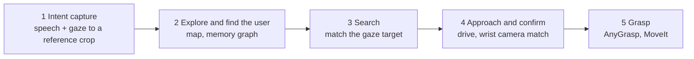
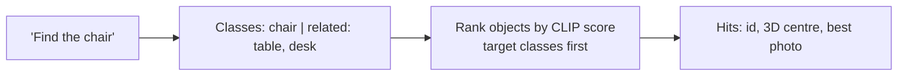
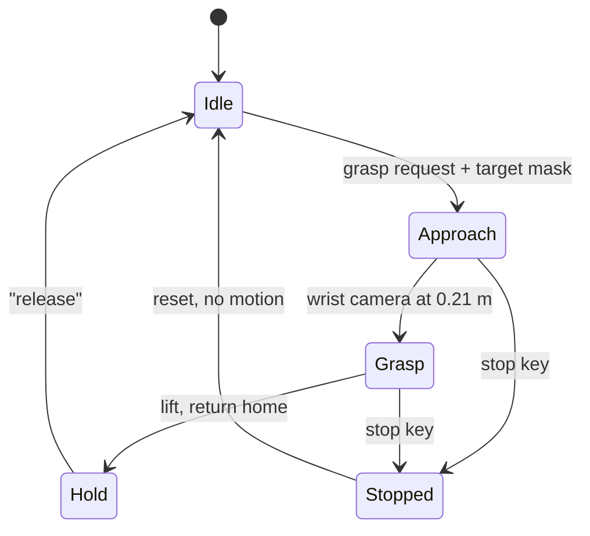
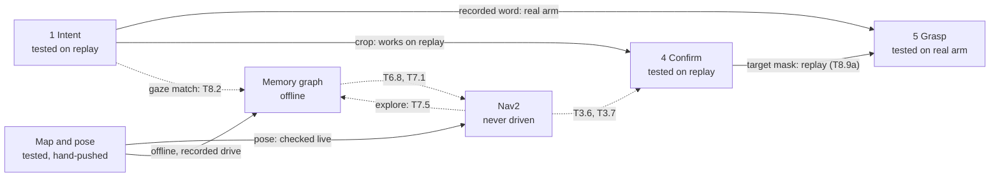

# Interim presentation: slide-by-slide content, 2026-10-28

The content specification for the slide-generation session. It fixes the narrative, the order, the
on-slide text, the visuals, the speaker scripts, the timing and who presents each slide. The next
session should design and lay out these slides, not re-plan them.

**Source of truth:** `docs/COMBINED_PROGRESS_REPORT_2026-10.md` (cited below as **CR§n**). The budget
is the approved budget proposal dated 5 Oct 2026, supplied by Dion in the session that wrote this
file. Nothing here goes beyond those two sources. Where a fact is missing, a placeholder says so.

**Placeholder notation.** Placeholders never appear on a slide. They sit in each slide's
"Placeholders" line, outside the on-slide content.

| Tag | Meaning |
|---|---|
| `[TEAM INPUT REQUIRED: ...]` | A fact only the team can supply |
| `[VERIFY: ...]` | A claim to confirm before the talk |
| `[ARTEFACT NEEDED: ... (owner)]` | A picture or video that lives in a teammate's `local/report_media/` folder, or must be recorded. The named owner supplies it |
| `[SOURCE GAP: ...]` | No evidence exists for this yet |

---

## A. Presentation overview

| Item | Content |
|---|---|
| Title | High-Readiness Mobile Manipulation via Gaze-Speech Interaction and Continuous Pre-Alignment |
| Working subtitle | Gappler: a mobile robot that fetches the object you looked at and named |
| One-sentence summary | We are building a mobile manipulator that turns a user's gaze and speech into a target, explores a room it cannot see at the start to find the user and then that object, drives to it, confirms it with the wrist camera and grasps it. |
| Central message | Each stage of the pipeline now works on its own and has a measured result, and the links between stages are scheduled milestones. The gaze target, which will tell the exploring robot when it has found the object, already steers the grasp at close range on replay. |
| Audience | Supervisor(s) and examiner(s). Technically literate, not familiar with our ROS 2, perception or grasping stack. One judge is a visualisation professor (CR§12), so the visuals must carry real information |
| Core time | 20 minutes, then 10 minutes of questions (not counted here) |
| Slides | 18 core slides, plus 9 appendix slides for questions |

**Three key takeaways**

1. The hard part is identity, not detection: the user's view and the robot's two views share almost
   nothing pixel for pixel, so the target must survive a change of viewpoint. Whole-object CLIP
   features do this for different objects (25 of 25), keypoints do not (0 of 15). Inside the grasp
   loop, the glasses crop now picks the right wrist target in 600 of 602 frames on replay.
2. Every subsystem has measured results on real hardware or real recordings: voice-started grasps on
   the real arm, a FAST-LIVO2 map closing within 12 mm over 26 m, a memory graph tuned against a
   hand-made answer key.
3. No end-to-end run exists yet, as planned. The open links (Nav2 driving, graph to goal, camera
   calibration, AnyGrasp off the ideal spot, the real arm with the glasses, exploration) are
   scheduled, with a cut list fixed in advance. Exploration and the gaze match are core and not on it.

**Narrative and section timings**

| Section | Slides | Presenter | Time |
|---|---|---|---|
| 1. Problem, objectives, intended system, approach | 1 to 5 | Dion | 4:45 |
| 2. Phase 1: intent capture | 6 | Dion | 1:20 |
| 3. Phase 2: map and frames | 7 to 8 | Sherman | 2:45 |
| 4. Phases 2 and 3: memory graph and search | 9 to 11 | Zongzhe | 3:10 |
| 5. Phases 4 and 5: cross-camera match and grasp | 12 to 14 | Dion | 3:45 |
| 6. Integration status and schedule | 15 to 16 | Sherman | 2:15 |
| 7. Budget, risks, next steps | 17 to 18 | Zongzhe | 1:35 |
| Handover pauses (5 changes of presenter, about 5 s each) | | | 0:25 |
| **Total** | | | **20:00** |

**Why this order works for the assessment.** It follows the problem, objectives, approach,
implementation, evidence, limitations, next steps chain the assessors grade. The implementation
part follows the robot's own sequence (user, then exploring and mapping, then search, then confirm and
grasp), so each presenter speaks once about their own subsystem and the audience never has to
reassemble the pipeline. The plan material (schedule and budget) comes last, where it can be judged
against the progress just shown.

**Rules for the slide-generation session**

1. **No single giant architecture slide.** The global flow appears twice, both times simple: slide
   4 (the five intended phases, five boxes) and slide 15 (what is wired today, with gaps marked).
   Target matching (slide 12), camera frames and calibration (slide 8), the memory graph (slides 9
   to 11) and grasp execution (slides 13 and 14) each get their own visual.
2. **A recurring phase strip.** A thin strip of five labelled boxes (1 Intent, 2 Explore and map, 3
   Search, 4 Approach and confirm, 5 Grasp) sits at the top of slides 6 to 14, with the current
   phase highlighted. It is the "you are here" marker that ties the deep dives to slide 4.
3. **One status colour scale everywhere** (from CR, status labels): Tested (green), Built not
   validated (amber), Isolated (blue), In progress (orange), Planned (grey outline), Out of scope
   (grey hatched). Use it on slides 4, 8, 15 and in the phase strip. Add a small legend wherever it
   appears.
4. **Every number keeps its condition.** "60 of 61 frames" always carries "recording, 1.4 to 2.4 m,
   steady stare". Do not drop the condition to save space.
5. **Restrained design.** One message-driven title per slide, high contrast, large labels, real
   project images over icons. No decorative stock images.
6. **Privacy.** Lab visitors' faces appear in Sherman's coloured map. Sherman cleared showing them as
   they are for this internal presentation (CR§12). Re-render before any external showing.
7. **Writing style.** Plain language, no em dashes, no semicolons, no emojis, no hype
   (`docs/dion_docs/WRITING_STYLE.md`).

---

## B. Slide-by-slide content

---

## Slide 1: High-Readiness Mobile Manipulation via Gaze-Speech Interaction and Continuous Pre-Alignment

**Purpose.** Open the talk, name the team and set the one-line idea.

**Key takeaway.** A robot that fetches the object you looked at and named.

**On-slide content**

- Title: *High-Readiness Mobile Manipulation via Gaze-Speech Interaction and Continuous Pre-Alignment*
- Subtitle: *Look at it, name it, and the robot fetches that one*
- Team: Dion, Sherman, Zongzhe
- Supervisor(s): see placeholder
- Interim assessment, 28 October 2026

**Recommended visualisation.** One real photo of the robot (RealMan RM65 arm on the Hexman
ECHO-PLUS base, Livox LiDAR and front D455 visible) beside the Aria glasses. Full-bleed or
half-bleed photo, title on a solid panel. No diagram.

**Proposed speaker script.**
"Good afternoon. We are Dion, Sherman and Zongzhe. Our project is a mobile robot that fetches the
specific object a person looked at and named, even when the robot cannot see that object at the
start."

**Estimated duration.** 0:20

**Evidence and source notes.** Title from the approved budget proposal. Hardware list CR§0.4.

**Placeholders.** `[TEAM INPUT REQUIRED: supervisor and examiner names for the title slide]`
`[ARTEFACT NEEDED: one photo of the full robot with the glasses beside it (any member, take at the lab)]`
Note: the approved title says "Continuous Pre-Alignment", a term the report never uses. Keep the title. Dion explains it if asked in Q&A.

**Presenter.** Dion

**Transition.** "Here is the situation we want the robot to handle."

---

## Slide 2: The user can see the object. The robot sees neither the user nor the object

**Purpose.** Establish the core problem and why it is hard. Answer "why is this not solved
already?"

**Key takeaway.** The target's identity has to survive a move between three very different
viewpoints, and existing systems avoid that problem.

**On-slide content**

- Title: *The user can see the object. The robot sees neither the user nor the object*
- Three panels, captioned:
  - **User's glasses:** 1 to 3 m away, front on
  - **Robot base camera:** knee height
  - **Robot wrist camera:** 0.2 to 0.5 m, from above
- Strip under the panels: *Same object, three viewpoints, almost nothing in common pixel for pixel*
- Two short lines on existing work:
  - FAM-HRI (Lai et al., 2025): gaze and speech pick an object, **if it is already in front of the arm**
  - HiCo-Nav (Xu et al., ICRA 2026): a robot searches a room by memory, **for a class, not the one you mean**
- Why it matters: assistive use, where a user can look but cannot easily point or speak, in a scene
  full of similar mugs, pill bottles and cans

**Recommended visualisation.** Three photos of the same box side by side, equal size, each labelled
with its camera and distance. The glasses and wrist crops exist in Dion's
`clip_glasses_vs_wrist_crops_2026-10-20.jpg`. Below them, two thin cards for FAM-HRI and HiCo-Nav,
each with its assumption in bold. Omit any architecture here.

**Proposed speaker script.**
"Picture a user wearing Meta's Aria glasses. They look at a box on a table and say 'find the box'.
The robot is somewhere else in the room. It has never seen the user's view.

These three images show why that is hard. On the left is what the glasses see: the box from a
metre or two away, front on. In the middle, the robot's base camera, at knee height. On the right,
the wrist camera on the arm, looking down from twenty centimetres. Same object, but the images have
almost nothing in common.

Two published systems each solve half of this. FAM-HRI uses gaze and speech from the same glasses to
tell an arm what to pick, but it assumes the object is already in front of the arm. HiCo-Nav lets a
robot search a room using a memory of what it has seen, but it finds a class, any box, not the one
you looked at. Our project joins the two: the robot explores like HiCo-Nav, and the user's gaze tells
it which object to stop for."

**Estimated duration.** 1:10

**Evidence and source notes.** CR§1 (core challenge, viewpoints and distances), CR§0.3 (two systems,
assistive case, D§5.5), CR§13.6 (references).

**Placeholders.** `[ARTEFACT NEEDED: a base-camera frame from knee height. The memory graph answer key has no box, so a frame of the box may not exist. Use a frame from Zongzhe's mg_handdriven1_survey_every_100th_frame_2026-10-21.jpg or Sherman's nav_camera_frames_along_t35f_run1_2026-10-21.jpg, captioned "the lab from the base camera", or take one frame of the box with the D455 at the lab (Sherman or Zongzhe)]`

**Presenter.** Dion

**Transition.** "So what exactly are we building, and how will we know it works?"

---

## Slide 3: Objective: find, reach and grasp the object the user looked at, in a room the robot cannot see

**Purpose.** State the main objective, how gaze and exploration fit together, and the measurable
milestones.

**Key takeaway.** One objective, gaze as the base case, and eleven milestones that each have a
concrete "done means".

**On-slide content**

- Title: *Objective: find, reach and grasp the object the user looked at*
- **Main objective:** a mobile manipulator that takes a spoken command and the user's gaze,
  explores a room it cannot see at the start to find the user and then the object they looked at,
  drives to it, confirms it with the wrist camera and grasps it
- **How gaze is used:** the CLIP feature of what the user looked at is the robot's target. While
  exploring, a match tells the robot to stop and approach. Without it, the robot cannot tell it has
  found the object
- **Evaluation:** end-to-end trials of this base case, success per phase. A without-gaze comparison
  is a stretch goal
- **Milestones, each with a test** (short form):

| | Milestone | Done means |
|---|---|---|
| M1 | Arm picks something up | 5 grasp attempts, success rate recorded |
| M2 | Voice and gaze reach the arm | Two boxes, picks the one you looked at, 3 times in 4 |
| M3 | Base navigates | Ten drives to a point, error recorded |
| M6 | Memory graph | A sentence query returns the right object |
| M7 | Graph drives the robot | Explores, finds the user, reaches the object out of view |
| M8 | Gaze picks the instance | A gaze match ends exploration. N end-to-end trials |
| M10 | Demonstration and paper | End-to-end run, paper with the trial results |

- Footer: *Also M0 (everyone can build and run), M4 (closed loop), M5 (calibrated base camera), M9 (optional: the paper's smarter exploration order)*

**Recommended visualisation.** Left third: a bridge diagram. Two blocks, "HiCo-Nav: explore and
remember every object" and "FAM-HRI: gaze and speech pick the object", joined by a highlighted
connector labelled "gaze target: the match that ends exploration". Right two thirds: the milestone
table, seven rows, with M7 and M8 marked as where the two systems meet. Keep M0, M4, M5, M9 in the
footer to keep the table readable.

**Proposed speaker script.**
"Our main objective is a mobile manipulator that takes what the user says and where they look,
explores a room it cannot see at the start, finds the user and then the object they looked at,
drives to it, checks it with the wrist camera and grasps it.

Gaze is what ties this together. From the glasses we cut out the object the user looked at and turn
it into a CLIP image feature. While the robot explores, it compares every object it sees with that
feature. A good enough match is the signal to stop exploring and go to that object. Without it, the
robot has no way to know it has found the right one. We will measure the whole pipeline end to end,
with gaze, phase by phase. A comparison without gaze is a stretch goal.

To make progress measurable we broke the project into eleven milestones. Each has a written test.
For example, M2 is done when, with two boxes on the table, the arm picks the one you looked at
three times out of four."

**Estimated duration.** 1:00

**Evidence and source notes.** CR§0.2 (objective, how the parts fit, milestone table with "done
means"), CR§1 (solution in outline), PP §1 (the five-phase base case).

**Placeholders.** None.

**Presenter.** Dion

**Transition.** "Here is the full behaviour we are building towards."

---

## Slide 4: The target system works in five phases, from speech and gaze to a grasp

**Purpose.** Give the audience the end-to-end behaviour before any detail, and state the scope
decisions so the gaps later are not read as omissions.

**Key takeaway.** Five phases from speech and gaze to a grasp, with each phase at a known stage.

**On-slide content**

- Title: *The target system works in five phases*
- Five boxes, left to right, each with a one-line job and a status badge:
  1. **Intent capture:** speech gives the word, gaze picks the object, crop it. *Tested on replay*
  2. **Explore and find the user:** the robot explores, maps the room and remembers objects with
     3D position and image feature. It looks for the user first. *Map tested live (pushed by hand).
     Memory graph tested offline. Exploration and finding the user planned*
  3. **Search:** compare each object with the gaze target. A match ends exploration. *Graph search
     built for sentences. Gaze match planned (T8.2)*
  4. **Approach and confirm:** drive to the object, wrist camera confirms it is the same one.
     *Confirm tested on replay and now steers the grasp. Driving planned*
  5. **Grasp:** grasp candidates on the wrist point cloud, plan, execute. *Tested on the real arm*
- Scope decisions box (small, right side):
  - Exploration is the core of the search. The paper's smarter exploration order (M9) is cut first
    if time runs short
  - Finding the user speeds up exploration: the object is somewhere the user can see
  - Out of scope: bringing the object back to the user
  - Final demonstration target: **March 2027 (M10)**

**Recommended visualisation.** A single horizontal row of five rounded boxes with arrows, coloured by
the status scale. Under each box, the owner's name in small text (1 Dion, 2 Sherman, Zongzhe and
Dion, 3 Zongzhe and Dion, 4 Dion and Sherman, 5 Dion). No topics, no node names. This is the slide the phase strip
on later slides refers back to.



**Proposed speaker script.**
"The finished system works in five phases. First, the user speaks and looks. Speech gives us the
word, gaze tells us which object, and we cut an image crop of it and turn it into a CLIP feature.
Second, the robot explores. It maps the room and builds a memory of the objects it sees, each with a
3D position and an image feature. It looks for the user first, because the object is somewhere the
user can see. Third, it compares what it sees with the user's target. A good match tells it to stop
exploring. Fourth, it drives close and the camera on the arm confirms that this is the object the
user meant. If not, it goes back to exploring. Fifth, it grasps.

Exploration is the core of the search. HiCo-Nav also has a smarter way to choose where to explore
next. That part is optional and the first thing we cut if time runs short. Bringing the object back
to the user is out of scope.

The badges show where each phase stands seven weeks in. The next eleven minutes go through them in
order."

**Estimated duration.** 1:15

**Evidence and source notes.** CR§0.2 (how the parts fit), CR§2.2 (intended pipeline), CR§2.3
(what is built today: exploration and finding the user planned, sentence query, crop not vector),
CR§7 (status per capability).

**Placeholders.** None.

**Presenter.** Dion

**Transition.** "Before the results, a word on where we started and how we work."

---

## Slide 5: We inherited code that did not run, so we built a test bench and a contract first

**Purpose.** Cover the "proposed approach" criterion: the starting point, the method and the team
split. Show the engineering judgement behind the plan.

**Key takeaway.** We rebuilt from tested open-source parts, measured a baseline before every
change, and split the work by subsystem with one written contract between them.

**On-slide content**

- Title: *We inherited code that did not run, so we built a test bench and a contract first*
- **September 2026 starting point:** a year of code from an earlier team. No tests, no CI. One
  program moved the real arm within seconds of starting, unprompted. The AnyGrasp path was
  unreachable. Navigation ran only from another user's private workspace, and the repo copy did not
  build. No memory graph code
- **How we work**
  - One subsystem per person, one channel contract naming the owner of every topic and frame
  - Test bench, 7 levels (L0 static checks to L6 real robot). CI on every PR, plus a GPU runner on
    the lab machine
  - Baseline first, then replace (for example, keypoint matching measured before CLIP replaced it)
  - Hardware one step at a time: written pass rule, saved log, two people present
- **Team split** (three columns):
  - **Dion:** glasses, cross-camera matching, arm and grasp, test bench and CI
  - **Sherman:** mobile base, LiDAR, camera mount, mapping and localisation
  - **Zongzhe:** memory graph, sentence reasoning, navigation goal nodes

**Recommended visualisation.** Left: a "before" card with the five starting problems as short lines
and a red outline. Right: three columns, one per person, each with their subsystem, the open-source
parts they build on (Aria SDK, SAM 3, AnyGrasp, MoveIt 2 / FAST-LIVO2, Nav2, SLAM Toolbox / HiCo-Nav
method, open_clip, Qwen2.5) and the milestones they lead. A thin band across the bottom: "Channel
contract + 7-level test bench + CI" as the shared base the three columns stand on.

**Proposed speaker script.**
"We did not start from zero, but we did not start from a working system either. The code we
inherited had no tests and no CI, and none of it ran from a fresh copy. One program homed the real
arm within seconds of starting, with no prompt. Navigation ran only from another user's workspace, and
our copy did not build. There was no memory graph.

So the first weeks went into foundations. We split the work by subsystem: Dion on the glasses and
the arm, Sherman on the base and mapping, Zongzhe on the memory graph. A written channel contract
says who owns every message and coordinate frame, so we can work in parallel without breaking each
other. A seven-level test bench runs on every pull request, from static checks up to a simulated
arm.

Two habits run through everything that follows. We measure a baseline before replacing anything,
and on the real robot we move one step at a time, with a written pass rule and two people present."

**Estimated duration.** 1:00

**Evidence and source notes.** CR§0.3 (starting point), CR§0.4 (practices, open-source parts table,
hardware), CR§0.5 (team and ownership), CR§1 accomplishment 1. Navigation wording: `ORIENTATION.md`
§8.6 and §8.15 (the stack that ran came from `~iot22/Ros2Workspaces`, the repo copy needed the missing
`xpkg_demo` and had no `livox_ros_driver2` manifest), S§2.1. CR§0.3 still says "never been built".

**Placeholders.** None.

**Presenter.** Dion

**Transition.** "Phase one: turning a sentence and a glance into a target."

---

## Slide 6: Speech gives the word, gaze picks the object: right box in 60 of 61 recorded frames

**Purpose.** Show how intent capture works and what it achieved, including its first failure mode.

**Key takeaway.** A gaze vote over one second picks the right mask reliably on a steady stare, and
the gaze error is large enough to matter for neighbouring objects.

**On-slide content**

- Phase strip: **1 Intent** highlighted
- Title: *Speech gives the word, gaze picks the object*
- Pipeline in four steps:
  1. **Voice:** speech detector, Whisper, small language model returns one object word ("box"). One
     message per sentence, down from 31
  2. **Pick the moment:** the glasses frame from when you spoke (gaze window of 1.0 s)
  3. **Segment:** SAM 3 finds every "box" in that frame
  4. **Gaze vote:** each gaze sample votes for the mask under it. Winner needs half the votes. Crop
     its box plus 20 px. This **reference crop** goes to the robot
- Results:
  - **60 of 61 frames, right box** (recording, 1.4 to 2.4 m, steady stare)
  - **4 of 4 spoken words produced a reference crop** (full chain on replay)
  - Word ready about 1.1 s after speech ends
- Limit: gaze is off by about 5.6 degrees (60 px at 1.4 m), about 15 cm at 1.5 m. At 1.5 m it
  landed on a stack of mats
- Status: tested on recordings and replay. Live glasses stream still throttled on the lab machine

**Recommended visualisation.** Main image: Dion's `aria_gaze_pick_vs_distance_2026-10-20.jpg`, the
gaze pick at four distances with the 1.5 m miss. Annotate the gaze dot, the chosen mask and the
miss with a callout "gaze landed on the mats". Above it, the four-step pipeline as small icons with
one-word labels (Voice, Moment, Segment, Vote). Results as two large numbers on the right.

**Proposed speaker script.**
"The user says 'find the box'. A speech detector waits for the sentence to finish, Whisper turns it
into text, and a small language model pulls out the object word. Before this, the old pipeline
produced thirty-one messages per phrase. Now it produces one.

Gaze runs at the same time. We keep the last twenty seconds of glasses images and gaze points, so
we can go back to the moment the user was speaking. SAM 3, a segmentation model you prompt with a
word, finds every box in that one frame. Then gaze votes. Each gaze sample in a one-second window
votes for the mask it lands on, and the winner needs half the votes. We crop that mask with a small
margin. That crop is what we send to the robot.

On a recording at 1.4 to 2.4 metres, this picked the right box in 60 of 61 frames. On a full
replay, all four spoken words produced a crop.

The limit is gaze accuracy. The eye model is off by about five and a half degrees, roughly 15
centimetres at 1.5 metres. Here, at 1.5 metres, it landed on a stack of mats that SAM 3 also called a
box. Keep that case in mind. It comes back on slide 12."

**Estimated duration.** 1:20

**Evidence and source notes.** CR§5.1 (steps, parameters: 1.0 s window, 80 px radius, half the
votes, 20 px crop, SAM 3 cutoff 0.3), CR§8.1 (31 to 1, 60 of 61 on recording c2cbafe8, 4 of 4 replay,
gaze bias), CR§4 voice row (1.1 s), CR§5.1 failure cases (mat stack), CR§7 (status).

**Placeholders.** `[ARTEFACT NEEDED: aria_gaze_pick_vs_distance_2026-10-20.jpg from docs/dion_docs/local/report_media/ (Dion)]`
`[VERIFY: whether T2.21 (word timestamps from Whisper, PR #91) has merged by 28 Oct. If yes, the script can say the word is stamped with the time it was spoken. If not, keep as is]`

**Presenter.** Dion

**Transition.** "That crop now has to be found by a robot that has never seen this view. Sherman
will show how the robot knows where it is."

---

## Slide 7: The base builds a coloured 3D map that closes within 12 mm over a 26 m loop

**Purpose.** Show the mapping and localisation result, the porting work it took to get there, and its
current limit.

**Key takeaway.** We adopted the HiCo-Nav paper's 3D method, FAST-LIVO2, because the memory graph
needs a full camera pose to place objects in 3D. It is published for ROS 1. Getting its ROS 2 port to
run correctly on our sensors took a week of staged work and three silent defects found and fixed, and
its pose is now handed to the navigation stack.

**On-slide content**

- Phase strip: **2 Explore and map** highlighted
- Title: *The base builds a coloured 3D map that closes within 12 mm over a 26 m loop*
- What it is: FAST-LIVO2 fuses the Livox MID-360 LiDAR, its IMU and the base D455 colour camera into
  a pose and a coloured map. It is what the HiCo-Nav paper uses for its camera poses, with the same
  LiDAR
- **Why 3D, not 2D SLAM:** 2D SLAM gives only x, y and heading. The memory graph places every object
  in 3D from the camera pose, so it also needs height, pitch and roll (1 degree of pitch moves an
  object 4 m away by about 7 cm). Nav2 still drives on a 2D grid, fed by this pose
- **Getting it to work** (FAST-LIVO2 is published for ROS 1, we run a community ROS 2 port), six
  steps, 15 to 22 Oct:
  1. **Build:** the port pinned and built in a sealed container (its libraries are not on the lab
     machine). A memory over-read and a shutdown crash fixed
  2. **Prove on the authors' data:** their ROS 1 recording converted to ROS 2, 14,850 of 14,850
     messages, every input and output counted
  3. **Record our sensors:** LiDAR 10 Hz, IMU 200 Hz, colour 30 Hz, every message audited
  4. **Find silent defects:** runs with and without the camera, each against a control. A range gate
     that dropped nothing, the LiDAR-to-IMU offset sign (about 10 cm off), a voxel key mismatch
  5. **Live, pushed by hand:** 26 m loop
  6. **Hand to Nav2:** pose bridged into the frame tree. Start tilt from the gravity estimate removed:
     floor tilt up to 1.2 degrees down to under 0.5
- Results (hand-pushed loop, recording `handdriven1`, 20 Oct):
  - **26.05 m loop, back to start within 12 mm** (4 mm LiDAR-only, 7 mm odometry error, 0.03 %)
  - Mid-route error at most 6.7 cm, at the floor of our reference (about 7 cm)
  - 11 to 14 ms per frame on the CPU, inside the 100 ms scan period
- Limit: pushed by hand, not driven. Nav2 has never driven the base

**Recommended visualisation.** Use the clean renders (no text baked in, 2026-10-24), so all labels
live on the slide. Main: the map building up as the base is pushed,
[`nav_fastlivo_map_buildup_clean_handdriven1_2026-10-24.gif`](sherman_docs/local/report_media/nav_fastlivo_map_buildup_clean_handdriven1_2026-10-24.gif) (10 s at about 12x real time,
holds 2 s on the closed loop, 1.1 MB, viewed from above at 50 degrees. `.mp4` beside it). Alternative main: the orbiting map,
[`nav_fastlivo_map_orbit_clean_handdriven1_2026-10-24.gif`](sherman_docs/local/report_media/nav_fastlivo_map_orbit_clean_handdriven1_2026-10-24.gif) (14 s, 15 MB, or the 51 MB `.mp4`).
Still fallback if the venue cannot play video: [`nav_fastlivo_map_iso_clean_handdriven1_2026-10-24.png`](sherman_docs/local/report_media/nav_fastlivo_map_iso_clean_handdriven1_2026-10-24.png).
Inset: [`nav_fastlivo_path_closure_zoom_clean_handdriven1_2026-10-24.png`](sherman_docs/local/report_media/nav_fastlivo_path_closure_zoom_clean_handdriven1_2026-10-24.png), the 10 cm by 10 cm
zoom on start (green dot) and end (white square). Slide caption: "10 cm zoom, bar = 2 cm, start to
end 12 mm". In all map renders the orange line is the path, the green dot the start, the white
square the end. Optional second inset or appendix A5: the top-down path coloured by time,
[`nav_fastlivo_path_top_clean_handdriven1_2026-10-24.png`](sherman_docs/local/report_media/nav_fastlivo_path_top_clean_handdriven1_2026-10-24.png) (dark purple early, yellow late).
Renders: `sherman_docs/local/presentation/scripts/clean_*.py` from `handdriven1`, same camera, crop
and colours as the 2026-10-22 set, far ghost points cropped. Results as three numbers in a column. Along the bottom, the
six steps as a thin flow strip of six small boxes, one short label and one number each (Build,
Authors' data 14,850/14,850, Our sensors, 3 silent defects, Live 26 m, Nav2 tilt under 0.5 degrees), with a "ROS 1
to ROS 2 port" tag at its left end. A small "2D: x, y, heading" against "3D: full pose" label beside
the "why 3D" line. Do not show the full sensor-to-Nav2 wiring here.

**Proposed speaker script.**
"Before the robot can remember where objects are, it needs to know where it is. We use FAST-LIVO2,
the method the HiCo-Nav paper uses, from the University of Hong Kong. It fuses the LiDAR, its motion
sensor and the colour camera into one pose, and paints a coloured 3D map.

Why 3D? 2D SLAM knows only where the base is on the floor and which way it faces. The memory graph
places each object in 3D from the camera's pose, so an unmeasured tilt moves objects by centimetres.
Nav2 still drives on a 2D grid built from this pose.

FAST-LIVO2 is published for ROS 1. We run a community ROS 2 port, and getting it to work was most of
the effort. The strip along the bottom shows the steps. I proved it on the authors' own recording
first, then on our sensors with every message checked. I found three defects that fail silently: no
crash, just a wrong map. Each was found by reading the source and confirmed against a control run.

The result: I pushed the base by hand around a 26-metre loop. The path returns to its start within
12 millimetres, and the mid-route error is within about 7 centimetres, the limit of our reference.
The pose now feeds Nav2's frame tree. Nav2 driving the base is the next test."

**Estimated duration.** 1:35

**Evidence and source notes.** CR§8.4 (closure 12 / 4 / 7 mm and 0.03 %, mid-route 6.7 and 6.5 cm vs
about 7 cm reference, compute 11 to 14 ms, three port defects), CR§4 FAST-LIVO2 and bridge rows,
Sherman's report S§6.4 (reason for the switch: a coloured, camera-fused pose for HiCo-Nav, decided
2026-10-15), CR§13.2 X10 (use all three closure numbers). Why 3D: `MEMORY_GRAPH_DESIGN.md` (merge
test depends on camera pose, 2D localisation has no reliable pitch or roll, appearance alone cannot
merge), `hico-nav/PAPER_REPORT.md` (2D SLAM option, no reliable pitch or roll. §6.2: the paper, §III-B(a),
takes its camera poses from FAST-LIVO2 on a Livox MID-360, so we adopted its method rather than
inventing one), 1 degree at 4 m =
4 x 0.01745 = 0.07 m. Option 2 (FAST-LIVO2 pose, SLAM Toolbox only draws the Nav2 grid): S§11. For
questions only, measured after the decision (S§12.2, same bags): restart inside the SLAM Toolbox map
0.25 to 0.30 m from the tape, 3D prototype 0.070 m. Glass ghost points (CR§9.2, about 42 %) left off
this slide as a known LiDAR effect. They stay in appendix A6. Six steps, from Sherman's report:
ROS 1 parent `hku-mars/FAST-LIVO2`, ROS 2 port `U-AMC/FAST-LIVO2-ROS2` pinned at `a09599a` (S§1.2,
`sherman_docs/t3.5/T3.5_CONFIG_SWEEP_20261019.md`). 1 Build, S§7.1 and §7.3 (container with no
network, AddressSanitizer one-byte over-read at `vio.cpp:1679`, shutdown crash from `-march=native`
alignment against prebuilt PCL), S§10.1 (Sophus and vikit absent on the box). 2 Authors' data, S§7.2
and `t3.5/T3.5_FASTLIVO_REPLAY.md` (ROS 1 to ROS 2 conversion, 14,850 of 14,850). 3 Our sensors,
S§8.2 (`t35b_proof3`, `stationary02`, audited with `rosbag2_py`). 4 Silent defects, S§9.3 (range gate
F2 dropped nothing, 52 % zero-range points passed. Offset sign F3, about 10.2 cm. Voxel key mismatch,
retrieval missed real map points). 5 Live, S§10 (20 Oct). 6 Nav2, S§11.1 (bridge, converter 110.6 ms
to 0.38 ms). Dates 15 Oct (switch) to 22 Oct (Nav2 pipeline figure). Defects were found by reading the source,
each confirmed against a control run (S§9.3). Start tilt, step 6 (S§11.7): FAST-LIVO2 takes 'down'
from the accelerometer at start, off by up to about a degree each launch. The bridge measures motion
from the first pose, so on a level start that error cancels (floor tilt 0.10 to 0.37 degrees on
`handdriven1`, against up to 1.2). It refuses to start above 2 degrees of start tilt.

**Placeholders.** `[VERIFY: the clean renders are in Sherman's gitignored docs/sherman_docs/local/report_media/, so the links above work on his machine only. Sherman copies them to whoever builds the slides]`
`[VERIFY: the venue can play video. Fall back to the GIF or the iso still]`

**Presenter.** Sherman

**Transition.** "A map is only useful to the arm and the memory if every camera's position on the
robot is known. That is a calibration question, and there are several of them."

---

## Slide 8: Four camera relationships, four different states of calibration

**Purpose.** Separate the camera-to-camera calibration problems from the robot's coordinate
transforms, so the audience does not conflate them. Show what is measured and what is nominal.

**Key takeaway.** The arm and its wrist camera are measured and calibrated, but the base camera and
the glasses are not yet, and each missing calibration blocks a specific later step.

**On-slide content**

- Phase strip: **2 Explore and map** highlighted (frames also serve 4 and 5)
- Title: *Four camera relationships, four different states of calibration*
- Four labelled links:

| Link | Used for | State |
|---|---|---|
| Base to arm | Arm grasps in the base's map | **Measured**: (0.18, 0, 0.48) m, yaw 180 degrees, matched on the robot. Base origin (floor, under the drive axle) checked against the vendor manual |
| Base camera to LiDAR | Object positions and depth in the memory graph | **Mount measured, not calibrated**: measured to the camera's mounting hole, Intel's published dimensions from there to the sensors. Rotation set by construction: flush on vertical aluminium extrusions, square by design. Angle not measured with a tool. Mount values wired and unit-tested (12 software checks). Camera to LiDAR not yet calibrated, about 6.7 px of error per degree. Calibration rig planned (T5.5) |
| Wrist camera to arm | Turning a grasp seen by the camera into an arm goal | **Calibrated** |
| Glasses to robot | A gaze ray in the robot's own 3D frame, for look-alike objects | **Planned** (T8.8). Three methods ranked |

- Footer: *Camera calibration (where is one camera relative to another) is a separate problem from the robot's frame tree (where each part is relative to the base)*

**Recommended visualisation.** A side-view line drawing of the robot: base, LiDAR on top, D455 at
the front, arm with the wrist D435i, and a small figure of the user with glasses to one side.
Draw the four links as coloured arrows using the status scale: solid green (measured or
calibrated), amber (measured, not calibrated), grey dashed (planned). Each arrow labelled with
its use, not its frame name. Beside it, one small inset: the LiDAR-on-camera overlay before
calibration, `nav_lidar_on_camera_overlay_stationary02_t0s_2026-10-19.png`, captioned "before
calibration: LiDAR points over the camera image". Frame names (`robot_base_link`, `base_link`,
`camera_color_optical_frame`) go to appendix slide A2, not here.

```
             user + glasses
                  :  (4) planned, T8.8
                  :
   [D455]--(2) measured, not calibrated--[LiDAR]
      |                    |
   [ base ]==(1) measured==[ arm ]==(3) calibrated==[wrist D435i]
```

**Proposed speaker script.**
"There are four places where we need to know how one part of the robot sits relative to another.

The arm on the base is measured. We set the transform from the mount drawings and checked it on the
robot. The base's own origin, on the floor under the drive axle, matches the vendor's manual.

The base camera relative to the LiDAR is measured but not calibrated. I designed and fitted the mount,
measured to the camera's mounting hole, and took the rest from Intel's published camera dimensions.
It sits flush on vertical aluminium extrusions, so it points straight by construction. What is left is a calibration
against the LiDAR itself, because one degree of error moves a point by about seven pixels. The rig
for that is planned.

The wrist camera relative to the arm is calibrated, so a grasp it sees becomes an arm goal.

The last one is different in kind. To use gaze to separate two identical objects, the robot needs
the user's gaze ray in its own frame, which means locating the glasses relative to the robot. That
is planned for January.

None of these blocks today's results, but each one blocks a specific later step."

**Estimated duration.** 1:10

**Evidence and source notes.** CR§5.4 "Frames" table (four problems and their status), CR§4 base
D455 and mount row (12 geometry checks, eye-estimated rotation). Rotation wording from Sherman,
2026-10-24: the camera sits flush on the top rectangular frame, mounted on aluminium extrusions that run
vertically, so zero rotation comes from the extrusions being square. No angle was measured with a
tool, so the residual is the extrusions' squareness plus screw play. The calibration (T5.5) still measures what
a body check cannot: the LiDAR's own mount and the image sensor's alignment inside the camera body.
`T5.3_D455_FIT.md`, `T5.4_D455_TF.md` and CR§4 still say "estimated visually" and should say
"set by construction". How the chain was built (`T5.4_D455_TF.md`): base origin `robot_base_link`
sits on the floor under the drive-axle midpoint, centred. The vendor model puts the wheel joints at
z = 0.065 m (`nav/vendor/urdf/xpkg_urdf_echo_plus/urdf/model.urdf:90-94`), the measured axle height
is 65 mm, so the origin is at floor height. Sherman checked this origin against the vendor's online
manual (2026-10-24). Camera: tape from the chassis midpoint to the platform front-top edge (+195 mm
forward, 558 mm up), then edge to the D455 bottom mounting hole (+13 mm, −30 mm), giving
(0.208, 0, 0.528) m to the hole. From the hole to `camera_link` and each sensor, Intel's published
geometry (`realsense2_description` `_d455.urdf.xacro`, offset (0.01115, 0.0475, 0.0145) m), and the
driver applies the factory fine extrinsics live. The 12 are software unit tests
from T5.4, 8 in `bench/test_geometry.py` (mount values single-sourced and reach the TF) and 4 in
`bench/test_camera_navigation.py` (camera-referenced stand-off maths, refusal when TF is lost). They
prove consistency, not physical accuracy (`sherman_docs/t5/T5.4_D455_TF.md`), CR§9.1 (6.7 px per degree,
S§13.1), CR§6.7 (TF tree, for appendix A2), CR§0.2 M5 (calibration not built).

**Placeholders.** `[ARTEFACT NEEDED: nav_lidar_on_camera_overlay_stationary02_t0s_2026-10-19.png (Sherman)]`
`[VERIFY: optional before the talk, a phone inclinometer on the camera top would turn "straight by construction" into a measured pitch and roll (Sherman)]`
`[TEAM INPUT REQUIRED: one phrase on how the wrist camera was calibrated (method, residual), in case an examiner asks. Dion confirmed on 2026-10-24 that it is calibrated]`
`[VERIFY: who presents the glasses-to-robot row. It is Dion's task (T8.8). Sherman can present it as written, or Dion can add one sentence in his later block]`

**Presenter.** Sherman

**Transition.** "With poses and camera images from that drive, Zongzhe builds the robot's memory of
the room."

---

## Slide 9: The memory graph turns a drive into objects with a position and an image feature

**Purpose.** Explain what the memory graph is, how it is built and what makes the implementation
credible.

**Key takeaway.** A fresh, tested implementation of the HiCo-Nav memory graph now builds a map of
objects from Sherman's recording, offline.

**On-slide content**

- Phase strip: **2 Explore and map** highlighted
- Title: *The memory graph turns a drive into objects with a position and an image feature*
- What it stores:
  - **Objects:** merged 3D points, a box, an averaged CLIP image feature, a class label
  - **Anchors:** kept photos with the camera pose, linked to the objects they show
- How it is built, in 14 tested stages: keep a photo every 1 m or 45 degrees, SAM 3 finds all 30
  vocabulary classes, LiDAR gives depth, lift to 3D, CLIP feature per object, merge repeat sightings
- Numbers (recording `handdriven1`, 3536 frames):
  - **29 photos kept, 99.2 % of segmentation time saved**
  - **Batched SAM 3: 40 phrases in 1.69 s instead of 9.70 s** (5.7 times faster)
  - **399 tests pass** on the lab GPU
  - **9 upstream problems fixed or avoided** (for example, the language model call had no timeout,
    and the task score was never set)
- Status: built offline from a recorded drive. Not yet built live while driving

**Recommended visualisation.** Main: the graph in 3D from the Rerun viewer. Grey LiDAR room, each
object as a labelled box, each anchor as a small camera at its pose, with lines from cameras to the
objects they saw. Use a screenshot from `mg_t6.3_four_photos_rerun_3d_2026-10-21.rrd`, or the
flythrough video if recorded. Secondary strip below: frame 700 in three small panels (photo, SAM 3
masks, 3D boxes) from `mg_frame700_masks_and_3d_objects_2026-10-21.png`. Put the four numbers as a
narrow column on the right.

**Proposed speaker script.**
"The memory graph is HiCo-Nav's idea. As the robot moves, it keeps a photo now and then, finds the
objects in it, and stores each object with its position in 3D and a CLIP image feature. CLIP is a
model that turns an image into a vector, so that similar-looking things get similar vectors. The
photos are kept too, linked to the objects they show. That link is the 'graph'.

HiCo-Nav published code, but with no licence, so I read it and wrote a fresh implementation as
fourteen separate stages, each with its own tests. Reading it also turned up nine problems, such as
a language-model call with no timeout, which we fixed or avoided.

Here is the graph built from Sherman's hand-pushed drive. Two choices keep it fast. A photo is kept
only after the robot moves a metre or turns 45 degrees, so 29 of 3,536 frames go to segmentation,
which saves over 99 % of that time. And all thirty object classes go through SAM 3 in one batch,
5.7 times faster than one at a time.

It is built offline from a recording. Building it live while the robot explores is next (T7.2,
T7.5)."

**Estimated duration.** 1:20

**Evidence and source notes.** CR§5.2 "What the memory graph represents", CR§4 memory graph rows
(S0 loader, anchor gate, batched SAM 3, lifting and CLIP), CR§8.5 (29 photos, 99.2 %, 1.69 vs 9.70 s,
399 tests), CR§1 accomplishment 5 (nine upstream problems), Zongzhe's report Z§2.2 (the nine
problems), CR§0.4 (upstream has no licence, read not copied).

**Placeholders.** `[ARTEFACT NEEDED: Rerun 3D screenshot or mg_graph_3d_flythrough video (video is a stub, recordable any time from the .rrd), and mg_frame700_masks_and_3d_objects_2026-10-21.png, from docs/zongzhe_docs/local/report_media/ (Zongzhe)]`

**Presenter.** Zongzhe

**Transition.** "The hardest part of building it is deciding when two sightings are the same
object."

---

## Slide 10: A 10 cm merge radius cut duplicates from 8 to 3 with no false merges

**Purpose.** Show the main tuning result, the evaluation method behind it, and the trade-off it
reveals.

**Key takeaway.** Merging by 3D geometry, tuned against a hand-made answer key, removes most
duplicates safely. Merging by appearance alone does not, because similar objects look alike.

**On-slide content**

- Phase strip: **2 Explore and map** highlighted
- Title: *A 10 cm merge radius cut duplicates from 8 to 3 with no false merges*
- Method: a hand-made answer key of 16 real objects marked on the LiDAR map (7 chairs, 2 tables, 2
  TVs, 2 computer towers, shelf, sofa, door). Independent of the code under test
- Why the radius: two views of one object land 4 to 9 cm apart with sparse LiDAR depth. Upstream's
  2.5 cm was too tight
- Result at 10 cm: **duplicates 8 to 3, 0 false merges, misses unchanged at 3** (first drive).
  Second drive: 2 to 1
- Trade-off: at 15 cm a chair merges into its desk on the second drive, so 10 cm, not 15
- Why not appearance: CLIP gives the same chair 0.934, **two chairs of the same model 0.81 to 0.85**,
  other objects 0.56. Merging on appearance alone removes duplicates by merging everything (10 to 14
  of 16 objects missed)
- Footnote: two drives, 16 objects. A difference of one is noise

**Recommended visualisation.** A line chart: x axis match radius (1, 2.5, 5, 7.5, 10, 15, 20 cm),
y axis duplicates. Two lines, first drive (real gate) and second drive. A second, lighter line or
markers for false merges, flat at 0 from 2.5 cm upwards. A vertical marker at 10 cm labelled "chosen",
and a callout at 15 cm "chair merges into desk (drive 2)". Data:

| Radius (cm) | 1 | 2.5 | 5 | 7.5 | 10 | 15 | 20 |
|---|---|---|---|---|---|---|---|
| Duplicates, drive 1 | 31 | 8 | 4 | 4 | 3 | 3 | 2 |
| False merges, drive 1 | 1 | 0 | 0 | 0 | 0 | 0 | 0 |
| Duplicates, drive 2 | | 2 | | | 1 | 1 | |

Drive 2 was only run at 2.5, 10 and 15 cm. Plot those three points, do not interpolate. Beside the
chart, a small bar with the three CLIP similarity values (0.934, 0.81 to 0.85, 0.56). Optional
inset: `mg_ground_truth_12_objects_on_lidar_map_2026-10-21.png` to show what the answer key looks
like.

**Proposed speaker script.**
"The robot sees the same chair from many places. Each sighting must merge into one object, and two
chairs side by side must stay two.

To measure that, I made an answer key by hand: sixteen real objects marked on the LiDAR map, without
using any of the code being tested. Then I swept the settings.

The lever is the match radius, how close two sightings' points must be. With our sparse LiDAR depth,
two views of one object land 4 to 9 centimetres apart, so upstream's 2.5 centimetres split objects.
At 10 centimetres duplicates fall from 8 to 3 with no false merges. On a second drive, 2 to 1. At 15,
a chair merges into the desk next to it, so we chose 10.

Why not just merge things that look alike? Because look-alikes are exactly the problem. CLIP scores
two chairs of the same model at 0.81 to 0.85, close to the same chair at 0.93. Merging on appearance
removes every duplicate by merging nearly everything. That is also why the class alone cannot find
the user's object."

**Estimated duration.** 1:00

**Evidence and source notes.** CR§8.5 (8 to 3, 0 false merges, second drive 2 to 1, chair into desk
at 15 cm, appearance-only 10 to 14 missed, CLIP 0.934 / 0.81 to 0.85 / 0.56), CR§6.5 (4 to 9 cm),
Zongzhe's report Z§3.5 (sweep table and answer key composition, source of the chart data).

**Placeholders.** `[ARTEFACT NEEDED: the line chart, built from the table above (slide session can draw it), optional mg_ground_truth_12_objects_on_lidar_map_2026-10-21.png (Zongzhe)]`

**Presenter.** Zongzhe

**Transition.** "Once the objects are in the graph, the robot has to find the right one from a
sentence."

---

## Slide 11: A sentence becomes a ranked list of objects with 3D positions

**Purpose.** Show how search works today and state plainly that the full query has not yet run on
a drive.

**Key takeaway.** Sentence-to-class reasoning works (20 of 22), and the ranking step is built, but
the acceptance run on the recorded drive is the next milestone.

**On-slide content**

- Phase strip: **3 Search** highlighted
- Title: *A sentence becomes a ranked list of objects with 3D positions*
- Three steps:
  1. **Sentence to classes:** a local language model (Qwen2.5, 1.5B) returns target and related
     classes. "Find the chair" gives target *chair*, related *table, desk*
  2. **Score:** each object's CLIP image feature against the sentence's CLIP text vector
  3. **Rank:** target classes first, then related, each by score. Each hit has a 3D centre and its
     best photo. A wrong hit can be rejected and skipped next time
- Results:
  - **Sentence to classes: 20 of 22 instructions** (checked by hand). 0.28 to 0.32 s a reply
  - Smaller 0.5B model: 12 of 22. Fallback without the model: 15 of 22
- Status: steps 2 and 3 tested on stand-ins and a few photos. **The full query on the recorded drive
  is the acceptance test, scheduled weeks 7 to 8 (T6.8)**
- Note: today the query is a sentence. In the full system each object is matched against the gaze
  crop's feature, and a match ends exploration (M8)

**Recommended visualisation.** A left-to-right flow of three boxes with real content inside each:
the sentence in quotes, then the class list as chips, then a ranked list of three hits with score
bars and a thumbnail. Below it, a compact coloured grid of the 22 instructions with three columns
(1.5B, 0.5B, fallback), green for right, red for wrong, from Zongzhe's reasoning check. Mark the
hits box with an "acceptance run pending" tag in the Planned colour.



**Proposed speaker script.**
"To search the graph, the robot first turns the sentence into classes. A small language model,
running locally, returns the target class and some related ones. 'Find the chair' gives chair, plus
table and desk, because chairs are usually near them. The 1.5 billion parameter model got 20 of 22
test instructions right and answers in about a third of a second.

Then every object is scored by comparing its stored image feature with the sentence, using CLIP
again. Target classes rank first, related ones after. Each hit comes with a 3D position and the best
photo of it, and a wrong hit can be rejected so the robot tries the next one.

The ranking has been tested on stand-in data and a few photos. Running the full query on the
recorded drive, checked against the answer key, is the next milestone, in the next two weeks.

Today the query is a sentence. In the full system, the robot matches each object against the gaze
crop from slide 6, and a good match tells it to stop exploring and go to the user's chair, not just
any chair. Dion now picks up the object at close range."

**Estimated duration.** 0:50

**Evidence and source notes.** CR§5.3 (steps and status), CR§8.5 (20 of 22 by hand, 19 of 22 auto,
0.5B 12 of 22, fallback 15 of 22), CR§4 reasoning row (0.28 to 0.32 s), CR§5.3 "Example query for
slides" (use "find the chair", the answer key has no box), CR§13.2 X11.

**Placeholders.** `[VERIFY: the "related: table, desk" example. Zongzhe to replace it with the model's actual output for "find the chair" from check_reasoning.json]`
`[ARTEFACT NEEDED: the 22-instruction right/wrong grid from local/t6.7/out/check_reasoning.json (Zongzhe)]`
`[AFTER T6.8: if the acceptance run happens before 28 Oct, replace the status line with its result]`

**Presenter.** Zongzhe

**Transition.** (Handover) "Thanks, Zongzhe. When the robot reaches the object, it has to confirm,
with the camera on its wrist, that this is the one the user looked at."

---

## Slide 12: CLIP finds the looked-at box across cameras, and now steers the grasp: 600 of 602

**Purpose.** Present the strongest research-relevant result: matching the glasses crop to the
wrist view, first as a method comparison, then inside the grasp loop (T8.9a). Show the baseline,
the choice, the result and the limit.

**Key takeaway.** Keypoint matching failed (0 of 15), CLIP matching works (25 of 25), and with it
inside the grasp client the wrist target is the looked-at box in 600 of 602 frames on replay. The
remaining misses come from a wrong gaze pick, not from the matcher.

**On-slide content**

- Phase strip: **4 Approach and confirm** highlighted
- Title: *CLIP finds the looked-at box across cameras, and now steers the grasp*
- The question: which wrist-camera mask is the object in the glasses crop?
- **Step 1, choose the method** (25 glasses-wrist pairs with 2 to 12 decoys, unless noted):

| Method | Box ranked first |
|---|---|
| SuperPoint + LightGlue keypoints (baseline, 15 pairs) | **0 of 15** |
| SAM 3 decoder vector | 7 of 25 |
| SAM 3 image features | 15 of 25 |
| **CLIP whole-object feature** | **25 of 25** |

- **Step 2, put it in the grasp loop (T8.9a):** the grasp client compares every wrist mask with the
  glasses crop and takes the closest. Below 0.56, or a tie within 0.01, it publishes nothing and
  the arm waits
- Result (recordings replayed, arm not moved), wrist targets on the box the user looked at:

| Scene | Old pick (most confident SAM 3 mask) | With the glasses crop |
|---|---|---|
| Three different boxes | 105 of 115 | **334 of 334** |
| Two cardboard boxes, 0.4 to 1.6 m | **0 of 114** | **266 of 268** |

- The 2 misses: at 1.5 m the gaze landed on the mat (slide 6), so the crop itself was wrong. Fix
  next: refuse weak gaze picks before the crop is sent (T2.24)
- Limit: **identical-looking objects.** Two same-colour boxes: 6 of 12. Appearance cannot separate
  them, so the gaze ray in the robot's frame is planned (T8.8)
- Footer: replayed recordings, counted per published target. Not yet run on the real arm

**Recommended visualisation.** Two panels, left to right, labelled "1 Choose the method" and "2 In
the grasp loop".

- Left: a horizontal bar chart of the four methods (0 %, 28 %, 60 %, 100 %), with the count printed
  on each bar ("0 of 15", "7 of 25", "15 of 25", "25 of 25"). LightGlue marked as the baseline. A
  small thumbnail of `lightglue_baseline_wrong_matches_2026-10-19.jpg` under the bar, captioned
  "keypoints match the ceiling and floor".
- Right: paired bars per scene, old pick against the glasses crop, as percentages with the counts
  printed (three boxes: 91 % vs 100 %, two cardboard boxes: 0 % vs 99 %). Above it,
  `clip_glasses_vs_wrist_crops_2026-10-20.jpg` cropped to one pair, captioned "glasses crop above,
  wrist crop below".
- A small warning-coloured callout bottom right: "Wrong gaze pick at 1.5 m: 2 misses. Fix: T2.24".
  A second one: "Same-colour boxes 6 of 12: needs gaze geometry (T8.8)".

**Proposed speaker script.**
"This is the central perception problem. We have the glasses crop from slide 6, and the wrist camera
sees several objects. Which one is it?

The obvious approach is keypoint matching: find distinctive points in both images and pair them. We
measured that first. It ranked the box first in none of 15 pairs. The viewpoints differ too much.
So we compared whole-object features, and CLIP ranked the right box first in all 25.

This week we put it where it matters, inside the grasp client. The arm now goes for the box you
looked at, not the box SAM 3 is most confident about. On a scene with two cardboard boxes, the old
pick took the wrong box in every one of 114 frames. With the glasses crop, 266 of 268 targets were
the right box. With three boxes, 334 of 334. If nothing matches well enough, the arm waits.

The two misses are instructive. They came at 1.5 metres, where gaze landed on the mat. The crop was
wrong before the matcher ever saw it. So the next step is to refuse weak gaze picks at the glasses.

The real limit is identical objects: two boxes of the same colour, 6 of 12. Appearance cannot
separate them. That needs the gaze ray in the robot's frame, the glasses calibration from slide 8.

All of this is on replayed recordings. The real arm run comes next."

**Estimated duration.** 1:35

**Evidence and source notes.** CR§8.2 (method comparison, same-colour boxes 6 of 12), CR§5.4 (T8.9a
design and results table), bench record
`docs/bench-runs/2026-10-24-labbox-t8.9a-grasp-matches-reference.txt` (baseline 105 of 115 and 0 of
114, T8.9a 334 of 334 and 266 of 268 over runs 4 and 5, 600 of 602 total, the 1.5 m misses, the 0.004
tie refused at 1.6 m), PR #129. Percentages on the visual are computed from those counts.

**Placeholders.** `[VERIFY: CR§8.2 also lists "two similar cardboard boxes 148 of 180" from T8.5 (matcher on display). The T8.9a cardboard scene gives 266 of 268. The counts differ in what they count (T8.9a counts only published targets, refusals excluded) and possibly in the recording. The slide uses only the T8.9a figure. Dion to confirm before anyone quotes both]`
`[ARTEFACT NEEDED: lightglue_baseline_wrong_matches_2026-10-19.jpg and clip_glasses_vs_wrist_crops_2026-10-20.jpg (Dion). The two bar charts can be drawn from the tables above]`

**Presenter.** Dion

**Transition.** "Once the target mask is chosen, the arm has to pick it up."

---

## Slide 13: The real arm grasps on a spoken command: 5 of 6 within reach

**Purpose.** Show the grasp execution sequence, the first real results and the safety work, with
the conditions stated.

**Key takeaway.** Voice-started grasps run end to end on the real arm, with a verified software stop,
in a narrow band of tested positions.

**On-slide content**

- Phase strip: **5 Grasp** highlighted
- Title: *The real arm grasps on a spoken command: 5 of 6 within reach*
- Sequence (state machine): **Idle** at home, then **Approach** (wrist camera steps 2 cm towards the
  mask centre until 0.21 m), then **Grasp** (choose and execute), then **Hold** until the user says
  "release"
- Results on the real RM65 arm (simple grasp path, command from a recorded voice file):
  - **First real grasp 13 Oct 2026**
  - **5 of 8 grasps, 5 of 6 within reach.** By distance: 44.5 cm 4 of 4, 49.5 cm 1 of 2, 54.5 cm 0
    of 2 (out of reach)
  - Grasp, hold, refuse two requests while busy, release, grasp again, in one run
  - **Software stop: arm stopped at two test points, motion cancelled within 1 ms**
- Conditions and limits: voice from a recorded file, not live glasses. Box in a narrow band of
  positions. Success judged by the people at the robot, no automatic check yet. Hardware e-stop is
  rejected by the arm controller, so every test has two people and a hand on the power button

**Recommended visualisation.** Left: a compact state diagram (four states and Stopped). Right: the
phone video of the real grasp, or three stills from it (approach, close, lift). Below: a small
distance chart, three columns (44.5, 49.5, 54.5 cm) with success counts as stacked bars, and a
dashed line at the reach limit. The stop result as a badge.



**Proposed speaker script.**
"Grasping is a state machine. A grasp request opens a short gate. The arm then steps the wrist camera
towards the target mask, two centimetres at a time, re-checking at each step, until it is 21
centimetres away. This is a simple form of visual servoing: small corrections absorb calibration and
depth errors. Then it grasps, lifts, returns home, and holds the object until the user says
'release'.

Our first real grasp was on 13 October. Started from a recorded spoken command, the arm made 5 of 8
grasps. Both failures at 54.5 centimetres were out of reach, so within reach it was 5 of 6. In one
run it grasped, held, refused two requests while busy, released, and grasped again.

Safety came first. The arm's hardware stop is rejected by its controller, so we wrote a software
stop. On the real arm it cancels motion within a millisecond. Every motion test still
has two people and a hand on the power button.

These grasps used a simple path, one blind step and close. The learned grasp model is the harder
part."

**Estimated duration.** 1:10

**Evidence and source notes.** CR§5.5 (sequence, simple path), CR§8.3 (first grasp 13 Oct, 5 of 8 by
distance, grasp-hold-release, stop within 1 ms), CR§6.9 (hardware e-stop rejected, error -4),
CR§5.5 "Success verification: none automatic", CR§2.4 (narrow position band), CR§13.4 Q1 (no grasp
reported with live glasses).

**Placeholders.** `[ARTEFACT NEEDED: phone video of the real grasp, grasp_real_arm_<date>.mp4. Dion has it, not yet copied into local/report_media/ (Dion)]`
`[VERIFY: whether any grasp has now run with the live glasses instead of a WAV file. If yes, update the conditions line]`

**Presenter.** Dion

**Transition.** "The learned grasp model, AnyGrasp, is where the current blocker sits."

---

## Slide 14: AnyGrasp works at one ideal spot because, up close, the camera sees only one face

**Purpose.** Explain the main open technical problem on the grasp side, its diagnosed cause and the
options. Show engineering judgement on a failure.

**Key takeaway.** The failure is diagnosed: close-range views hide the box's shape, so the
confident grasps are the wrong ones. The fix is to grasp from further back or from fused views.

**On-slide content**

- Phase strip: **5 Grasp** highlighted
- Title: *AnyGrasp works at one ideal spot because, up close, the camera sees only one face*
- AnyGrasp: a learned model that proposes 6-DoF grasps on a point cloud
- Result: **2 of 3 at the ideal spot** (44.5 cm, centred, square). Fails elsewhere: a recipe from
  OK-Robot gave more grasps offline (132 vs 97) but **0 of 4 live**
- Cause, diagnosed:
  - At 0.21 m the wrist camera sees mostly one face of the 75 x 60 x 143 mm box
  - The confident grasps go across the 75 mm face, wider than the 71 mm gripper
  - Our fit check measures width from visible points, so edge and corner grasps pass it wrongly
    (369 of 369 passed on replay)
  - The good top-down grasp is proposed in 49 of 75 frames but scores at most 0.25, under our 0.3
    floor
- Next, cheapest first: grasp once from 0.4 to 0.5 m with the whole box in view (A), grasp on
  several fused views (B, retest owed), new AnyGrasp SDK (C, waiting on a licence)

**Recommended visualisation.** Main: Dion's fit-check figure
`fit_check_edge_grasp_75mm_face_measured_56mm_passes_wrongly.png`, captioned "a 75 mm face measured
as 56 mm: the check passes a grasp the gripper cannot make". Beside it, a simple dimensioned sketch:
the box with 75 and 60 mm marked, the gripper's 71 mm opening drawn against both, a red cross on
75, a green tick on 60. A small strip at the bottom with the three options as A, B, C chips. Optional:
`anygrasp_8_best_grasps_angles_2026-10-20.png` if space allows. Leave the RViz recording for the
appendix.

**Proposed speaker script.**
"AnyGrasp is a learned model that looks at a point cloud and proposes grasps: where to put the
gripper and at what angle. At the ideal spot it worked twice in three tries. Anywhere else it failed.

We traced why. The arm runs AnyGrasp when the camera is 21 centimetres from the box, and from there
it sees mostly one face. AnyGrasp's most confident grasps go across the 75-millimetre face, but our
gripper opens to 71. Our own fit check should catch that, but it measures width from the points it
can see, so a grasp on an edge looks narrow enough and passes. On replay every one of 369 grasps
passed it. The grasp we want, from the top across 60 millimetres, is proposed in most frames, but
scores 0.25, under our floor.

So the problem is not the model. It is where we ask it. The cheapest fix is to run AnyGrasp once from
further back, 40 to 50 centimetres, with the whole box in view, then make one planned move. The
second is to fuse several views into one cloud, which is built and needs a retest. This decides when
M1 closes."

**Estimated duration.** 1:00

**Evidence and source notes.** CR§5.5 "Why AnyGrasp fails off the ideal spot" (one face, 75 x 60 x 143
mm, 71 mm gripper, 369 of 369, 49 of 75 frames, 0.25 vs 0.3), CR§8.3 (2 of 3 at ideal spot, OK-Robot
132 vs 97 offline, 0 of 4 live), CR§9.4 item 2 (strategy choice open), Dion's report D§7 options A to
E. CR§5.5 gives the top as "59 mm". The slide rounds it to 60 mm to match the box size.

**Placeholders.** `[ARTEFACT NEEDED: fit_check_edge_grasp_75mm_face_measured_56mm_passes_wrongly.png, optional anygrasp_8_best_grasps_angles_2026-10-20.png (Dion)]`
`[VERIFY: if the new SDK licence (T1.45) or the fusion retest (T1.47) has a result before 28 Oct, add one line. Otherwise keep as is]`

**Presenter.** Dion

**Transition.** (Handover) "Sherman will now step back from the parts and show what is connected
today."

---

## Slide 15: Each phase runs on its own. The links between them are the next milestones

**Purpose.** Show the actual wiring against the intended flow, so the assessors see exactly what is
integrated and what is not. This is where the presentation is most explicit about gaps.

**Key takeaway.** No end-to-end run exists yet, as planned for this stage. The glasses now steer the
grasp on replay, and three links remain, each with a task and a date.

**On-slide content**

- Title: *Each phase runs on its own. The links between them are the next milestones*
- What runs together today:
  - **Voice to grasp on the real arm:** recorded voice command, SAM 3 on the wrist camera, approach, grasp
  - **Glasses to grasp target on replay:** the gaze crop picks the wrist target (600 of 602). Real
    arm run next
  - **Map to the navigation frame tree:** pose and 2D map from FAST-LIVO2 handed to Nav2's frames,
    checked live. Nav2 has not run on it yet
  - **Recorded drive to memory graph:** offline, built from the base's recorded drive
- Three missing links:
  1. Exploration to a navigation goal: query service, goal node, exploring with a live graph and the
     gaze match that ends it (T6.8, T7.1, T7.5, T8.2), finding the user (T7.6), and the handover from
     base to arm on arrival (T3.7)
  2. Nav2 driving the base (T3.6, starts after this presentation)
  3. Camera calibrations: base camera to LiDAR (T5.5), glasses to robot (T8.8, needed only for
     look-alike objects)
- First closed-loop run (speak, look, drive, grasp) is **M4, January 2027**, as in the plan. The
  plan's target for this interim was "M0 done, M1 and M3 under way"

**Recommended visualisation.** Reuse slide 4's five boxes in the same positions, so the audience
recognises them. Inside each box, the status colour. Between boxes, draw the actual links: solid
where data flows today, dashed red with a task ID where a link is missing. Add the two side inputs
below the row (map from slide 7, memory graph from slide 9) with their real connection state. This
is the simplified version of the report's "implemented pipeline today" diagram. Do not show topic
names or node names. Topic-level wiring goes to appendix slide A1.

Additions (2026-10-24), since this slide is the team overview:

- Owner names under each box, as on slide 4 (1 Dion, 2 Sherman, Zongzhe and Dion, 3 Zongzhe and
  Dion, 4 Dion and Sherman, 5 Dion), so the audience sees how each person's part links to the next.
- Phases 2 and 3 are a loop, not a straight line: Nav2 explores, the memory graph grows, a match
  with the gaze target becomes the next goal. Draw it as a return arrow between the two.
- The map feeds both Nav2 (pose, checked live) and the memory graph (offline, from the recorded
  drive). Nav2 itself is amber: built, never driven.
- The sketch below is the idea only. The final visual is still to be drawn.



**Proposed speaker script.**
"Here are the same five phases, now drawn with the links that exist today.

Dion's side: a recorded voice command starts a real grasp on the real arm, and since this week the
glasses crop also chooses which object the arm goes for, on replayed recordings, and the real arm
run is next. My pose reaches the
navigation frame tree. Zongzhe's memory graph is built from my recorded drive.

Three links are missing, and each has a task. The robot has to explore with a live memory graph,
match what it sees against the gaze target, and turn a match into a navigation goal. Nav2 has to drive the base, which I start right after this
presentation. And the cameras need calibrating.

So there is no end-to-end run yet. That matches the plan: the first closed-loop run is milestone M4,
in January. The September plan expected only the build milestone done at this point, with the arm and
the base under way. Here is how we stand against that schedule."

**Estimated duration.** 1:05

**Evidence and source notes.** CR§3.3 (implemented pipeline and "what the second diagram shows"),
CR§7 (status table), CR§9.1 (limitations), CR§1 (integration status, interim target from PP §5.2),
CR§0.2 (M4 forecast 11 to 31 Jan 2027), CR§5.4 (T8.9a results). Added 2026-10-24: CR§3.3 draws
Nav2 as "never run on this" and the memory graph as built from the recorded drive `handdriven1`.
Real-arm voice was a replayed WAV (`bench-runs/2026-10-13-labbox-t1.11-step4-voice-grasp.txt`,
`2026-10-14-labbox-t1.12-t1.14-real-arm.txt`). PP §1: phase 4 reject goes back to exploring. T8.8 is
not a dependency of the end-to-end trials (T8.3). For questions: the graph stores positions in
FAST-LIVO2's world frame and Nav2 plans in SLAM Toolbox's `map` frame, so the goal step needs a
frame conversion (CR§9.3, appendix A6).

**Placeholders.** `[VERIFY: CR§1 says M4 is "scheduled 28 Dec 2026 to 17 Jan 2027 (PP §5.1)" but CR§0.2 and §0.6 forecast it 11 to 31 Jan 2027, re-estimated 24 Oct. This slide uses "January 2027", which fits both. Use the CR§0.6 dates on slide 16. The project plan also disagrees with itself: PROJECT_PLAN.md:414 forecasts 11 to 31 Jan, its §6.6 heading still says 28 Dec to 17 Jan]`
`[ARTEFACT NEEDED: the final slide 15 diagram, drawn from the idea above (any member)]`

**Presenter.** Sherman

**Transition.** Straight into slide 16, same presenter.

---

## Slide 16: Ahead on memory and gaze, behind on calibration and driving, final dates unchanged

**Purpose.** Meet the "weekly schedule in chart form" criterion with actual progress and a
forecast, and judge progress against the September plan.

**Key takeaway.** Three milestones started weeks early, two slipped one to two weeks, and the final
dates hold.

**On-slide content**

- Title: *Ahead on memory and gaze, behind on calibration and driving, final dates unchanged*
- Gantt chart, weeks 1 to 31 (week 1 = 14 Sep 2026), actual to 24 Oct and forecast after (see
  visual)
- Against the September plan at week 7:
  - Planned: M0 done, M1 and M3 under way
  - **Actual: M0 done. M1 met on the simple path. M3 map and localisation done**
  - **Started early:** M2 (voice and gaze to arm), M6 (memory graph), M8 (gaze picks the instance)
  - **Behind:** base camera calibration (M5) and drive-to-point (M3), one to two weeks
- Progress: 97 of 171 task rows done
- Key dates: interim 28 Oct (week 7), final report 28 Mar 2027 (week 28), oral presentation weeks 30
  and 31
- Footer: forecasts re-estimated on 24 Oct. Estimates, not commitments

**Recommended visualisation.** A week-by-week Gantt. Columns are weeks 1 to 31 with the month under
them. Shaded vertical bands for non-working time: recess (week 3), exams and early December (weeks
9 to 12), winter break (weeks 13 and 14), half-speed buffer (weeks 15 and 16). A vertical "today"
line at week 7 and markers for the final report (week 28) and oral (weeks 30 and 31). Each milestone
is one row: solid bar for actual work, lighter bar for forecast. M9
drawn hatched as "optional, likely cut". Data:

| Milestone | Actual (weeks) | Forecast (weeks) | Forecast end |
|---|---|---|---|
| M0 Build and run | 1 to 2, done | | Done 24 Sep |
| M1 Arm picks something up | 2 to 6 | 7 to 8 | 8 Nov 2026 |
| M2 Voice and gaze to arm | 4 to 6 | 7 to 17 | 10 Jan 2027 |
| M3 Base navigates | 1 to 6 | 7 to 17 | 10 Jan 2027 |
| M4 Closed loop | | 18 to 20 | 31 Jan 2027 |
| M5 Calibrated base camera | 1 to 6 | 7 to 19 | 24 Jan 2027 |
| M6 Memory graph offline | 2 to 6 | 7 to 20 | 31 Jan 2027 |
| M7 Graph drives the robot | | 19 to 24 | 28 Feb 2027 |
| M8 Gaze picks the instance | 6 | 7 to 26 | 14 Mar 2027 |
| M9 Frontier scoring (optional) | | 19 to 23 | 21 Feb 2027, if kept |
| M10 Demo and paper | | 25 to 27 | 21 Mar 2027 |

Week spans are read from the ASCII chart in CR§0.6, which already counts calendar weeks (bars that
cross exam and break weeks are calendar time, not working time). Say this in a footnote on the chart.

**Proposed speaker script.**
"This chart shows every milestone by week. Solid bars are work done so far, light bars are our
forecast, and the grey bands are recess, exams and the winter break, when we are not working.

Our September plan expected, at this point, only the build milestone finished and the arm and base
under way. We have that. The build milestone closed in week two. The arm picks up a box on the simple
path. My map and localisation are done.

Three milestones started well ahead of their windows: voice and gaze to the arm, the memory graph,
and the gaze-instance work. The memory graph should finish a week early.

Two things are behind, and both are mine: calibrating the base camera, because the rig is not built
yet, and the test drives, because bring-up has taken twice my estimates. They slip one to two weeks into January. M8 and
the final dates do not move.

The weeks after the break carry most of the integration: closed loop in January, the robot exploring
in February, and the end-to-end trials in March."

**Estimated duration.** 1:10

**Evidence and source notes.** CR§0.6 (Gantt, ASCII week chart, forecast table and its basis,
"progress against the September plan at week 7", key dates), CR§0.2 (97 of 171 task rows, milestone
table), CR§0.6 "Why each forecast" (M3 bring-up doubled its estimate, PP §8.3).

**Placeholders.** `[VERIFY: M1's forecast (8 Nov) depends on the AnyGrasp licence reply expected around 26 Oct. Update if it has changed]`
`[VERIFY: an examiner may ask for the original September plan. It is in git at 1cde0ec:docs/PROJECT_PLAN.md §5.3. Keep it as appendix slide A7]`

**Presenter.** Sherman

**Transition.** (Handover) "Zongzhe will cover what the plan costs and what could go wrong."

---

## Slide 17: Budget: SGD 1,500 for compute, approved. Risks are mostly schedule and shared hardware

**Purpose.** Meet the budget criterion and show the risks the team manages, with mitigations.

**Key takeaway.** A small, approved compute budget, and a known list of risks each with a status.

**On-slide content**

- Title: *Budget: SGD 1,500 for compute, approved. Risks are mostly schedule and shared hardware*
- Budget in SGD (approved, dated 5 Oct 2026):

| No. | Item | Cost per unit | Units | Total | Purpose |
|---|---|---|---|---|---|
| 1 | Hardware GPU | 1,000.00 | 1 | 1,000.00 | Compute requirement |
| 2 | API credits | 500.00 | 1 | 500.00 | Compute requirement (AI services) |
| | **Total** | | | **1,500.00** | |

- Why compute: one shared 16 GB GPU runs SAM 3, AnyGrasp, CLIP, Whisper and two language models for
  three people and CI. Batched SAM 3 alone peaks at 10.3 GiB. The full set has never run together
- Risks and status:

| Risk | Status |
|---|---|
| Critical path runs almost entirely through one person (Dion) | Cut list fixed in advance: M9 first. Exploration and the gaze match are core |
| AnyGrasp licence bound to a hardware ID | New licence requested, network ID pinned |
| Shared, throttled lab machine | Ongoing: CPU throttling, two silent hangs, disk 89 % full |
| No hardware stop on arm or base | Software stop tested, two people and the power button at every test |
| Graph duplicates from poor camera poses | Controlled: 8 to 3 duplicates, 0 false merges |

**Recommended visualisation.** Two panels. Left: the budget as a clean two-row table with a total
row, and an "Approved" tag. Right: the risk table as five rows with a coloured status dot (green
controlled, amber ongoing). Keep the cut list as a one-line footer: "Cut order if late: M9 (smarter
exploration order), without-gaze comparison, reasoning layer, graph pruning, two-stage trigger,
fewer end-to-end trials."

**Proposed speaker script.**
"Our budget is small and approved: a thousand Singapore dollars for a GPU and five hundred for API
credits for AI services, both for compute. The reason is concrete. Everything runs on one 16 gigabyte GPU in the lab, shared by the
three of us and by the CI runner. Segmentation, grasping, CLIP, speech and two language models all
need it, and the memory graph's segmentation alone peaks at over 10 gigabytes. We have never run
them all at once.

The main risks are about schedule and shared hardware. The critical path runs almost entirely
through one person, so we fixed a cut list in advance. The paper's smarter exploration order goes
first. Exploration itself and the gaze match stay, because the system does not work without them. The grasp model's licence is tied to a machine ID, and a new one is
requested. The lab machine is shared and has hung twice. And neither the arm nor the base has a
working hardware stop, so every motion test has two people and a hand on the power button."

**Estimated duration.** 0:45

**Evidence and source notes.** Budget: the approved budget proposal, 5 Oct 2026 (supplied by Dion).
Compute justification: CR§2.4 (one 16 GB RTX 4060 Ti shared by three users and CI), CR§9.3 risk 5
(GPU contention, never run together), CR§6.2 (10.3 GiB peak). Risks: CR§0.7 (risk table, critical
path, cut list).

**Placeholders.** Note: currency confirmed SGD by Dion. The API credits are for AI services in general. The team explains the detail if asked.
`[TEAM INPUT REQUIRED: whether the GPU has been bought yet and any spend to date, in case an examiner asks]`

**Presenter.** Zongzhe

**Transition.** "To close, what happens next and what we want you to remember."

---

## Slide 18: Next: close the grasp, drive the base, query the graph. Then explore with gaze

**Purpose.** Give the concrete next steps and the three takeaways, and end on the full pipeline.

**Key takeaway.** The next two weeks close specific, named gaps, and the path to end-to-end trials
runs to March.

**On-slide content**

- Title: *Next: close the grasp, drive the base, query the graph. Then explore with gaze*
- **Weeks 7 to 8 (before exams):**
  - Refuse weak gaze picks at the glasses (T2.24), then the gaze-matched grasp on the real arm
  - New AnyGrasp SDK, fused-view retest, then a 12-trial grasp validation. M1 closes (target 8 Nov)
  - Nav2 prerequisites and the first drives to a point (T3.6)
  - Memory graph query acceptance run on the recorded drive (T6.8)
- **After the break:** two-box gaze grasp on hardware (M2), camera calibration (M5), closed loop
  (M4, January), the robot explores and finds the user (M7, February), **a gaze match ends
  exploration, end-to-end trials (M8, March)**
- **Three takeaways:**
  1. The hard part is identity across viewpoints. CLIP does it for different objects and now steers
     the grasp. Gaze geometry is needed for look-alikes
  2. Every subsystem has measured results on real hardware or real recordings
  3. The links are scheduled, with a cut list fixed in advance

**Recommended visualisation.** Left two thirds: a short timeline with two blocks (weeks 7 to 8, then
January to March), each item with its task ID in small grey text. Right third: the three takeaways
as numbered cards. End on a small version of slide 4's five-phase strip, all boxes outlined, with
"March 2027: end-to-end demonstration" under it.

**Proposed speaker script.**
"In the next two weeks, before exams, we close four specific gaps. The glasses learn to refuse a
weak gaze pick, and the gaze-matched grasp runs on the real arm. The new AnyGrasp version and the fused views are tested, then a twelve-trial
validation closes the grasp milestone. Sherman starts driving the base with Nav2. And I run the full
memory graph query on the recorded drive, checked against the answer key.

After the break, the pieces join: the two-box gaze test on the real arm, the camera calibrations,
the first closed-loop run in January, and the robot exploring on its own in February, with a gaze
match telling it when to stop. In March we run the end-to-end trials.

Three things to take away. The hard part of this problem is keeping the object's identity across
very different viewpoints. Every subsystem now has measured results on real hardware or real data.
And the remaining links are scheduled, with a cut list fixed in advance. Thank you. We are happy to
take questions."

**Estimated duration.** 0:50

**Evidence and source notes.** CR§0.6 "Next on the schedule", CR§10 P0 items 1 to 5, CR§0.6 forecast
table (M1 8 Nov, M4 31 Jan, M7 28 Feb, M8 14 Mar).

**Placeholders.** None.

**Presenter.** Zongzhe

**Transition.** Into questions.

---

## C. Implementation and results coverage check

| Assessment item | Slide(s) | Evidence strength and gaps |
|---|---|---|
| Background and motivation | 2 | Strong. Two published systems and their assumptions. Base-camera view of the box may need a new frame |
| Main project objectives | 3 | Strong. Objective, how gaze and exploration fit, milestones with tests |
| Proposed technical approach | 4, 5 | Strong. Five phases, scope decisions, method, team split |
| End-to-end system architecture | 4 (intended), 15 (actual) | Strong. Kept to two simple diagrams. Topic-level wiring in appendix A1 |
| Actual implementation progress | 6 to 15 | Strong per subsystem. No end-to-end run, stated on slide 15 |
| Phase 1, intent capture | 6 | Tested on recordings and replay. Not live (throttled stream) |
| Phase 2, map | 7 | Tested live, hand-pushed. Not driven |
| Phase 2, frames and calibration | 8 | Arm and wrist camera done. Base camera and glasses planned |
| Phase 2, memory graph | 9, 10 | Tested offline, strong tuning evidence. Not live |
| Phase 2, exploration and finding the user | 4 | Planned (T7.5, T7.6). Stated on slide 4 |
| Phase 3, search | 11 | Reasoning tested. Full query not run (T6.8). Gaze match planned (T8.2) |
| Phase 4, approach and confirm | 12, 15 | Strong on replay: 600 of 602 inside the grasp loop (T8.9a). Not yet on the real arm. Navigation to object never tested |
| Phase 5, grasp | 13, 14 | Real arm results, small sample (8 and 3 trials). AnyGrasp blocker diagnosed |
| Integration status | 15 | Explicit. Three missing links, each with a task |
| Experimental methodology and conditions | 6, 7, 10, 12, 13 | Conditions kept with every number. Sample sizes are small, say so if asked |
| Quantitative and qualitative results | 6, 7, 9 to 14 | Strong. All per stage, none end to end |
| Limitations and failure cases | 6, 7, 10, 12, 13, 14, 15 | Shown on each slide, plus slide 15. Full list in appendix A6 |
| Remaining work and risk mitigation | 15, 17, 18 | Strong. Cut list and risk table |
| Weekly schedule in chart form | 16 | Present. Actual plus forecast by week. The September plan is in git if asked |
| Budget proposal | 17 | Present and approved, SGD. API credits explained by the team if asked |
| Team contributions | 5, presenter split | Each person presents their own subsystem. Commit counts deliberately not shown (different bases, CR§8.6) |
| Conclusion and key takeaways | 18 | Present |

---

## D. Timing and team handover plan

| Slide | Section | Presenter | Duration | Elapsed |
|---|---|---|---|---|
| 1 | Title | Dion | 0:20 | 0:20 |
| 2 | Problem | Dion | 1:10 | 1:30 |
| 3 | Objectives | Dion | 1:00 | 2:30 |
| 4 | Five phases | Dion | 1:15 | 3:45 |
| 5 | Approach and team | Dion | 1:00 | 4:45 |
| 6 | Phase 1: intent capture | Dion | 1:20 | 6:05 |
| | *Handover to Sherman* | | 0:05 | 6:10 |
| 7 | Phase 2: map | Sherman | 1:35 | 7:45 |
| 8 | Frames and calibration | Sherman | 1:10 | 8:55 |
| | *Handover to Zongzhe* | | 0:05 | 9:00 |
| 9 | Phase 2: memory graph | Zongzhe | 1:20 | 10:20 |
| 10 | Merge tuning | Zongzhe | 1:00 | 11:20 |
| 11 | Phase 3: search | Zongzhe | 0:50 | 12:10 |
| | *Handover to Dion* | | 0:05 | 12:15 |
| 12 | Phase 4: cross-camera match in the grasp loop | Dion | 1:35 | 13:50 |
| 13 | Phase 5: grasp | Dion | 1:10 | 15:00 |
| 14 | AnyGrasp blocker | Dion | 1:00 | 16:00 |
| | *Handover to Sherman* | | 0:05 | 16:05 |
| 15 | Integration status | Sherman | 1:05 | 17:10 |
| 16 | Schedule | Sherman | 1:10 | 18:20 |
| | *Handover to Zongzhe* | | 0:05 | 18:25 |
| 17 | Budget and risks | Zongzhe | 0:45 | 19:10 |
| 18 | Next steps and conclusion | Zongzhe | 0:50 | 20:00 |

**Total: 20:00**, including five handovers of about 5 s. No video runs longer than its slide's
time: the orbit video on slide 7 and the grasp video on slide 13 play while the presenter talks.
Trim each video to 15 s or less. If rehearsal runs long, cut first from slide 5 (drop the
open-source list from the script) and slide 10 (drop the second-drive sentence).

**Speaking time per person:** Dion about 9:50, Sherman about 5:00, Zongzhe about 4:45. Dion still
has the largest share because he leads 5 of the 11 milestones and the critical path. Sherman takes
integration and the schedule, where his M3 and M5 are the two slips he can explain first-hand.

**Handover lines** (the outgoing presenter says the first half, the incoming one picks up):

| From, to | Line |
|---|---|
| Dion to Sherman (after 6) | "That crop now has to be found by a robot that has never seen this view. Sherman will show how the robot knows where it is." |
| Sherman to Zongzhe (after 8) | "With poses and camera images from that drive, Zongzhe builds the robot's memory of the room." |
| Zongzhe to Dion (after 11) | "Dion now picks up the object at close range." |
| Dion to Sherman (after 14) | "Sherman will now step back from the parts and show what is connected today." |
| Sherman to Zongzhe (after 16) | "Zongzhe will cover what the plan costs and what could go wrong." |

---

## E. Appendix slides (backup for questions, not in the 20 minutes)

| # | Slide | Likely question it answers | Content from |
|---|---|---|---|
| A1 | Topic-level wiring today | "What exactly is connected?" | CR§3.3 diagram, with topic names (`/aria/audio/prompt`, `/grasp/target`, `/object_centroid_2d`, `/grasp_candidates`) |
| A2 | Coordinate frames | "How do grasp poses reach the arm?" | CR§6.7 TF tree: `map` to `odom` to `robot_base_link` to `base_link` through the arm links to `camera_color_optical_frame`. Base-to-arm (0.18, 0, 0.48) m, yaw 180 deg |
| A3 | Matching rule and thresholds | "Why 0.56? Is CLIP cosine a probability?" | CR§5.4 rule (cutoff 0.56 tuned on 20 pairs, tie margin 0.01, wrist tie means no match), CR§6.4 (not a calibrated probability, float16 drift up to 0.0039), CR§6.6 (no confidence crosses a stage) |
| A4 | Grasp filters and the five options | "Why not just lower the score floor?" | CR§5.5 filters (mask, cone, 0.3 floor, 68 mm width, 45 mm fingertip depth, 5-frame stability), the 30 deg cone against the 44 deg camera axis, D§7 options A to E. RViz grasp recording if Dion records it |
| A5 | FAST-LIVO2 port defects and mid-route accuracy | "How do you know the map is right?" | CR§8.4 (three defects with before and after counts, mid-route error vs reference, 0.15 s stamp lag, floor marks that did not close). Sherman's `nav_t35f_drift_step3_error_vs_time_2026-10-21.png` |
| A6 | Full limitations and failure list | "What fails today?" | CR§9.1 and CR§9.2 tables, plus the architectural risks in CR§9.3 (crop mismatch, graph frame vs Nav2 frame, standoff 0.6 m vs the 35 to 46 cm tested grasp band, GPU contention, viewpoint change glasses to base camera untested) |
| A7 | September plan vs actual | "How does this compare with your original plan?" | September plan in git at `1cde0ec:docs/PROJECT_PLAN.md` §5.3, against CR§0.6 actual and forecast |
| A8 | Why gaze, not just a class name | "Isn't identical-object picking niche?" | CR§0.3 "Why gaze matters beyond look-alike objects": partly hidden objects, uncertain features, a robot that does not see what the user sees, assistive use |
| A9 | End-to-end evaluation plan | "How will you measure the final system?" | CR§11.2 metrics table: target accuracy, false acceptance per stage, gaze-match accuracy, user discovery and search distance, handover success, without gaze as a stretch, end-to-end success counted only when the intended object is lifted |

---

## F. Final quality audit

| # | Question | Result |
|---|---|---|
| 1 | One coherent technical story? | Yes. Problem, then objectives, five phases, method, then the phases in the robot's own order, then integration, plan, close. Each presenter's block is one contiguous part of the pipeline |
| 2 | Can an examiner follow without knowing the code? | Yes. Slide 4 sets the five phases before any detail. CLIP, SAM 3, visual servoing and AnyGrasp are explained at first use. Node and topic names are kept out of the core slides |
| 3 | Proposed vs implemented vs tested vs integrated clear? | Yes. Status badges on slide 4, one colour scale, a status line on every phase slide, slide 15 for integration. T8.9a is stated as replay only, not the real arm |
| 4 | Strongest results given space? | Yes. The CLIP vs keypoint result (slide 12) gets the longest technical slot. The map closure, merge tuning and real-arm grasps each have their own slide |
| 5 | Every important claim backed? | Yes, with CR section references per slide and the T8.9a bench record. Flagged to verify: the "find the chair" example classes, and the two cardboard-box figures on slide 12 |
| 6 | One purpose and a useful visual per slide? | Yes. Each technical slide has its own visual. No single giant architecture slide |
| 7 | Scripts add value beyond bullets? | Yes. They explain why (why CLIP over keypoints, why 10 cm not 15, why AnyGrasp fails up close) and link slides (the mat stack from slide 6 returns on slide 12) |
| 8 | Limitations stated plainly? | Yes, on each slide and gathered on slide 15. No slide implies an end-to-end result |
| 9 | Objectives, schedule and budget addressed? | Yes: slides 3, 16, 17 |
| 10 | Fits 20 minutes? | Yes, 20:00 including handovers. Scripts are about 140 words a minute. Cut points named in section D |
| 11 | Contributions fair and accurate? | Each member presents their own work. Sherman also presents integration and the schedule, so speaking time is closer to even (section D) |
| 12 | Concise enough for layout? | Yes. On-slide content is short, with tables kept to four or five rows except the milestone and Gantt data, which are drawn as charts |

**Discrepancies carried from the source** (do not resolve silently on the slides):

- M4 timing: CR§1 says 28 Dec 2026 to 17 Jan 2027 (from the September plan), CR§0.2 and §0.6
  forecast 11 to 31 Jan 2027. Slides use "January 2027" on slide 15 and the CR§0.6 forecast on
  slide 16.
- Two cardboard-box figures: 148 of 180 (T8.5, matcher on display, CR§8.2) and 266 of 268 (T8.9a,
  published targets only). Slide 12 uses only the second. See its placeholder.
- `handdriven1` size: Sherman's 4.5 GB, 117.9 s is used (CR§13.2 X3). It does not appear on the
  slides.
- Box top width: 59 mm in CR§5.5, rounded to 60 mm on slide 14.
- Commit counts use different bases and are not shown (CR§8.6).

---

## Artefacts to collect, by owner

Each file lives in that person's `docs/<name>_docs/local/report_media/` folder. Stubs are files that
do not exist yet.

| Owner | Files | Slides |
|---|---|---|
| Dion | `aria_gaze_pick_vs_distance_2026-10-20.jpg`, `lightglue_baseline_wrong_matches_2026-10-19.jpg`, `clip_glasses_vs_wrist_crops_2026-10-20.jpg`, `fit_check_edge_grasp_75mm_face_measured_56mm_passes_wrongly.png`, optional `anygrasp_8_best_grasps_angles_2026-10-20.png`. **Stub:** `grasp_real_arm_<date>.mp4` (exists on Dion's phone, copy it in). Optional stub: `rviz_grasp_<date>.mp4` for A4. T8.9a numbers are in `docs/bench-runs/2026-10-24-labbox-t8.9a-grasp-matches-reference.txt`, charts drawn from them | 2, 6, 12, 13, 14 |
| Sherman | Clean renders, no text baked in (2026-10-24): `nav_fastlivo_map_buildup_clean_handdriven1_2026-10-24.gif` (or `nav_fastlivo_map_orbit_clean_handdriven1_2026-10-24.gif`, `.mp4`, or `nav_fastlivo_map_iso_clean_handdriven1_2026-10-24.png`), `nav_fastlivo_path_closure_zoom_clean_handdriven1_2026-10-24.png`, optional `nav_fastlivo_path_top_clean_handdriven1_2026-10-24.png`. `nav_lidar_on_camera_overlay_stationary02_t0s_2026-10-19.png` (already clean), `nav_t35f_drift_step3_error_vs_time_2026-10-21.png` for A5. Possibly a base-camera frame for slide 2 | 2, 7, 8, A5 |
| Zongzhe | Rerun 3D screenshot from `mg_t6.3_four_photos_rerun_3d_2026-10-21.rrd`. **Stub:** `mg_graph_3d_flythrough_<date>.mp4` (recordable any time). `mg_frame700_masks_and_3d_objects_2026-10-21.png`, optional `mg_ground_truth_12_objects_on_lidar_map_2026-10-21.png`, the 22-instruction grid from `check_reasoning.json`, the real "find the chair" output | 9, 10, 11 |
| Any member | Photo of the full robot with the glasses, for the title slide | 1 |

---

## Changelog

| Date | Who | Change |
|---|---|---|
| 2026-10-24 | Claude (Opus 5.5) + Dion | Created (T10.4). 18 core slides and 9 appendix slides from `COMBINED_PROGRESS_REPORT_2026-10.md` and the approved budget proposal (5 Oct 2026). T8.9a and the teammates' media left as placeholders. |
| 2026-10-24 | Claude (Opus 5.5) + Dion | T8.9a results in (slides 12, 15, 18, PR #129, 600 of 602 on replay). Sherman now presents slides 15 and 16 (Dion 9:50, Sherman 5:00, Zongzhe 4:45). Budget in SGD, API credits for AI services. Wrist camera to arm calibrated (slide 8). |
| 2026-10-24 | Claude (Opus 5.5) + Dion | Framing fix (T10.5, Dion). No research claim, no protected M8, no ablation. Exploration is core, finding the user speeds it up, the gaze target is the match that ends exploration, gaze is the base case and without gaze is a stretch. Overview, slides 2, 3, 4, 9, 11, 15, 16, 17, 18, sections C and E rewritten to match. Phase strip label 2 is now "Explore and map". |
| 2026-10-24 | Claude (Opus 5.5) + Sherman | Slide 7: why 3D SLAM over the 2D SLAM in the plan (the memory graph needs the full camera pose to place objects for HiCo-Nav, Nav2 still drives on a 2D grid), glass ghost points moved off the slide to appendix A6 as a known LiDAR effect, script trimmed to stay at 1:35. Slide 5: navigation ran from another user's workspace and the repo copy did not build (was "never built"). Slide 8: the 12 checks are software unit tests, not physical measurements. The camera rotation is set by construction, flush on vertical aluminium extrusions, not measured with a tool (Sherman), instead of "estimated by eye". Status now "Mount measured, not calibrated". Base origin checked against the vendor manual. Camera chain: tape to the D455 mounting hole, Intel published geometry from there (Sherman). Slide 7 credits FAST-LIVO2 as the HiCo-Nav paper's own pose source (PAPER_REPORT §6.2). Slide 7 now shows the six-step port work (ROS 1 original, ROS 2 port, build, authors' data, our sensors, three silent defects, live loop, Nav2) as a flow strip, and drops the "plan proposed 2D, I built that first" lines. Step 6 adds the start-tilt fix (bridge measures from the first pose, floor tilt under 0.5 degrees). Script says the defects were found by reading the source and confirmed against controls, not by camera on and off runs. Slide 7 visuals now point at clean renders with no text baked in (build-up GIF, orbit, iso still, 10 cm closure zoom, top-down path), linked from Sherman's local report_media. Slide 15 kept as written, with additions: recorded voice not spoken, Nav2 shown as never driven (not "works"), T7.6 and T3.7 added to missing link 1, T8.8 marked look-alike only, owners under each box and the explore loop added to the visual idea, script names each person's part. Final visual still to draw. |
