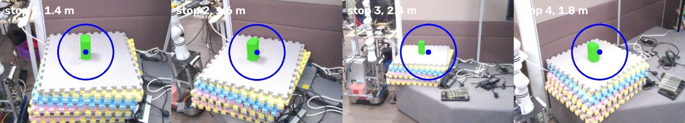
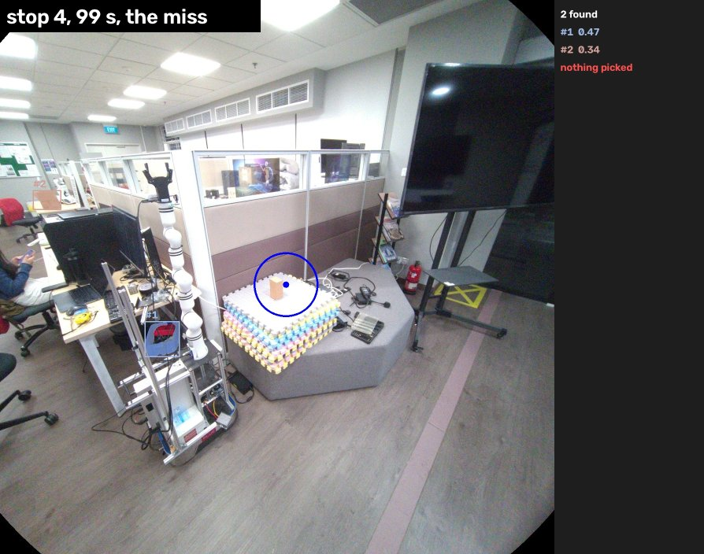
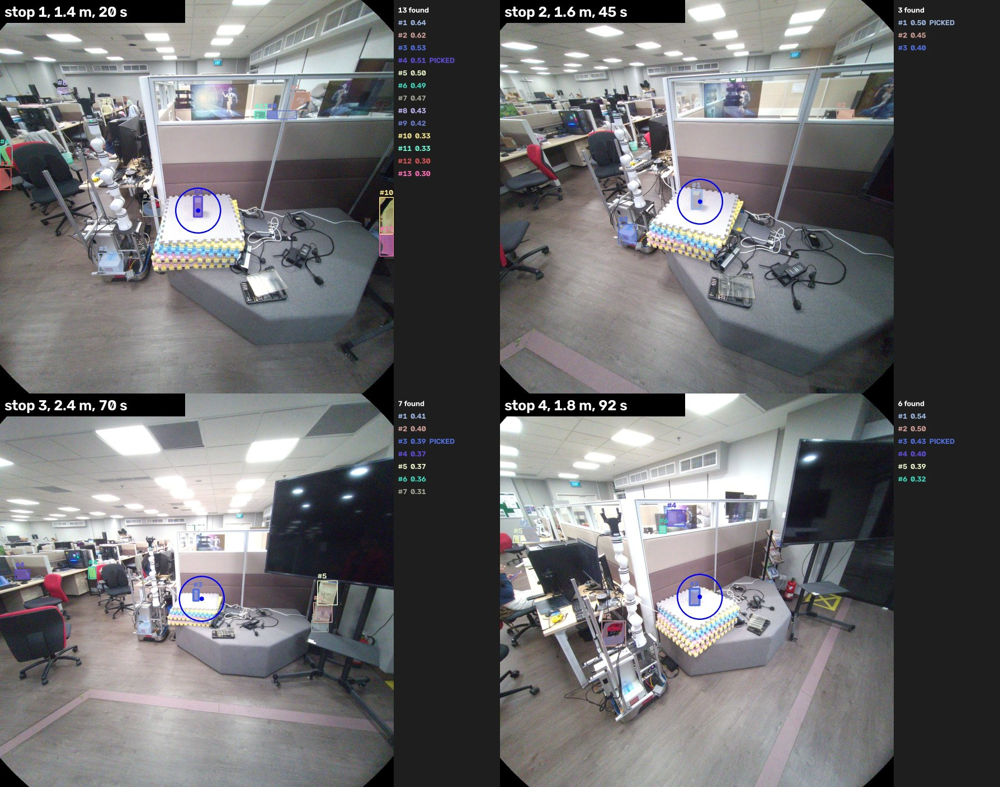

# T2.9 on a recording: gaze picks the object, offline

**Result (2026-10-13):** on the depth recording, the glasses-side chain picks the right box in
**60 of 61** frames at all four stops (1.4 to 2.4 m). It needed two changes from the service
defaults: keep more than 5 SAM 3 detections, and a lower score cutoff. No ROS, no live glasses.

## What was run

Recording `c2cbafe8` (Dion's Mac, `~/aria-recordings/`): 118 s, standing at four distances from
one box on a table. RGB 1 fps, eye camera 10 fps. Outputs are next to it in `c2cbafe8-….pick/`,
outside git. Images in this folder show people only far in the background, with nothing to identify them (Dion, 2026-10-13).

| Stage | Where | Tool | Check |
|---|---|---|---|
| 1 frames | Mac | `aria/tools/replay_recording_gaze_pick.py --stage 1` | rotate and undistort the RGB frame |
| 2 gaze | Mac | same, `--stage 2` | eye model, 1 s average, gaze pixel into the published image |
| 3 masks | box | `aria/tools/segment_frames_with_sam3.py` | SAM 3 with "box", through the service's own code |
| 4 pick | Mac | same as 1, `--stage 4` | mask under the gaze, else nearest within 80 px |

Mac venv `~/aria-test` (projectaria SDK 1.1.0, torch, projectaria-eyetracking). Box runs used
`~/rcp-Gappler` at d762f86, GPU idle before each run. Box scratch: `~/dion_t2.9/`.

## Findings

1. **The live glasses image is undistorted in the wrong order** [code, measured on the
   recording]. `image_streaming_pipeline.py:132-135` rotates the frame 90 degrees, then undistorts
   it with the unrotated camera's calibration. The lens centre is not mid-image
   (1452.8, 1450.0 in 2880 px), so the result is shifted about 12.5 px sideways in the 1408 px
   image, about 1.2 degrees. Undistort first, then rotate. `playback_controller.py` has the same
   order. Fix is **T2.13**.
2. **Gaze lands on the box** at every stop, with the fixed 1.5 m depth. At stop 1 (1.4 m) it sits
   just below the box, about 60 px. Within a stop the gaze moves about 8 to 13 px (1 s average)
   or 5 to 19 px (single eye frame). This recording is a steady stare, so it shows little benefit
   from averaging. Real use, where eyes drift off the object, is where the average should help.
   Measuring the error properly is T2.3.
3. **The best SAM 3 score is often the wrong object.** With "box", the red box on the robot base
   (0.64) and objects behind the glass (0.62) outscore our box (0.51 to 0.57). Picking by score
   would grab the wrong one. Gaze is what picks the right one.
4. **The 5-detection cap drops our box** [measured]. The service keeps the 5 best scores
   (`max_detections: 5`, shared_services_config.yaml:10). In 14 of the 47 frames at stops 1 to 3, our box ranked 6th
   to 8th, so it was dropped before gaze was checked. With 20 kept, every frame picked it.

   | Cutoff, cap | Frames with a pick, stops 1 / 2 / 3 / 4 |
   |---|---|
   | 0.5, 5 (service default) | 3/15, 8/15, 1/17, 1/14 |
   | 0.3, 5 | 6/15, 15/15, 12/17, 13/14 |
   | 0.3, 20 | 15/15, 15/15, 17/17, 13/14 |

   The one miss (stop 4, 99 s) is SAM 3's: the gaze is on the box, but SAM 3 returned only two
   other objects, so the box has no tint. Keeping the last pick for a frame or two would cover it.

   

   Every detection at one frame per stop, with its score (stage 4's own output, cutoff 0.3, 20
   kept). Our box ranks 4th at stop 1, 1st at stop 2, 3rd at stops 3 and 4.

   

   Keeping top 5 can work, but only if the 5 are chosen by closeness to the gaze, not by score.
   The aria client can do that by asking for more (`max_detections` in the request) and choosing
   by gaze itself.
5. **A request cannot lower the cutoff below 0.5.** SAM 3 drops results below the score it was
   loaded with (`segmentation_service.py:128-130`), so `Segment.srv`'s `min_score` can only raise
   it. Using 0.3 for the glasses needs the service loaded at 0.3, with the grasp client asking for
   0.5. A design choice for T2.9.
6. **At 2.4 m the box scores near the cutoff.** The glasses camera is not sharp at that range,
   which is expected. 2.4 m is not the limit of this test, only the furthest stop recorded.

## Later: when the object cannot be found (Dion, 2026-10-13)

If no mask is near the gaze, the robot should not just stop. It should go back to navigation and
follow the user's gaze ray (the direction from the glasses through the gaze point) to find the
object, then try again from closer. The clarifying follow-up question ("the box on that table, or
the one next to it?") is another future fallback. Recorded as **T7.4**. Related to the parked
problem in NEXT_STEPS 2.13: the robot cannot always see what the user sees.

## Wiring into the live path (2026-10-13, in progress, uncommitted)

Dion's choices (2026-10-13): gaze in published-image pixels from `et_worker` together with T2.13,
service loaded at 0.3 and 20 with the grasp client asking 0.5 and 5, test by replaying the VRS
onto ROS, and the glasses-to-wrist matching test on its own branch later (T8.5).

**Done on the branch:**

| Piece | Where | State |
|---|---|---|
| T2.13 undistort, then rotate | `image_streaming_pipeline.py` rgb_worker, `playback_controller.py` | code done, not yet seen on the live stream |
| Gaze in published pixels | `et_worker` + `undistortion_helper.to_published_pixel` | code done. Visualizer now draws gaze on the undistorted image |
| Pick rule, no ROS | `aria_segmentation_client/gaze_pick.py` (`mean_gaze`, `pick_mask`) | 6 tests pass |
| Settings | `aria_config.yaml` `aria_segmentation_client:` gaze_window_s 1.0, pick_radius_px 80 | |
| Service defaults 0.3 and 20 | `shared_services_config.yaml`. Grasp client sends 0.5 and 5 (`grasp_config.yaml`) | grasp test added |
| Aria client | `aria_segmentation_client.py`: word at once (unchanged), then segment the newest glasses image, pick by gaze (waits up to 3 s for a newer image), second Target with crop and mask | 22 tests pass on the box |
| Replay onto ROS | `aria/tools/replay_recording_to_glasses_topics.py` feeds the VRS into the real rgb_worker and et_worker | runs on the box |
| End-to-end driver | `t2.9_e2e_replay_on_box.sh` (this folder): service + client + replay on domain 88, "box" said at 22, 46, 70 and 95 s | see result |

Tests on the box (domain 87, copy in `~/dion_t2.9/repo`): aria client 22, grasp client 18,
segmentation service and logic 36, all pass. Bench L0-L2 on the Mac: contracts pass after
removing two machine paths from a docstring. The 4 contract warnings are the new subscriptions,
deliberate. Baseline not re-snapshotted.

**End-to-end result, second run (2026-10-13, after the fixes below): 4 of 4 words picked a box
and sent a reference.** `/grasp/target` recorded all 8 messages (4 words, 4 references).

| Word at | Newest image | Pick |
|---|---|---|
| 22 s | 1.8 s old, waited for the next | #6 of 13, score 0.46, 0 px from the gaze |
| 46 s | recent | #1 of 5, score 0.59, 7 px |
| 70 s | 1.9 s old, waited | #9 of 9, score 0.34, 16 px |
| 95 s | recent | #3 of 5, score 0.40, 8 px |

Each pick is the mask under or next to the gaze, the rule that was right in 60 of 61 frames
offline. Which object each one is was not checked on the image [unverified].

**First run:** at stop 3 (70 s) the client logged `Looked at: 'box' #3 of 11, score
0.57, 14 px from the gaze, reference sent`, the same box and score as the offline run. The other
three words sent the word alone, because no recent glasses image was there (below).

**Findings from the wiring:**

1. **The box cannot load the eye model** [reproduced on the box]. `uv.lock` pins the
   eye-tracking fork at `253911e`, whose `model_utils.py:203` calls `torch.load` without
   `weights_only=False`, which torch 2.6+ refuses. The fork's current main has the fix (the Mac
   install has it). Live gaze on the box would fail the same way. The e2e driver sets
   `TORCH_FORCE_NO_WEIGHTS_ONLY_LOAD=1` as a stopgap. Fix: bump the lock, **T2.14**.
2. **The replay's image comes every 1.8 to 3 s** [measured], not every 1 s as recorded. The
   client wanted an image newer than gaze_window_s (1 s), so 2 of 4 words found none. Fixed in
   the client (Dion, 2026-10-13): when the newest image is older than the gaze window, wait up to
   `image_wait_s` (3 s) for the next one, then segment it with the gaze from then. Rejected: a
   looser age limit (gaze would no longer match the image) and a downsizer (below).
   The slowness is not the image size [inferred]: the same steps take about 100 ms on the Mac
   (raw JPEG 82 ms at 2880 px, 20 ms at 1408, undistort 16 ms, undistorted JPEG 6 ms). Gaze was
   slow too (4.7 to 6.6 a second, recorded at 10), box load about 12 on 16 cores. Likely the eye
   model and rgb_worker compete for CPU. Measuring it is **T2.15**.
   **Why no downsizer** (Dion asked, 2026-10-13): SAM 3 scales every image to 1008 px itself
   [inferred from its default, not checked in the installed copy], so a smaller image saves
   little. It would also need the gaze pixel and pick radius scaled to match, and would shrink
   the reference crop the wrist side matches against (T8.5). Not purely a gain, so not done.
   640 x 480 is the wrist camera's size, not a SAM 3 limit.
3. **Missing fourth word, solved** [measured]. `ros2 topic echo /grasp/target` started before
   anything published there, could not tell the message type, and quit. The driver now names the
   type. It also waits for the replay to finish before stopping it.
5. **No image for the first ~20 s** [measured]. rgb_worker builds its undistortion maps with
   about 2 million per-pixel Python calls (`undistortion_helper.py:11-12`). The replay's fixed
   wait went from 15 to 30 s. Live, this delays the first image after start. In T2.15.
4. Running `grasp/grasp_env.sh` in a copy of the repo starts the 20 min AnyGrasp build. Source
   only `aria/aria_env.sh` for the client tests. Nothing was written to the shared `.venv`.

## Next session (cold start)

Done 2026-10-13: image wait (4 of 4), missing word, T2.14 lock bump, visualizer method commented
out instead of deleted (delete once T2.9 passes on the live glasses).

1. After the PR merges: `uv sync` on the box for T2.14, with the other users told. Then drop
   `TORCH_FORCE_NO_WEIGHTS_ONLY_LOAD` from the e2e driver.
2. T8.5, the glasses-to-wrist matching test, on its own branch.
3. T2.15, why the glasses workers are slow on the box.

Box state: scratch in `~/dion_t2.9/` (repo copy, VRS, frames, masks, e2e logs). Nothing running.

## Changelog

| Date | Who | Change |
|---|---|---|
| 2026-10-13 | Claude (Opus 5.5) + Dion | Created. Stages 1 to 4 on recording c2cbafe8, findings, T2.13 and T7.4 added. Stop 1 all-detections image added. Stop 4 added (60 of 61). |
| 2026-10-13 | Claude (Opus 5.5) + Dion | Wiring section: live code, tests, first end-to-end pass on the box, T2.14 and T8.5, cold-start steps. |
| 2026-10-13 | Claude (Opus 5.5) + Dion | Client waits for the next image, 4 of 4 end to end. Findings 2 and 3 resolved, finding 5 and T2.15 added, why no downsizer. |
