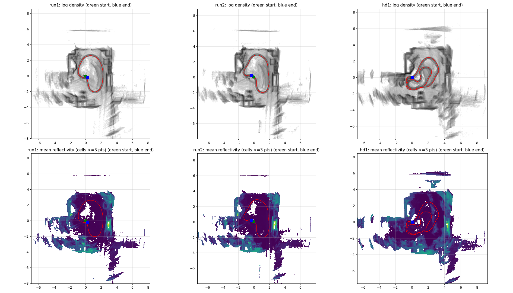
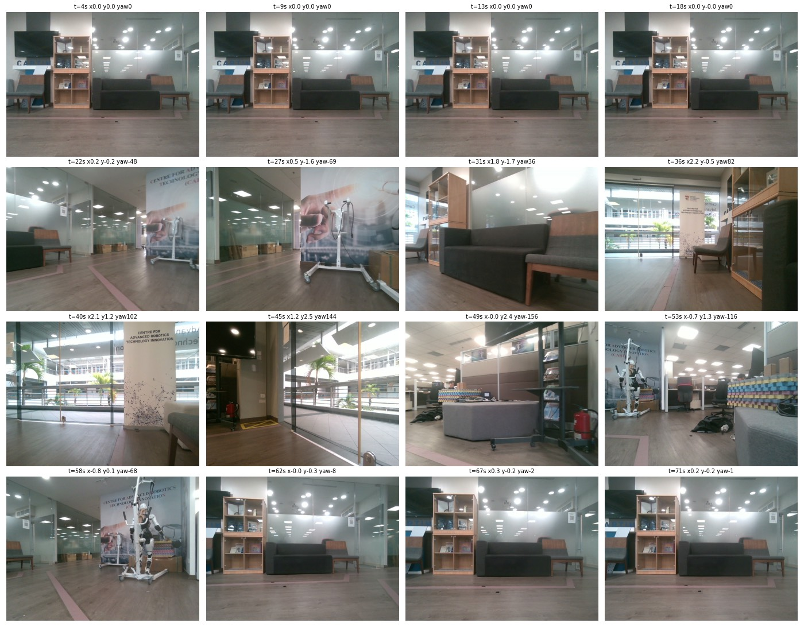
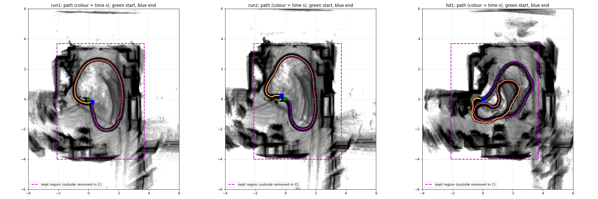

# T3.5f: replay A/B/C/D staged to separate "scene or trajectory" from "visual update" and "glass" (2026-10-21)

Status: **staged, not run.** (Update: the offline route analyses in [T3.5f_ROUTE_ANALYSIS_20261021.md](T3.5f_ROUTE_ANALYSIS_20261021.md) show the closure error is a physical displacement, not drift.) Every replay needs `sudo docker`, so the four runs are yours to start. Nothing here moved a robot, used sudo, or was pushed. The note after the first drift write-up ([T3.5f_DRIFT_CAUSE_20261021.md](T3.5f_DRIFT_CAUSE_20261021.md)) concluded "favourable outlier". That was too quick. FAST-LIVO2 in a fully observed room should not drift 2 %, so something that depends on the route is biasing it.

Tags: `[measured]` from the bags or a command run today · `[code]` from source · `[inferred]` reasoning · `[unverified]` not checked.

## The two suspects and what each replay asks

| Suspect | Why it fits | Replay that tests it |
|---|---|---|
| 1. The visual update fights the LiDAR update because the camera mount rotation is eye-estimated zeros (`Rcl`). One degree is about 6.6 px at this camera. The pixel error depends on what is in view, so it depends on the route. | Opposite error directions in runs 1 and 2, run 2's attitude swing of 4 deg and 0.2 m z range. | **A** (image on) against **B** (image off, everything else equal). |
| 2. Mirror and glass phantoms, which depend on the viewpoint. | The room is glass-walled (below). | **A** against **C** (image on, points beyond the glass removed). |
| Baseline | T3.5e used the recorded poses of `handdriven1`. Nobody replayed that bag. | **D**. |

| Replay | Bag | Mapper config | Differs from A in |
|---|---|---|---|
| A | `bags/run1` | `t35c_stationary02_20261019_visual.yaml` (the config the live runs used, `img_en: 1`) | nothing |
| B | `bags/run1` | `t35c_stationary02_20261019_lio.yaml` (`img_en: 0`) | `common.img_en` only (the T3.5c prep note proves the YAML pair differs in nothing else) |
| C | `bags/run1_glassout` | the visual YAML | LiDAR points outside the glass box removed |
| D | `bags/hd1` | the visual YAML | the bag, at rate 0.3 |

## What was staged `[measured]`

Everything is on the lab box under `~/rcp-Gappler/log/t59-fastlivo/log/t35f-replay-ab/`. Nothing outside `~/rcp-Gappler` was touched, and the source bags were only read.

| Item | Where | Note |
|---|---|---|
| Replay bundle | `bundle/replay/` | This branch's `replay/` with one change, the pose dump (next section). 66 harness tests and 77 checker tests pass on the box. `bash -n run_replay.sh` is clean. |
| Replay input bags | `bags/run1`, `bags/run1_glassout`, `bags/hd1` | Four topics each: `/livox/lidar`, `/livox/imu`, the colour image and its camera info. 3.5 G, 2.3 G, 2.3 G. sha256 in `BAGS.sha256`. |
| Config check | `bundle/replay/config/identity_t35f_*.json` | `check_replay_configs.py` returns `CONFIG_OK` for A, B, C and D against the emitted identity of its own bag. The identities are committed beside this note. The run 1 identity and the glass-out identity are equal. |
| Input manifest | `STAGED_INPUTS.sha256` | 54 files. |
| Analysis scripts | `tools/` | Same files as `tools/fastlivo/live/analysis/t35f_replay_ab/` in the repo. |

**Why the bags are copies.** `ros2 bag play` plays every topic in the bag. The live bags also hold the mapper's own outputs (`/aft_mapped_to_init`, `/cloud_registered`, `/tf` and others). Played back, those would collide with the replayed mapper's outputs and the harness would count both. The copies hold exactly the four input topics with the original timestamps. `[measured]` The message bytes of all four topics in `run1` and `hd1` are identical to the source, and in `run1_glassout` the image, IMU and camera info bytes are identical (the LiDAR differs on purpose).

**Pose dump (code change).** The harness did not keep the poses, only counts and first and last stamps. `replay.py` now writes every odometry message it sees to `evidence/odom_poses.csv` and records the row count in `result.json`. The monitor subscribes best effort, so a pose can be missing. Compare the row count with the mapper's own count. This is the only change to the reviewed harness, and `test_replay.py` has a test for it.

**The metric.** `closure.py` takes the first and last pose of a track. On the recorded bags it gives `[measured]` run 1 0.317 m (2.24 % of 14.14 m), run 2 0.307 m (1.82 % of 16.83 m), `handdriven1` 0.012 m (0.05 % of 26.05 m). These match the earlier write-ups, so replay results are comparable to them.

## Where the glass is `[inferred]` from images and LiDAR, the box is my reading

No file records the mirror and glass location. The T3.5d note only says Sherman judged the map coherent except the "transparent and mirror section". I built a top-down picture from each bag (LiDAR points placed with the bag's own poses) and looked at 16 camera frames along run 1.





- The room is a box of roughly x from -1.8 to 3.5 m and y from -3.8 to 3.4 m in the odom frame, enclosed by **frosted and clear glass partitions**. Frames at 22 s, 27 s and 62 to 71 s look through frosted glass at boxes and reflect the ceiling lights in it. Frames at 36 s, 40 s and 45 s face clear glass onto a balcony with palms.
- Outside that box the LiDAR picture is streaks and ghost copies: a line near y = 6 m (the balcony parapet seen through the glass), fans to the left and right of the room, and doubled walls on the right side. Those are returns from beyond the glass or reflections in it.
- A bright reflectivity strip sits on the right wall near (3.0, -0.3) in all three bags `[measured]` (mean reflectivity panel of `topdown.png`).
- I did not find a mirror in the camera frames I looked at. "Mirror and glass" in practice means glass.

**Box used for C:** keep a LiDAR point only if its odom-frame position is inside x from -2.1 to 3.7 and y from -4.0 to 3.7 (the glass planes plus about 0.2 m). Everything beyond is dropped, which removes what is seen through the glass and what is reflected in it, and keeps the glass surface itself and the room interior. 12.7 % of all points are removed, 19.8 % of the non-zero ones `[measured]`.



Limits of C, so you can reject it if the box is wrong:
- The box is in the odom frame and the point positions use the live poses, which carry about 0.3 m of drift by the end. That is why the margin exists. Phantoms within about 0.3 m behind a plane survive.
- One pose per scan, no deskew. Fine for a 0.2 m margin.
- If you want a different region, edit the four numbers and rerun `make_replay_bag.py --keep-box X0 X1 Y0 Y1` (one minute, ROS sourced). A and B do not depend on it.

## How the runs passed the glass `[measured]`

| Run | Minimum distance of the path to the box edge (left / right / bottom / top) | Non-zero points outside the box |
|---|---|---|
| Run 1 | 1.18 / 1.45 / 1.95 / 1.10 m | 19.8 % |
| Run 2 | 0.79 / 1.70 / 2.00 / 0.82 m | 19.3 % |
| `handdriven1` | 1.38 / **0.39** / 2.43 / 1.26 m | 30.2 % |

By robot heading (0 = +x, 45 = +x and +y), the outside share is 12 to 28 % in both loops, highest facing 45 deg and 270 deg. Run 1 and run 2 are within 4 points of each other in every heading bin.

What this says before any replay:
- `handdriven1` saw the most beyond-the-glass points (30 %) and closed best (12 mm). More glass in view did not give more drift. `[inferred]` Glass phantoms alone do not predict the closure error. The caveat is that the points are placed with drifted poses.
- Runs 1 and 2 saw the same glass burden at every heading and ended in opposite directions. `[inferred]` A bias that comes only from the glass should push both the same way.
- `handdriven1` drove to 0.39 m from the right wall and revisited it. Runs 1 and 2 stayed at least 1.45 m from it. `[inferred]` Near planes and revisits constrain the pose, a single loop in the middle of the room does not.

None of this is a result. The replays decide.

## The sudo part: exact commands (yours to run)

Check first that nobody else is using the box. The wrapper refuses if it sees a build, ROS node, or container, and asks for the custody window itself. Each run reserves 2 CPUs and 8 GiB for up to 600 s. A and B and C each take about 303 s of playback plus startup and drain, one at a time.

```bash
cd ~/rcp-Gappler/log/t59-fastlivo/log/t35f-replay-ab/bundle/replay
S=$HOME/rcp-Gappler/log/t59-fastlivo/log/t35f-replay-ab/bags
export T35_MAPPER_CONFIG=t35c_stationary02_20261019_visual.yaml T35_CAMERA_CONFIG=t35c_stationary02_20261019_camera.yaml T35_REPLAY_RATE=0.25
```

```bash
# A: recorded config, image on
T35_REPLAY_BAG=$S/run1 bash ./run_replay.sh
```

```bash
# B: identical, image off (the LiDAR-IMU YAML differs from the visual one only in common.img_en)
T35_REPLAY_BAG=$S/run1 T35_MAPPER_CONFIG=t35c_stationary02_20261019_lio.yaml bash ./run_replay.sh
```

```bash
# C: image on, points beyond the glass removed
T35_REPLAY_BAG=$S/run1_glassout bash ./run_replay.sh
```

Expected: each ends with `Supervisor exited 0` and `verdict PASS` in `evidence/result.json`. A harness FAIL or INCONCLUSIVE means the mapper did not finish the bag, and its closure number is then not a closure. If B passes it can only claim LiDAR-inertial smoke by the harness's own wording, which is what we want here.

Then read the closure of each, newest container first (the container name is printed at the end of each run):

```bash
cd ~/rcp-Gappler/log/t59-fastlivo
ls -dt replays/t59-replay-* | head -3
source /opt/ros/humble/setup.bash
python3 log/t35f-replay-ab/tools/closure.py \
  A=replays/<A container>/evidence/odom_poses.csv \
  B=replays/<B container>/evidence/odom_poses.csv \
  C=replays/<C container>/evidence/odom_poses.csv \
  recorded-run1=bag:log/t35f-live-20261021/bag
```

Check that `odom_poses.csv` has about as many rows as `result.json` says and as the mapper's own pose count. If the last pose is missing the closure is wrong.

### D: unblocked

The rate cap was raised to 0.3 (with a test) so `handdriven1` (117.9 s) fits: 583 s of the 600 s window. The command is in [T3.5f_ROUTE_ANALYSIS_20261021.md](T3.5f_ROUTE_ANALYSIS_20261021.md). The route analyses there also show that runs 1 and 2 physically ended 0.32 m from their start, so A, B and C are expected to reproduce about 0.3 m. Read that note before spending the custody windows.

```bash
# D: handdriven1 as recorded, image on, rate 0.3 (about 393 s of playback, 583 s of the 600 s window)
T35_REPLAY_BAG=$S/hd1 T35_REPLAY_RATE=0.3 bash ./run_replay.sh
```

## What each outcome means (ranked conclusion is pending the runs)

| Result | Reading |
|---|---|
| A about 0.3 m again | The scene and trajectory cause it, and live timing does not. Continue to B and C. |
| A much smaller than 0.3 m | Live timing or live attitude mattered, not the scene. |
| B much smaller than A | The visual update is fighting the LiDAR, which supports suspect 1. The next step is a calibration of `Rcl`, not a drift tune. |
| B about equal to A | The visual update is not the cause. |
| C much smaller than A | Glass phantoms bias the pose, which supports suspect 2. |
| C about equal to A | Glass is not the main driver. Together with the observations above this would leave route geometry or something shared by both runs. |
| D about 12 mm | That bag really is a favourable trajectory. |
| D much larger | The 12 mm was not reproducible and the T3.5e baseline needs a caveat. |

Rank by closure error and by the two ratios A/B and A/C. A single replay of each is one sample. FAST-LIVO2 is not bit-reproducible, so if A and B differ by less than about the run-to-run spread, repeat A once before reading anything into it `[inferred]`. We do not yet know that spread.

## Housekeeping

- `/home` went from 20 GB free to 13 GB free (97 % used) when I wrote 8.1 GB of replay bags. The retained containers and evidence are under `/` (79 GB free), not `/home`. When the runs are done and you have the numbers: `rm -r ~/rcp-Gappler/log/t59-fastlivo/log/t35f-replay-ab/bags` frees it. I did not delete anything.
- The source bags and logs are unchanged.

## Not proven

No replay has run, so there is no closure number here for A, B, C or D. The glass box is my reading of one room from images and a drifted top-down view. The pre-replay observations are `[inferred]`, from two loops and one hand-driven bag.
